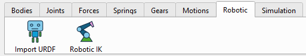
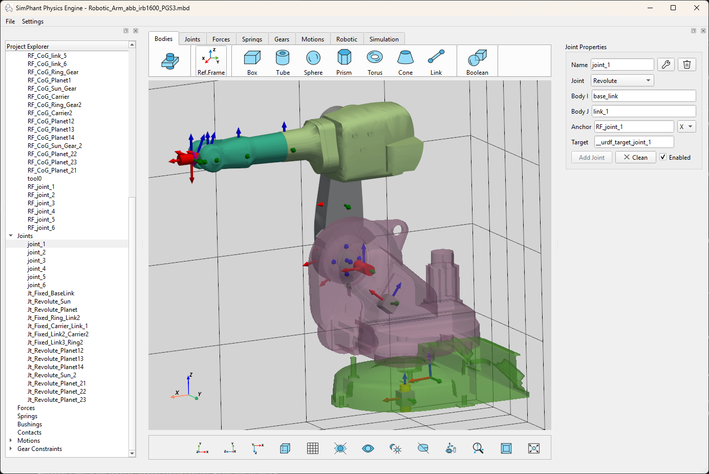
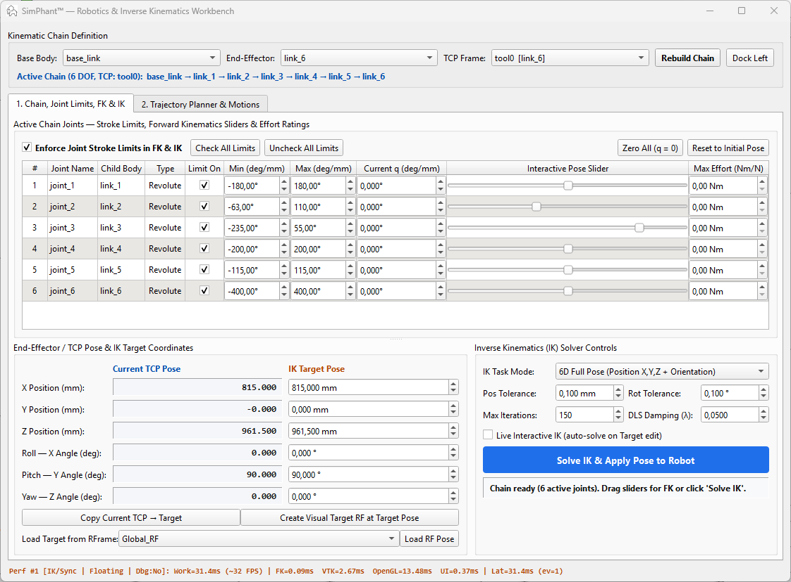
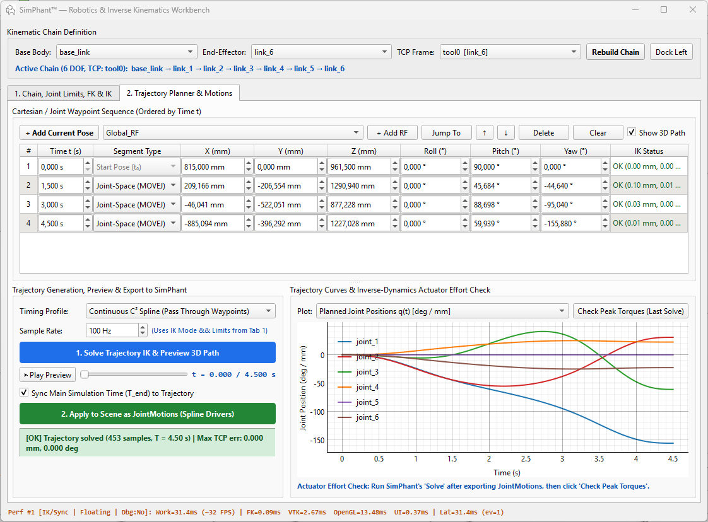
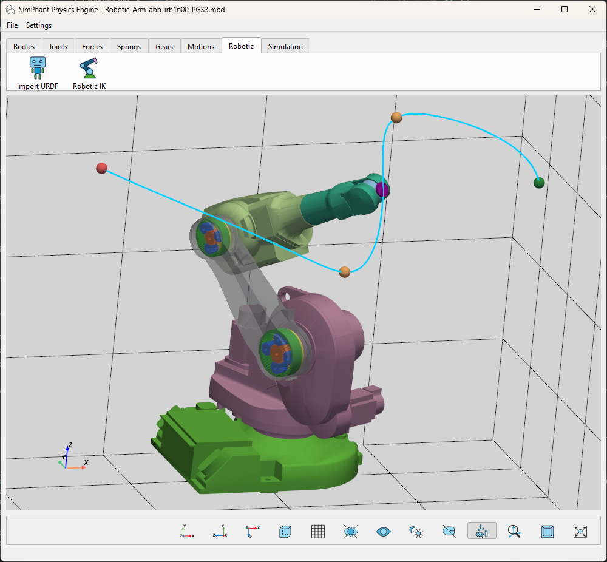
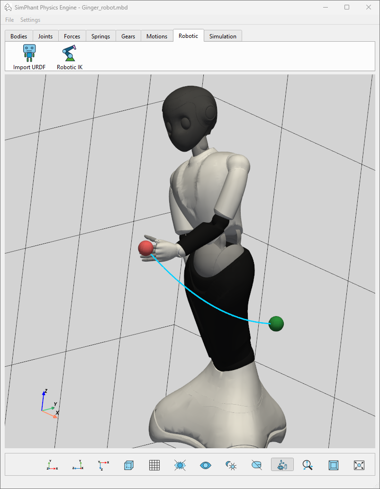

# SimPhant Robotics & Inverse Kinematics Workbench

## 1. Introduction & Basic Robotics Terminology

The **Robotics & Inverse Kinematics Workbench** (launched via the **`Robotic_IK`** button alongside **`Import URDF`** in the **Robotic** toolbar tab) provides a complete kinematic and inverse-dynamics workflow for articulated mechanisms across two integrated tabs:

* **Tab 1 (`1. Chain, Joint Limits, FK & IK`):** Configure mechanical joint stroke and motor effort limits, interactively pose the mechanism with real-time Forward Kinematics sliders, and solve 6D / 5D / 3D Inverse Kinematics for any target pose.
* **Tab 2 (`2. Trajectory Planner & Motions`):** Build multi-waypoint Cartesian and Joint-Space trajectories, preview the 3D path in real time, export smooth spline **`JointMotion`** drivers directly into SimPhant's dynamic solver, and verify peak motor torques against actuator ratings.

The core robotics concepts used throughout both tabs:

* **Kinematic Chain:** A sequence of rigid bodies (*links*) connected one after another by mechanical *joints*—similar to how your shoulder, upper arm, forearm, and hand are connected by your shoulder, elbow, and wrist joints.
* **Base Body (Root Link):** The starting body of the kinematic chain (for example, the pedestal `base_link` of an industrial robot arm, or the `pelvis` / `torso` of a humanoid robot). During kinematic posing, the Base Body stays stationary while all downstream links move relative to it.
* **End-Effector (EE):** The last body at the tip of the selected kinematic chain (for example, a robot's wrist flange, gripper, welding torch, or foot).
* **TCP (Tool Center Point):** A specific **Reference Frame (RFrame)** attached to the End-Effector that defines the exact working point and coordinate axes of the tool (for example, the tip of a gripper or the center of a flange, commonly named `tool0` in industrial robots). If no separate TCP Reference Frame is selected, SimPhant uses the End-Effector body's own **Center of Gravity (CoG)** frame as the TCP.
* **DOF (Degrees of Freedom):** The number of independent, movable joint coordinates ($q_1, q_2, \dots, q_N$) along the active kinematic chain. Each **Revolute** joint adds 1 rotational DOF (measured in degrees, $^\circ$), and each **Prismatic** joint adds 1 translational DOF (measured in millimeters, $\text{mm}$).
* **FK (Forward Kinematics):** The *"forward"* problem: **given the joint angles/displacements** $(q_1, \dots, q_N)$, calculate the resulting 3D position and orientation of every body in the robot and of the TCP.
* **IK (Inverse Kinematics):** The *"inverse"* problem: **given a desired 3D target position and orientation for the TCP**, automatically solve for the joint angles/displacements $(q_1, \dots, q_N)$ that bring the TCP to that target without violating joint stroke limits.
* **Waypoint:** A key 3D pose (position + orientation) paired with an arrival timestamp $t_m$ along a planned motion—acting like checkpoints in space and time that define the robot's path.
* **Trajectory Planning:** Converting a sequence of discrete waypoints into smooth, continuous, time-dependent joint functions $\mathbf{q}(t)$ so the robot accelerates from rest, moves smoothly, and decelerates without sudden velocity jumps or infinite acceleration spikes.
* **`MOVEL` vs. `MOVEJ` (Motion Segment Types):** Standard industrial robotics motion commands:
  * **`Linear TCP (MOVEL)`:** Moves the TCP along a **straight 3D line** in Cartesian space while smoothly rotating the tool orientation. Essential for process paths such as welding, cutting, gluing, or part insertion.
  * **`Joint-Space (MOVEJ)`:** Interpolates every joint directly from its start angle to its end angle. The TCP traces a natural curved arc in 3D space, which is fast and avoids kinematic singularities during large point-to-point repositioning moves.
* **SLERP (Spherical Linear Interpolation):** A mathematical method using unit quaternions to rotate a 3D frame smoothly along the shortest arc between two orientations at a controlled angular rate, avoiding Euler-angle gimbal lock or unnatural twisting.
* **Inverse Dynamics & Actuator Effort ($\tau(t)$):** Once a kinematic trajectory $\mathbf{q}(t)$ drives SimPhant's dynamic multibody solver (`MBSolver`), **Inverse Dynamics** determines the exact physical **motor torques ($\text{Nm}$)** or **linear actuator forces ($\text{N}$)** required at every joint to overcome gravity, 3D link inertias, Coriolis/centrifugal forces, springs, and external loads/contacts.

---

## 2. Model Requirements (Which SimPhant Models Can Use This Tool?)

The Robotics Workbench is **universal**—it does not require a special robot file format and works equally well on imported **URDF** robots (such as ABB industrial arms or the Unitree G1 humanoid) and on **custom multibody mechanisms** built directly inside SimPhant.

To use the tool, your SimPhant model must satisfy the following requirements:

1. **At Least Two Enabled Rigid Bodies:**
   The scene must contain at least two active (non-Ground, enabled) `RigidBody` components: one to serve as the **Base Body** and another as the **End-Effector Body**.
2. **A Connected Path of Supported Joints:**
   There must be a continuous chain of enabled joints connecting the Base Body to the End-Effector Body. Supported joint types along the chain are:
   * **Revolute Joint (`JointType.REVOLUTE`):** 1 rotational DOF around the joint's local Z-axis.
   * **Prismatic Joint (`JointType.PRISMATIC`):** 1 linear sliding DOF along the joint's local Z-axis.
   * **Fixed Joint (`JointType.FIXED`):** 0 DOF (rigidly locks two bodies together; useful when sensors or adapter plates are mounted between movable links).
   *(Note: Multi-DOF joints such as Spherical, Cylindrical, or Planar joints cannot be part of an active serial IK chain.)*
3. **Tree / Serial Topology Along the Active Path:**
   The path between the selected Base Body and End-Effector Body must form a single serial chain (no closed four-bar loops along the active path).
   * **Branched Robots (Humanoids & Dual-Arm Systems) Are Fully Supported:** If your model is a branched tree (for example, a humanoid where the left arm, right arm, head, and legs all branch off the torso/pelvis), you simply select the **Base Body** (e.g., `pelvis`) and the **End-Effector Body** of the limb you wish to move (e.g., `right_hand`). SimPhant automatically detects all **side-branch subtrees** (such as the left arm and head attached to the moving torso) and moves them rigidly along with their parent body so no joints ever separate.
4. **Recommended Degrees of Freedom (DOF) for IK Tasks:**
   * **6D Full Pose IK (3D Position + 3D Orientation):** Requires at least **6 DOF** (e.g., a 6-axis industrial robot arm) to reach arbitrary positions and orientations in space.
   * **5D Position + Tool Z-Axis Alignment:** Requires at least **5 DOF** (useful for cylindrical tools like drills, spindles, or laser heads where spin around the tool's Z-axis does not matter).
   * **3D Position-Only IK (X, Y, Z only):** Works on chains with **3 or more DOF** (or even 1–2 DOF for targets lying within the mechanism's reachable plane/arc).
   * **Redundant Chains ($N_{\text{dof}} > 6$):** Fully supported (e.g., 7-DOF arms or torso + arm chains); the solver uses the extra degrees of freedom to keep joints centered away from their mechanical limits.
5. **Constraining the Base Body to `Ground` for Dynamic Simulation (`MBSolver`):**
   During pure kinematic posing and trajectory preview inside `RoboticsWindow`, the **Base Body** (e.g., `base_link`) is held stationary automatically. However, before running SimPhant's dynamic **`Solve`** with exported **`JointMotion`** spline drivers (especially after importing a standalone `.urdf` file), **the Base Body must be rigidly constrained to `Ground` using an enabled `Fixed Joint`**. Otherwise, the entire robot is unconstrained in 3D space and will fall freely under gravity during dynamic simulation.

---

## 3. User Interface Reference (`RoboticsWindow`)

When you click **`Robotic_IK`** in the top **Robotic** toolbar tab, the **SimPhant™ — Robotics & Inverse Kinematics Workbench** window opens. It consists of a **shared Kinematic Chain header** at the top, **two main workbench tabs** (`1. Chain, Joint Limits, FK & IK` and `2. Trajectory Planner & Motions`), and a **live performance telemetry bar** at the bottom:

---

### 3.1 Shared Top Section: Kinematic Chain Definition

This header bar defines which part of your multibody model acts as the active robot chain across both Tab 1 and Tab 2:

| UI Control | Type | Purpose & Function for the User |
| :--- | :---: | :--- |
| **`Base Body`** | Dropdown (`QComboBox`) | Selects the starting body of the kinematic chain (e.g., `base_link` on an arm, or `pelvis` on a humanoid). This body remains fixed in space while you pose the chain. When the window opens, SimPhant automatically selects the root link of your model. |
| **`End-Effector`** | Dropdown (`QComboBox`) | Selects the tip body of the chain that you want to control (e.g., `link_6`, `right_hand`, or `left_ankle_roll_link`). SimPhant automatically defaults to the deepest leaf link in your model. |
| **`TCP Frame`** | Dropdown (`QComboBox`) | Selects which Reference Frame (`RFrame`) represents the **Tool Center Point (TCP)** to track and solve for. If your end-effector has a tool frame (such as `tool0`), it is selected automatically. You can also choose `<End-Effector CoG>` to control the End-Effector body's Center of Gravity directly, or pick any other custom Reference Frame in the scene. |
| **`Rebuild Chain`** | Button (`QPushButton`) | Re-scans the model's joints, bodies, and Reference Frames to rebuild the kinematic chain (useful if you added, enabled, or disabled joints or Reference Frames in the main SimPhant window while the Robotics Workbench was open). |
| **`Dock Left` / `Float Window`** | Button (`QPushButton`) | Toggles the Robotics Workbench between a docked panel on the left side of the main SimPhant window and an independent, resizable floating window. |
| **`Active Chain (...)` Banner** | Status Label (`QLabel`) | Displays a word-wrapped live summary of the discovered chain: total movable Degrees of Freedom (`DOF`), active TCP name, and the exact sequence of bodies from Base to End-Effector (`base_link → link_1 → ... → link_6`). If no valid joint path exists between the chosen bodies, it displays a warning explaining why. |

---

### 3.2 Tab 1 — Upper Panel: Active Chain Joints — Stroke Limits, Forward Kinematics Sliders & Effort Ratings

This panel gives you a complete spreadsheet of every movable joint in the active chain, allowing you to inspect/edit joint limits and pose the robot using Forward Kinematics:

#### Top Toolbar Controls (above the Joint Table)
* **`Enforce Joint Stroke Limits in FK & IK` (Checkbox):**
  Master switch for joint stroke limits. When checked (default), both the interactive FK sliders/spinboxes and the IK solver strictly keep every limited joint inside its `[Min, Max]` range. Uncheck this box if you want to test unconstrained mathematical solutions without stroke limits.
* **`Check All Limits` / `Uncheck All Limits` (Buttons):**
  Quickly enables or disables the individual `Limit On` checkboxes for all joints in the chain at once.
* **`Zero All (q = 0)` (Button):**
  Sets all joint coordinates in the active chain to $q = 0$ (clamped to active stroke limits if `0` lies outside a joint's allowed range) and updates the 3D robot immediately.
* **`Reset to Initial Pose` (Button):**
  Restores every body and Reference Frame in the scene back to the exact pose they had when the chain was initialized.

#### Joint Table Columns (`tblJoints`)
Each row in the table corresponds to one active joint (ordered from Base $\rightarrow$ End-Effector):

1. **`#`:** Sequential index ($1 \dots N_{\text{dof}}$) of the joint along the chain.
2. **`Joint Name`:** Name of the SimPhant `Joint` component (e.g., `joint_1` or `left_knee_joint`).
3. **`Child Body`:** Name of the link driven by this joint.
4. **`Type`:** `Revolute` (rotational, displayed in degrees `°`) or `Prismatic` (linear, displayed in millimeters `mm`).
5. **`Limit On` (Checkbox):** Enables or disables stroke limits for this individual joint. For models imported from URDF, this is automatically checked and populated from the `<limit>` tag.
6. **`Min (deg/mm)` (Editable SpinBox):** The lower mechanical stroke limit ($q_{\min}$) of the joint. Editing this value immediately updates the range of the interactive slider and is saved with your `.mbd` project file.
7. **`Max (deg/mm)` (Editable SpinBox):** The upper mechanical stroke limit ($q_{\max}$) of the joint.
8. **`Current q (deg/mm)` (Editable SpinBox):** Displays and edits the exact current angle ($^\circ$) or linear displacement ($\text{mm}$) of the joint. Typing a value here immediately moves the 3D robot via Forward Kinematics. *(If a joint hits its mechanical limit during an IK solve, this field highlights in amber/yellow so you can immediately see which joint saturated.)*
9. **`Interactive Pose Slider` (`QSlider`):** Dragging this slider smoothly rotates or slides the joint in real time in the 3D viewport while continuously updating the **Current TCP Pose** readout below.
10. **`Max Effort (Nm/N)` (Editable SpinBox):** Stores the maximum actuator torque ($\text{Nm}$ for Revolute) or force ($\text{N}$ for Prismatic) rating of the joint motor (imported automatically from URDF `<limit effort="..."/>` and saved in `.mbd` files for actuator sizing and servo control).

---

### 3.3 Tab 1 — Lower-Left Panel: End-Effector / TCP Pose & IK Target Coordinates

This side-by-side panel compares where the robot's TCP is **right now** against where you **want it to go**:

* **`Current TCP Pose` Column (Read-Only Readout Boxes):**
  Displays the real-time global position and orientation of the selected TCP Reference Frame as you drag FK sliders or solve IK:
  * **`X Position (mm)` / `Y Position (mm)` / `Z Position (mm)`:** Global Cartesian coordinates in millimeters.
  * **`Roll — X Angle (deg)` / `Pitch — Y Angle (deg)` / `Yaw — Z Angle (deg)`:** Global extrinsic Euler angles in degrees (matching SimPhant's Reference Frame angle convention).
* **`IK Target Pose` Column (Editable SpinBoxes):**
  Specify the desired global target coordinates (`X, Y, Z` in $\text{mm}$ and `Roll, Pitch, Yaw` in degrees) where the IK solver should place the TCP.
* **`Copy Current TCP → Target` (Button):**
  Copies the 6 current TCP coordinates directly into the `IK Target Pose` spinboxes. This is the easiest way to start: pose the robot roughly with sliders (or from its home pose), click **Copy Current TCP → Target**, and then adjust `X`, `Y`, `Z`, or angles by a specific offset (e.g., $+100\text{ mm}$ along $Z$).
* **`Create Visual Target RF at Target Pose` (Button):**
  Creates a visible 3D Reference Frame (`IK_Target_1`, `IK_Target_2`, ...) in the SimPhant viewport and Model Tree at the exact coordinates currently entered in `IK Target Pose`. This lets you visually inspect the target position and orientation triad in 3D before or after solving IK.
* **`Load Target from RFrame` (Dropdown + `Load RF Pose` Button):**
  Allows you to pick any existing Reference Frame in your SimPhant scene and load its 3D position and orientation into the `IK Target Pose` fields with one click.

---

### 3.4 Tab 1 — Lower-Right Panel: Inverse Kinematics (IK) Solver Controls

This panel configures how the numerical IK solver computes the joint angles:

* **`IK Task Mode` (Dropdown):**
  Selects which coordinates of the TCP are constrained by the IK solver:
  1. **`6D Full Pose (Position X,Y,Z + Orientation)`:** Matches both the 3D position $(X, Y, Z)$ and the full 3D orientation $(\text{Roll, Pitch, Yaw})$ of the target. Best for 6-DOF and 7-DOF arms.
  2. **`3D Position Only (X, Y, Z — Free Orientation)`:** Places the TCP point at the target $(X, Y, Z)$ without constraining its orientation (the Roll/Pitch/Yaw target boxes are disabled). Ideal for arms with fewer than 6 joints, point-to-point positioning, or when reaching targets near the edge of the workspace.
  3. **`5D Position + Tool Z-Axis Alignment`:** Matches the 3D position $(X, Y, Z)$ and aligns the TCP's blue **Z-axis arrow** with the target's Z-axis, leaving rotation around the Z-axis free. Ideal for axisymmetric tools (spindles, drills, grippers, laser pointers).
* **`Pos Tolerance` (`mm` SpinBox):**
  Maximum allowable distance error between the TCP and the target position for the IK solve to be considered converged (default: `0.100 mm`).
* **`Rot Tolerance` (`°` SpinBox):**
  Maximum allowable angular error between the TCP orientation and the target orientation (default: `0.100 °`).
* **`Max Iterations` (SpinBox):**
  Maximum number of Levenberg–Marquardt steps the solver may take per attempt (default: `150`).
* **`DLS Damping (λ)` (SpinBox):**
  Singularity damping factor $\lambda$ (default: `0.0500`). Smaller values give faster Newton-like steps when far from singularities; larger values provide smoother, more conservative steps near workspace boundaries.
* **`Live Interactive IK` (Checkbox):**
  When checked, the IK solver runs **automatically in real time** every time you increment or type into any of the `IK Target Pose` spinboxes (`X, Y, Z, Roll, Pitch, Yaw`), allowing you to "jog" the robot's tool in Cartesian space and watch the whole arm follow smoothly.
* **`Solve IK & Apply Pose to Robot` (Blue Action Button):**
  Executes the IK solver for the current `IK Target Pose`, updates all joint angles in the table, and moves the 3D robot in the viewport.
* **Status Banner (below the Solve button):**
  Displays the outcome of the solve:
  * **Green Banner (`[OK] IK Converged...`):** Shows the number of iterations used and the final achieved position error ($\text{mm}$) and orientation error ($\text{deg}$).
  * **Amber Warning Banner (`[WARN] Target not fully reached...`):** Indicates that the target is outside the robot's reachable workspace or blocked by joint stroke limits. The robot moves to the closest physically achievable pose, lists which joints saturated (`Limit reached: ...`), and highlights those joints in the table.

---

### 3.5 Tab 2 — Upper Panel: Cartesian / Joint Waypoint Sequence (`tblWaypoints`)

Switching to **`2. Trajectory Planner & Motions`** turns the static IK solver from Tab 1 into a time-parameterized motion generator. The upper panel defines the ordered sequence of **Waypoints** that the robot's TCP must visit over time.

#### Waypoint Toolbar Controls (above the Waypoint Table)
* **`+ Add Current Pose` (Button):**
  Captures the robot's current 3D TCP position and orientation in the viewport and appends it as a new row in the waypoint table. The first waypoint defaults to $t = 0.000\text{ s}$, and each subsequent waypoint automatically increments the arrival time by $+1.5\text{ s}$ (which you can freely edit).
* **`Scene Reference Frame Selector` (`QComboBox`) + `+ Add RF` (Button):**
  Selects any existing Reference Frame in your SimPhant scene (such as `IK_Target_1`, `IK_Target_2` created on Tab 1, or imported CAD target frames) and appends its exact 3D position and orientation as a new trajectory waypoint with one click.
* **`Jump To` (Button):**
  Solves Inverse Kinematics for the currently selected waypoint row and immediately moves the 3D robot to that pose so you can visually verify reachability, link clearance, and arm posture before solving the full trajectory.
* **`↑` / `↓` (Reorder Buttons):**
  Moves the selected waypoint earlier or later in the sequence while keeping the arrival timestamps monotonically ordered down the table.
* **`Delete` (Button):**
  Removes the currently selected waypoint row from the table.
* **`Clear` (Button):**
  Clears all waypoints from the table and removes any 3D trajectory preview curve and waypoint markers from the viewport.
* **`Show 3D Path` (Checkbox):**
  When checked (default), displays the planned 3D TCP trajectory curve (cyan polyline) and waypoint markers (orange 3D spheres) directly inside SimPhant's 3D viewport.

#### Waypoint Table Columns (`tblWaypoints`)
Each row represents one timed target pose along the robot's path:

1. **`#`:** Sequential waypoint number ($1 \dots M$).
2. **`Time t (s)` (Editable SpinBox):** Exact timestamp (in seconds) when the TCP arrives at this waypoint. Waypoint timestamps must increase strictly down the table ($t_1 < t_2 < \dots < t_M$).
3. **`Segment Type` (Dropdown):** Controls the interpolation law used to travel *from the previous waypoint into this waypoint*:
   * **Row 1 (`Start Pose (t₀)`):** Marks the starting pose of the user waypoint sequence.
   * **`Linear TCP (MOVEL)`:** Moves the TCP along an exact **3D straight line** in Cartesian space while rotating the tool smoothly via quaternion **SLERP**. Ideal for linear process operations (welding, cutting, insertion, pick/place approach).
   * **`Joint-Space (MOVEJ)`:** Solves IK at the destination waypoint and interpolates smoothly directly in **joint coordinates**. Ideal for fast, singularity-free repositioning moves in free space. You can freely mix `MOVEL` and `MOVEJ` rows within the same trajectory (when using the Quintic Rest-to-Rest profile).
4. **`X (mm)`, `Y (mm)`, `Z (mm)` (Editable SpinBoxes):** Global Cartesian coordinates of the waypoint in millimeters. Editing any coordinate updates the 3D waypoint sphere in real time.
5. **`Roll (°)`, `Pitch (°)`, `Yaw (°)` (Editable SpinBoxes):** Global extrinsic Euler angles of the waypoint in degrees (matching SimPhant's Reference Frame convention).
6. **`IK Status` (Read-Only Cell):** Shows `Pending` before solving, and after solving displays either green **`OK (err mm)`** if the waypoint converged within tolerance or amber **`WARN (err mm)`** if the waypoint lies outside the reachable workspace or hits a joint limit.

---

### 3.6 Tab 2 — Lower-Left Panel: Trajectory Generation, Preview & Export to SimPhant

This panel computes the continuous joint trajectories, lets you scrub through the 3D animation kinematically, and exports the trajectory as physical `JointMotion` spline drivers:

* **`Timing Profile` (Dropdown):**
  Chooses the velocity/acceleration time-scaling law across your waypoints:
  1. **`Quintic Rest-to-Rest (Smooth Stop at Each Waypoint)`:** Uses a minimum-jerk 5th-order polynomial on every segment so the robot **starts from rest and comes to a smooth $C^2$ stop** (zero velocity and zero acceleration) at every waypoint. Supports arbitrary per-segment mixing of `MOVEL` and `MOVEJ`.
  2. **`Continuous C² Spline (Pass Through Waypoints)`:** Fits a globally smooth, $C^2$-continuous spline across all waypoints so the TCP **cruises smoothly through interior waypoints without stopping**, while still enforcing exact zero velocity and zero acceleration at the initial start and final stop.
* **`Sample Rate` (`Hz` SpinBox):**
  Sets the number of trajectory IK evaluations per second (default: `100 Hz`, range: `20–1000 Hz`) used both for 3D path preview and for writing the exported spline CSV tables. *(Note: Trajectory IK automatically honors the active **`IK Task Mode`**—6D, 3D, or 5D—and **`Enforce Joint Stroke Limits`** settings configured on Tab 1.)*
* **`1. Solve Trajectory IK & Preview 3D Path` (Blue Action Button):**
  Solves warm-started Inverse Kinematics sequentially across every sample of the timeline, renders the 3D TCP curve and waypoint spheres in the viewport, updates each row's `IK Status`, unlocks the preview controls, and plots the planned joint curves.
  * **Automatic Home (`q = 0`) Alignment:** Because SimPhant's dynamic `MBSolver` always initializes from the deterministic **`Zero All (q = 0)`** robot configuration, if your first waypoint is set at $t_1 > 0\text{ s}$ and is not already at `q = 0`, the planner automatically prepends a smooth approach ramp from `q = 0` (at $t = 0\text{ s}$) to Waypoint 1 (at $t = t_1$) so the dynamic simulation starts smoothly with zero initial jump.
* **Interactive Trajectory Preview Bar:**
  * **`▶ Play Preview` / `⏸ Pause` (Button):** Plays back the solved kinematic trajectory directly in the 3D viewport at real-time speed so you can check robot posture, wrist rotations, and obstacle clearance *before* running a full multibody dynamics solve.
  * **Timeline Scrubber (`QSlider`) & `t = ... / ... s` Readout:** Drag the slider to inspect the exact 3D robot configuration at any millisecond along the planned path.
* **`Sync Main Simulation Time (T_end) to Trajectory` (Checkbox):**
  When checked (default), exporting the trajectory automatically sets SimPhant's main **Simulation Time** field (`T_end`) to match the timestamp of your last waypoint.
* **`2. Apply to Scene as JointMotions (Spline Drivers)` (Green Action Button):**
  Transfers your planned trajectory into SimPhant's multibody dynamics engine in one click:
  1. Resets the 3D scene to the exact **`Zero All (q = 0)`** reference configuration.
  2. Writes high-precision relative displacement CSV files (`splines/<ProjectName>_IK/IK_Motion_<JointName>.csv`) in radians ($\text{rad}$) for Revolute joints and millimeters ($\text{mm}$) for Prismatic joints.
  3. Automatically creates (or updates) one enabled **`JointMotion`** component (`spline(...)`) per active chain joint under the **Motions** folder in SimPhant's Model Tree.
  4. **Automatic Base-to-`Ground` Safety Check:** Verifies whether the active **Base Body** (e.g., `base_link`) is rigidly connected to `Ground` via an enabled **`Fixed Joint`**, and displays a warning dialog and amber status message if you still need to fix the Base Body to `Ground` before clicking **`Solve`**.
* **Trajectory Status Banner (below the Export button):**
  Reports total sample count, duration, maximum TCP tracking error ($\text{mm}$), any saturated joint names, and confirmation when `JointMotion` spline drivers have been created.

---

### 3.7 Tab 2 — Lower-Right Panel: Trajectory Curves & Inverse-Dynamics Actuator Effort Check

This panel provides an interactive scientific chart (`pyqtgraph`) for inspecting both planned kinematics and dynamically solved motor torques/forces:

* **`Plot` Mode Selector (Dropdown):**
  Switches the plot canvas between four multi-joint views:
  1. **`Planned Joint Positions q(t) [deg / mm]`:** Plots every active joint coordinate $q_k(t)$ over time.
  2. **`Planned Joint Velocities dq/dt [deg/s / mm/s]`:** Plots joint speeds $\dot{q}_k(t)$, allowing you to verify smooth bell-shaped velocity profiles and zero-velocity endpoints.
  3. **`Planned TCP Tracking Error [mm]`:** Plots the 3D Euclidean distance between the desired Cartesian path $\mathbf{p}_{\text{des}}(t)$ and the achieved TCP position $\mathbf{p}_{\text{tcp}}(t)$ at every sample.
  4. **`Solved Actuator Effort τ(t) from Last MBSolver Run [Nm / N]`:** Plots the physical **actuator torques ($\text{Nm}$)** and **forces ($\text{N}$)** computed by SimPhant's dynamic `MBSolver` during the most recent simulation run.
* **`Check Peak Torques (Last Solve)` (Button):**
  Extracts the inverse-dynamics motion reaction histories from the last `MBSolver` run, switches the plot to `Solved Actuator Effort τ(t)`, and compares every joint's peak effort $|\tau_k(t)|_{\max}$ against its **`Max Effort (Nm/N)`** rating from Tab 1.
* **Interactive Plot Canvas:**
  Supports mouse-wheel zoom, click-drag pan, and a color-coded joint legend.
* **Actuator Effort Summary Banner (below the Plot):**
  * **Green (`[OK] Peak Actuator Efforts...`):** Lists each joint's peak torque/force and percentage of rated motor capacity when all motors operate within limits (e.g., `joint_1: 142.3 Nm (45%)`).
  * **Red (`[WARN] Peak Effort Exceeds Rating...`):** Highlights any overloaded motor (`OVER!`), indicating that you should increase segment duration, adjust waypoint placement, reduce payload mass, or choose a higher-torque actuator.

---

### 3.8 Live Performance Bar & `.mbd` Project Portability

* **Bottom Live Performance Line:** At the bottom of `RoboticsWindow`, a live monospace green telemetry bar reports real-time rendering frame rate (`FPS`) and per-frame Numba FK, VTK actor matrix, and OpenGL render timings as you drag sliders or scrub trajectories.
* **Saved Waypoints & Portable Spline `.mbd` Archives:**
  * All **Tab 1 joint limits**, **Tab 2 waypoints**, and **planner settings** are saved automatically inside your `.mbd` project file and restored when you reopen the project.
  * Whenever a project uses **`spline(...)`** CSV files (for **`JointMotion`** drivers or **`Force`** actuators), SimPhant stores both the original CSV path and an embedded copy of the CSV inside the `.mbd` archive. When opened on another computer where the external CSV folder does not exist, SimPhant automatically extracts the embedded splines cleanly so your simulation runs anywhere without broken file paths.

---

## 4. Quick-Start Workflows for the Users

### 4.1 Tab 1 Workflow: Interactive FK Posing & Static IK

1. **Load a Robot Model:** Open `Robotic_Arm_abb_irb1600.mbd` (via `File → Load Project`) or import any `.urdf` robot (via the **`Import URDF`** button in the **Robotic** toolbar tab).
2. **Open the Workbench:** Go to the **Robotic** tab in the top toolbar and click **`Robotic_IK`**.
3. **Verify the Chain:** Notice that SimPhant has automatically selected `base_link` as the Base Body, `link_6` as the End-Effector Body, and `tool0` as the TCP Reference Frame.
4. **Explore Forward Kinematics (FK):** Drag any **Interactive Pose Slider** in the Joint Table and watch the robot links, joints, and `Current TCP Pose` coordinates update live in the 3D viewport.
5. **Solve Inverse Kinematics (IK):**
   * Click **`Copy Current TCP → Target`**.
   * Change the Target `X`, `Y`, or `Z` coordinate (for example, subtract `150 mm` from `X` and add `200 mm` to `Y`), or check **`Live Interactive IK`** and scroll the spinbox arrows.
   * Click **`Solve IK & Apply Pose to Robot`** (and optionally **`Create Visual Target RF at Target Pose`** to see the target frame in 3D).
6. **Return Home Anytime:** Click **`Reset to Initial Pose`** or **`Zero All (q = 0)`** to return the robot to its starting configuration.

---

### 4.2 Tab 2 Workflow: Multi-Waypoint Trajectory Planning & Inverse-Dynamics Torque Check

1. **Define Waypoints:**
   * Pose the robot using Tab 1 (either FK sliders or IK targets), then switch to **`2. Trajectory Planner & Motions`** and click **`+ Add Current Pose`** for each checkpoint—or select existing target Reference Frames (`IK_Target_1`, `IK_Target_2`, ...) in the dropdown and click **`+ Add RF`**.
   * Adjust the **`Time t (s)`** column (e.g., `0.0 s`, `1.5 s`, `3.0 s`, `4.5 s`) and choose **`Linear TCP (MOVEL)`** for straight-line tool paths or **`Joint-Space (MOVEJ)`** for fast point-to-point moves.
2. **Solve & Preview Kinematically:**
   * Choose a **`Timing Profile`** (`Quintic Rest-to-Rest` for stops at waypoints, or `Continuous C² Spline` for smooth pass-through motion) and click **`1. Solve Trajectory IK & Preview 3D Path`**.
   * Inspect the cyan 3D path and orange waypoint spheres in the viewport, drag the **Timeline Scrubber** or click **`▶ Play Preview`**, and inspect `Planned Joint Positions`, `Planned Joint Velocities`, and `Planned TCP Tracking Error` in the plot on the right.
3. **Export Spline `JointMotion` Drivers:**
   * Click **`2. Apply to Scene as JointMotions (Spline Drivers)`**. SimPhant snaps the robot to its `Zero All (q = 0)` baseline, writes the per-joint spline CSVs, populates the **Motions** tree node, and synchronizes the main **Simulation Time**.
4. **Run Full Multibody Dynamics & Check Motor Torques:**
   * Verify that the robot's **Base Body** (e.g., `base_link`) is connected to **`Ground`** by an enabled **`Fixed Joint`** (if you just imported a `.urdf` file, add a `Fixed Joint` between `Ground` and `base_link` so the robot base does not fall under gravity).
   * In SimPhant's main toolbar, click **`Solve`** to run the dynamic `MBSolver` (which automatically resets the robot to `Zero All (q = 0)` before integrating gravity, link inertias, payloads, springs, and 3D contacts).
   * Return to Tab 2 of `RoboticsWindow` and click **`Check Peak Torques (Last Solve)`** (or open SimPhant's **`Telemetry`** window) to plot the required motor torques $\tau_k(t)$ in $\text{Nm}$ and verify every joint actuator stays within its rated **`Max Effort`**.

---

## 5. Mathematical Foundation

### 5.1 Joint Coordinate Definition ($q_k$)
In SimPhant, every joint between `body_i` (parent) and `body_j` (child) stores a local orthonormal triad on each body:

$$\mathbf{F}_i = \begin{bmatrix} \mathbf{a}_i & \mathbf{b}_i & \mathbf{u}_i \end{bmatrix} \in SO(3), \qquad \mathbf{F}_j = \begin{bmatrix} \mathbf{a}_j & \mathbf{b}_j & \mathbf{u}_j \end{bmatrix} \in SO(3)$$

where $\mathbf{u}_i, \mathbf{u}_j$ are the local joint axes and $\mathbf{a}, \mathbf{b}$ span the plane perpendicular to the joint axis. Given the global orientation matrices $\mathbf{A}_i, \mathbf{A}_j \in SO(3)$ and Centers of Gravity $\mathbf{r}_i, \mathbf{r}_j \in \mathbb{R}^3$:

* **Revolute Joint Angle ($q_k = \theta_k \in [-\pi, \pi]\text{ rad}$):**
  Measured via the four-quadrant $\text{atan2}$ projection of body $j$'s reference vector onto body $i$'s joint plane around the global axis $\mathbf{v}_i = \mathbf{A}_i \mathbf{u}_i$:

  $$\theta_k = \operatorname{atan2}\!\Big(\big(\mathbf{v}_i \times (\mathbf{A}_i \mathbf{a}_i)\big) \cdot \mathbf{p}_{\perp},\; (\mathbf{A}_i \mathbf{a}_i) \cdot \mathbf{p}_{\perp}\Big)$$

* **Prismatic Joint Displacement ($q_k = d_k \text{ in m}$):**
  Measured as the signed projection of the anchor-to-anchor vector along the global joint axis $\mathbf{v}_i$:

  $$d_k = \big((\mathbf{r}_j + \mathbf{A}_j \mathbf{s}_j) - (\mathbf{r}_i + \mathbf{A}_i \mathbf{s}_i)\big) \cdot \mathbf{v}_i$$

---

### 5.2 Forward Kinematics (FK) Propagation
Given a joint coordinate vector $\mathbf{q} = [q_1, q_2, \dots, q_{N_{\text{dof}}}]^T$, Forward Kinematics walks sequentially from the **Base Body** ($\mathbf{r}_0, \mathbf{A}_0$) to the **End-Effector Body** ($\mathbf{r}_{\text{ee}}, \mathbf{A}_{\text{ee}}$).

For each step connecting parent $p$ to child $c$ with direction sign $\sigma \in \{+1, -1\}$:
1. **Global Joint Anchor & Axis:**
   $$\mathbf{p}_{\text{anchor}} = \mathbf{r}_p + \mathbf{A}_p \mathbf{s}_p, \qquad \mathbf{u}_{\text{glob}} = \sigma (\mathbf{A}_p \mathbf{u}_p)$$

2. **Child Body Orientation $\mathbf{A}_c$ and CoG Position $\mathbf{r}_c$:**
   * **Revolute Joint:**
     $$\mathbf{A}_c = \mathbf{A}_p \, \mathbf{F}_p \, \mathbf{R}_z(\sigma q_k) \, \mathbf{F}_c^T, \qquad \mathbf{r}_c = \mathbf{p}_{\text{anchor}} - \mathbf{A}_c \mathbf{s}_c$$
     where $\mathbf{R}_z(\theta)$ is the elementary $3 \times 3$ rotation about the local $Z$-axis.
   * **Prismatic Joint:**
     $$\mathbf{A}_c = \mathbf{A}_p \, \mathbf{F}_p \, \mathbf{F}_c^T, \qquad \mathbf{r}_c = \mathbf{p}_{\text{anchor}} + q_k \mathbf{u}_{\text{glob}} - \mathbf{A}_c \mathbf{s}_c$$
   * **Fixed Joint:**
     $$\mathbf{A}_c = \mathbf{A}_p \, \mathbf{F}_p \, \mathbf{F}_c^T, \qquad \mathbf{r}_c = \mathbf{p}_{\text{anchor}} - \mathbf{A}_c \mathbf{s}_c$$

3. **TCP Pose in World Coordinates:**
   Using the constant local offset $(\mathbf{p}_{\text{tcp}}^{\text{loc}}, \mathbf{R}_{\text{tcp}}^{\text{loc}})$ of the TCP relative to the End-Effector body:
   $$\mathbf{p}_{\text{tcp}}(\mathbf{q}) = \mathbf{r}_{\text{ee}} + \mathbf{A}_{\text{ee}} \mathbf{p}_{\text{tcp}}^{\text{loc}}, \qquad \mathbf{R}_{\text{tcp}}(\mathbf{q}) = \mathbf{A}_{\text{ee}} \mathbf{R}_{\text{tcp}}^{\text{loc}}$$

---

### 5.3 Analytical Geometric Jacobian $\mathbf{J}(\mathbf{q})$
To know how small changes in the joints $\Delta \mathbf{q}$ affect the 3D linear and angular position of the TCP, SimPhant assembles the exact $6 \times N_{\text{dof}}$ **Geometric Jacobian matrix**:

$$\begin{bmatrix} \mathbf{v}_{\text{tcp}} \\ \boldsymbol{\omega}_{\text{tcp}} \end{bmatrix} = \mathbf{J}(\mathbf{q}) \, \dot{\mathbf{q}}, \qquad \mathbf{J}(\mathbf{q}) = \begin{bmatrix} \mathbf{J}_v(\mathbf{q}) \\ \mathbf{J}_\omega(\mathbf{q}) \end{bmatrix} \in \mathbb{R}^{6 \times N_{\text{dof}}}$$

For each active joint $k \in \{1, \dots, N_{\text{dof}}\}$ with global unit axis $\mathbf{u}_k$ and global anchor point $\mathbf{p}_k$:
* **If Joint $k$ is Revolute:**
  $$\mathbf{J}_v[:, k] = \mathbf{u}_k \times (\mathbf{p}_{\text{tcp}} - \mathbf{p}_k), \qquad \mathbf{J}_\omega[:, k] = \mathbf{u}_k$$
* **If Joint $k$ is Prismatic:**
  $$\mathbf{J}_v[:, k] = \mathbf{u}_k, \qquad \mathbf{J}_\omega[:, k] = \mathbf{0}_{3 \times 1}$$

---

### 5.4 Task-Space Pose Error & Damped Least-Squares (DLS) IK Solver
Given a desired target TCP position $\mathbf{p}_{\text{target}} \in \mathbb{R}^3$ and target orientation matrix $\mathbf{R}_{\text{target}} \in SO(3)$, the 6D task-space error vector $\mathbf{e}(\mathbf{q}) \in \mathbb{R}^6$ is:

$$\mathbf{e}(\mathbf{q}) = \begin{bmatrix} \mathbf{e}_{\text{pos}} \\ \mathbf{e}_{\text{rot}} \end{bmatrix}, \qquad \mathbf{e}_{\text{pos}} = \mathbf{p}_{\text{target}} - \mathbf{p}_{\text{tcp}}(\mathbf{q})$$

where the orientation error $\mathbf{e}_{\text{rot}} \in \mathbb{R}^3$ depends on the selected **IK Task Mode**:
* **6D Full Pose Mode:** Uses the exact $SO(3)$ logarithmic map (rotation vector) of the relative rotation matrix:
  $$\mathbf{e}_{\text{rot}} = \log_{SO(3)}\!\big(\mathbf{R}_{\text{target}} \, \mathbf{R}_{\text{tcp}}(\mathbf{q})^T\big)$$
* **5D Position + Tool Z-Axis Alignment Mode:** Uses the shortest rotation vector that aligns the current TCP $Z$-axis $\mathbf{z}_{\text{tcp}}$ with the target $Z$-axis $\mathbf{z}_{\text{target}}$:
  $$\mathbf{e}_{\text{rot}} = \frac{\mathbf{z}_{\text{tcp}} \times \mathbf{z}_{\text{target}}}{\|\mathbf{z}_{\text{tcp}} \times \mathbf{z}_{\text{target}}\|} \operatorname{atan2}\!\big(\|\mathbf{z}_{\text{tcp}} \times \mathbf{z}_{\text{target}}\|,\; \mathbf{z}_{\text{tcp}} \cdot \mathbf{z}_{\text{target}}\big)$$
* **3D Position-Only Mode:** Only the top 3 rows ($\mathbf{e}_{\text{pos}}$ and $\mathbf{J}_v$) are solved; orientation is left free.

At each iteration, the solver computes the joint update step $\Delta \mathbf{q}$ using **Damped Least-Squares (Levenberg–Marquardt)**:

$$\Delta \mathbf{q} = \mathbf{J}_W^T \left( \mathbf{J}_W \mathbf{J}_W^T + \lambda_{\text{eff}}^2 \mathbf{I} \right)^{-1} \mathbf{e}_W + \alpha_{\text{null}} \left(\mathbf{I} - \mathbf{J}_W^+ \mathbf{J}_W\right)(\mathbf{q}_{\text{mid}} - \mathbf{q})$$

* **Singularity Robustness ($\lambda_{\text{eff}}$):** Standard Jacobian inverse $\mathbf{J}^{-1}$ blows up to infinity when a robot arm stretches out fully or aligns two wrist axes (*kinematic singularity*). The damping factor $\lambda > 0$ guarantees a smooth, finite joint step everywhere in the workspace.
* **Active-Set Joint Limit Projection:** When `Enforce Joint Stroke Limits` is active, any joint that reaches its lower or upper bound ($q_k = q_{\min,k}$ or $q_{\max,k}$) and tries to move further outside its allowed range is temporarily frozen in an active set for that iteration, allowing the remaining free joints to redistribute and complete the motion.
* **Null-Space Centering (for Redundant Robots, $N_{\text{dof}} > 6$):** The second term gently biases extra degrees of freedom toward the middle of each joint's stroke $\mathbf{q}_{\text{mid}} = \frac{1}{2}(\mathbf{q}_{\min} + \mathbf{q}_{\max})$ without affecting TCP accuracy.

---

### 5.5 Minimum-Jerk Quintic Rest-to-Rest Trajectory (`Quintic Rest-to-Rest`)
On each segment $[t_m, t_{m+1}]$ of duration $T_m = t_{m+1} - t_m > 0$, define the normalized dimensionless time $\tau = \frac{t - t_m}{T_m} \in [0, 1]$. To guarantee smooth $C^2$ motion with **zero velocity and zero acceleration** at both segment endpoints (preventing infinite inertial torque spikes at $t_m$ and $t_{m+1}$), SimPhant applies the **minimum-jerk 5th-order polynomial**:

$$s(\tau) = 10\tau^3 - 15\tau^4 + 6\tau^5$$

whose time derivatives vanish cleanly at $\tau = 0$ and $\tau = 1$:

$$\dot{s}(\tau) = \frac{30\tau^2(1 - \tau)^2}{T_m}, \qquad \ddot{s}(\tau) = \frac{60\tau(1 - \tau)(1 - 2\tau)}{T_m^2}$$

Depending on the row's selected **`Segment Type`**, $s(\tau)$ drives either Joint Space or Cartesian Space:

* **Joint-Space Segment (`MOVEJ`):**
  After solving IK once for the endpoint $\mathbf{q}_{m+1}$ (with continuous $2\pi$ Revolute angle unwrapping relative to $\mathbf{q}_m$), joint coordinates are interpolated directly:

  $$\mathbf{q}(t) = \big(1 - s(\tau)\big)\,\mathbf{q}_m + s(\tau)\,\mathbf{q}_{m+1}$$

* **Linear Cartesian Segment (`MOVEL`):**
  The desired 3D TCP position moves along an exact straight line while the desired 3D TCP orientation rotates along the shortest geodesic on $SO(3)$ via **Spherical Linear Interpolation (SLERP)**:

  $$\mathbf{p}_{\text{des}}(t) = \big(1 - s(\tau)\big)\,\mathbf{p}_m + s(\tau)\,\mathbf{p}_{m+1}$$

  $$\mathbf{R}_{\text{des}}(t) = \operatorname{SLERP}\!\big(\mathbf{R}_m, \mathbf{R}_{m+1};\, s(\tau)\big) = \mathbf{R}_m \exp_{SO(3)}\!\Big(s(\tau)\,\log_{SO(3)}\!\big(\mathbf{R}_m^T \mathbf{R}_{m+1}\big)\Big)$$

  At every time sample $t_n$, the DLS IK solver is **warm-started** from the immediately preceding joint vector $\mathbf{q}(t_{n-1})$, ensuring rapid convergence and continuous posture tracking without sudden elbow or wrist configuration flips.

---

### 5.6 Continuous $C^2$ Pass-Through Spline Trajectory (`Continuous C² Spline`)
When the robot should pass smoothly *through* interior waypoints $(t_1, \dots, t_{M-2})$ without stopping, SimPhant constructs a globally $C^2$-continuous trajectory across all knots $(t_0, t_1, \dots, t_{M-1})$:

1. **Interior Velocity & Acceleration Estimation:** A clamped $C^2$ cubic spline $\mathbf{c}(t)$ with zero endpoint slope ($\dot{\mathbf{c}}(t_0) = \dot{\mathbf{c}}(t_{M-1}) = \mathbf{0}$) is fitted through all waypoint knots $\mathbf{y}_m$ to extract smooth, curvature-minimizing interior velocities $\mathbf{v}_m = \dot{\mathbf{c}}(t_m)$ and accelerations $\mathbf{a}_m = \ddot{\mathbf{c}}(t_m)$ for $m = 1, \dots, M - 2$.
2. **Clamped Hermite Quintic Construction:** Piecewise 5th-order Bernstein polynomials (`BPoly.from_derivatives`) are assembled so that interior knots match $(\mathbf{y}_m, \mathbf{v}_m, \mathbf{a}_m)$ continuously while the start and end knots satisfy **exact rest boundary conditions**:

   $$\dot{\mathbf{y}}(t_0) = \ddot{\mathbf{y}}(t_0) = \mathbf{0}, \qquad \dot{\mathbf{y}}(t_{M-1}) = \ddot{\mathbf{y}}(t_{M-1}) = \mathbf{0}$$

3. **Antipodal Quaternion Continuity on $SO(3)$:** For Cartesian `smooth_spline` paths, waypoint orientations are converted to unit quaternions $\mathbf{q}_{\text{rot},m} \in S^3$ with hemisphere sign alignment ($\mathbf{q}_{\text{rot},m} \cdot \mathbf{q}_{\text{rot},m-1} \ge 0$ so $\mathbf{q}$ and $-\mathbf{q}$ never cause a $360^\circ$ spin), interpolated with the $C^2$ quintic spline, and continuously re-normalized onto $S^3$ before warm-started IK evaluation:

   $$\mathbf{q}_{\text{unit}}(t) = \frac{\tilde{\mathbf{q}}_{\text{rot}}(t)}{\|\tilde{\mathbf{q}}_{\text{rot}}(t)\|}$$

---

### 5.7 Rheonomic `JointMotion` Export & Inverse-Dynamics Actuator Effort ($\boldsymbol{\tau}$)
When you click **`2. Apply to Scene as JointMotions`**, SimPhant resets the mechanism to its deterministic home baseline $\mathbf{q}_0 = \mathbf{0}$ (clamped to active stroke limits) and exports each joint's relative displacement history (incorporating the topological joint direction sign $\sigma_k \in \{+1, -1\}$):

$$f_k(t) = \sigma_k \big(q_k(t) - q_{k,0}\big)$$

Inside SimPhant's dynamic **`MBSolver`**, each `JointMotion` introduces a time-dependent (*rheonomic*) scalar constraint equation enforcing that the physical 3D multibody joint coordinate $p_k(\mathbf{q}_{\text{sys}})$ tracks the spline driver $f_k(t)$:

$$\Phi_{\text{mot},k}(\mathbf{q}_{\text{sys}}, t) = p_k(\mathbf{q}_{\text{sys}}) - \big(p_k(\mathbf{q}_{\text{sys}}(0)) + f_k(t)\big) = 0$$

Differentiating twice with respect to time (with central finite differences for $\dot{f}_k(t)$ and $\ddot{f}_k(t)$ inside the spline compiler and Baumgarte stabilization parameters $\alpha, \beta$) appends the motion Jacobian rows $\mathbf{\Phi}_{q,\text{mot}}$ to SimPhant's full Augmented Index-1 DAE KKT system:

$$\begin{bmatrix} \mathbf{M} & \mathbf{\Phi}_q^T \\ \mathbf{\Phi}_q & \epsilon \mathbf{I} \end{bmatrix} \begin{bmatrix} \ddot{\mathbf{q}}_{\text{sys}} \\ \boldsymbol{\lambda} \end{bmatrix} = \begin{bmatrix} \mathbf{Q}_{\text{ext}} + \mathbf{Q}_v \\ \boldsymbol{\gamma}^* \end{bmatrix}$$

By D'Alembert's principle and the method of Lagrange multipliers, the generalized constraint reaction term $-\mathbf{\Phi}_{q,\text{mot}}^T \boldsymbol{\lambda}_{\text{mot}}$ represents the exact generalized forces exerted by the motion drivers onto the multibody system. Consequently, each solved motion multiplier $\tau_k(t) = \lambda_{\text{mot},k}(t)$ equals the **exact Inverse-Dynamics Actuator Effort**—in **$\text{Nm}$** for Revolute joints and **$\text{N}$** for Prismatic joints—accounting simultaneously for:
* Gravity on all links and end-effector payloads,
* Full 3D link masses, CoG offsets, and $3 \times 3$ rotational inertia tensors ($\mathbf{M}\ddot{\mathbf{q}}_{\text{sys}}$),
* Gyroscopic, Coriolis, and centrifugal coupling terms ($\mathbf{Q}_v$),
* Passive springs, bushings, external forces/torques, and 3D mesh contact reactions ($\mathbf{Q}_{\text{ext}}$).

Finally, clicking **`Check Peak Torques (Last Solve)`** evaluates the motor sizing criterion across the simulated horizon $[0, T_{\text{end}}]$:

$$\tau_{k,\text{peak}} = \max_{t \in [0, T_{\text{end}}]} \big|\tau_k(t)\big| \le \tau_{k,\max}$$

reporting the utilization ratio $\tau_{k,\text{peak}} / \tau_{k,\max}$ for every actuated joint in the robot chain.

