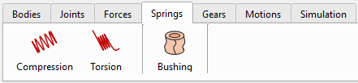
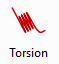

The "Springs" section includes the following components:

-   Compression Spring which acts as a translational spring damper,
-   Torsion Spring which acts as a rotational spring damper,
-   Bushing which acts as a translational and rotational flexible connection element.

## Compression Spring

Compression spring can be defined between any two rigid Bodies and the Ground in the specific points in space defined by the selection of the Reference Frames.

The Compression Spring applies an Action-Reaction pair of forces to two bodies (Body_I, Body_J) simultaneously.

### Definition of the Compression Spring

Compression Spring is defined by the following parameters in the User Interface:

-   Body_I: first action Body or Ground,
-   Body_J: second action Body or Ground,
-   RF Body I: Reference Frame as an action point on the Body_I,
-   RF Body J: Reference Frame as an action point on the Body_J,
-   Stiffness (N/mm): Spring Rate (k),
-   Damping (Ns/mm): Spring Damping (C),
-   Preload (N): Spring initial force preload: it is pushing if positive and compressing if negative.

 

Once the Spring is defined, the Stiffness, Damping and Preload can be later updated, but the related free-standing Reference Frames are locked for edition. At the same time, by demand, the CoG Reference Frame can be shifted with the Spring and related rigid Body.

It is possible do define several Compression Springs between the same Bodies.

### Force calculation of the Compression Spring

The Force magnitude of the Compression Spring is calculated as following:

$$
F_{s p r i n g} = F_{p r e l o a d} - k \mathrm{\Delta} L - C \dot{L}
$$

$$
\mathrm{\Delta} L = L - L_{i n i t i a l}
$$

where:

$$L_{i n i t i a l}$$ is the initial distance between RF_Body_I and RF_Body_J at time point t=0,

$$L$$ is the actual distance as the magnitude of the vector between RF_Body_I and RF_Body_J dynamically calculated by the solver,

$$\mathrm{\Delta} L$$ is the Spring deformation,

$$\dot{L}$$ is the relative velocity of RF_Body_I and RF_Body_J,

The calculated spring force ($$F_{s p r i n g}$$) is applied as an Action-Reaction to the Body_I and Body_J, as well as the local Torques based on the cross product of the lever arms form the Bodies’ CoGs to the points of Spring force application (‘RF Body I’ and ‘RF Body J’).

### User defined Non-Linear Compression Spring Damper

User can specify the Non-Linear Spring Force F(x, v).
Follows the spring force convention: 

$$
F_{spring}=F_{preload}-F\left(x,v\right)
$$

where:

x = ΔL = L - L_initial, in mm (positive when stretched).

v = d(ΔL)/dt, in mm/s.

F(x, v) must be returned in N.

Example: to replicate a linear Stiffness K and Damping C, enter: 

-K\*x - C\*v

It is possible to use ‘np.’ to call any standard NumPy math function, for example:

np.cosh(x), np.sign(v), etc.

Following custom functions are supported in the program:

The STEP function changes smoothly between two specified values.

Syntax: step(x; x0; F0; x1; F1)

The IF function:

Syntax: if(\<condition\>; \<value if less or equal to 0\>; \<value if greater than 0\>).

## Torsion Spring

Torsion spring can be defined between any two rigid Bodies (or Ground) in the specific point along the specific direction.

The Torsion Spring applies an Action-Reaction pair of torques to two bodies (Body_I, Body_J) simultaneously.

### Definition of the Torsion Spring

Torsion Spring is defined by the following parameters in the User Interface:

-   Body_I: first action Body or Ground,
-   Body_J: second action Body or Ground,
-   Anchor: Reference Frame of the Spring location,
-   XYZ-dropdown: the axis of the Anchor RF. It defines the Spring Torque axis. It is considered if Target RF is not defined.
-   Target: this Reference Frame defines the Spring Torque direction as the axis between the Anchor and Target reference frames. XYZ-dropdown is ignored if Target RF is defined.
-   Stiffness (Nmm/rad): Spring Rate (k),
-   Damping (Nmms/rad): Spring Damping (C),
-   Preload (Nmm): Spring initial Torque preload.

As is evident from the definition, once Anchor RF is defined, there are two ways to define the Spring Torque axis:

1.  If Torque axis is one of the Anchor RF axes, then this axis can be selected by XYZ-dropdown box;
2.  If Target RF is defined, then Torque axis will connect the Anchor and the Target reference frames. XYZ-dropdown is not considered in this case.

 

Once the Spring is defined, the Stiffness, Damping and Preload can be later updated, but the related free-standing Reference Frames are locked for edition. At the same time, by demand, Body_I or Body_J can be shifted or rotated by their CoG Reference Frames.

It is possible do define several Torsion Springs between the same Bodies.

### Torque calculation for the Torsion Spring

The Torsion Spring is restricted to act around a primary axis defined by Anchor (and optionally Target) Reference Frames. Torque magnitude of the Torsion Spring is calculated as following:

$$
T_{s p r i n g} = T_{p r e l o a d} - k \mathrm{\Delta} \theta - C \dot{\theta}
$$

where:

$$\mathrm{\Delta} \theta$$ is the Spring deformation calculated as relative rotation of Body_I and Body_J along the Torque axis,

$$\dot{\theta}$$ is the relative angular velocity of Body_I and Body_J along the Torque axis.

The calculated Spring Torque magnitude ($$T_{s p r i n g}$$) is applied as an Action-Reaction Torque to the Body_I and Body_J.

### User defined Non-Linear Torsion Spring Damper

User can specify the Non-Linear Spring Torque T(theta, omega).

Follows the spring torque convention: 

$$
T_{spring}=T_{preload}-T\left(\theta,\omega\right)
$$

where:

theta = twist angle relative to the initial angle, in rad.

omega = d(theta)/dt, in rad/s.

T(theta, omega) must be returned in Nmm.

Example: to replicate a linear Stiffness K and Damping C, enter: 

-K\*theta - C\*omega

It is possible to use ‘np.’ to call any standard NumPy math function, for example:

np.cosh(theta), np.sign(omega), etc.

Following custom functions are supported in the program:

The STEP function changes smoothly between two specified values.

Syntax: step(theta; th0; T0; th1; T1)

The IF function:

Syntax: if(\<condition\>; \<value if less or equal to 0\>; \<value if greater than 0\>).

## Bushing

Bushing is a generalized compliant element that exerts translational and rotational spring damper forces across all 6 degrees of freedom.

Mathematically, it operates purely within the local coordinate system of its anchor Reference Frame (RF Body_I). The Bushing element acts as three Compression and three Torsion Springs applied to the same point.

### Bushing definition

A Bushing is a compliant 6-DOF connection (spring-damper) between two Bodies. It is defined by the following parameters in the User Interface:

- Body_I: first action Body or Ground. Body_I carries the Bushing frame (RF Body I).
- Body_J: second action Body or Ground. The Bushing Force and Torque act on Body_J; the reaction acts on Body_I.
- RF Body I (required): global Reference Frame defining the Bushing position on Body_I (anchor point) and the orientation of the Bushing axes X, Y, Z. Stiffness, damping and preload act along these axes. The axes are fixed to Body_I: they move and rotate together with Body_I. Any Reference Frame can be used (e.g. the Global RF or a CoG RF).
- RF Body J (optional): global Reference Frame defining the anchor point on Body_J. If it is empty, the anchor point on Body_J is placed exactly at the position and orientation of RF Body I.
- Stiffness Kx, Ky, Kz (N/mm): translational stiffness along the axes of RF Body I.
- Stiffness KRx, KRy, KRz (Nmm/rad): rotational stiffness about the axes of RF Body I.
- Damping Cx, Cy, Cz (N/(mm/s)): translational damping.
- Damping CRx, CRy, CRz (Nmm/(rad/s)): rotational damping.
- Preload Fx, Fy, Fz (N): constant force along the axes of RF Body I, acting on Body_J also at zero deformation.
- Preload Tx, Ty, Tz (Nmm): constant torque about the axes of RF Body I.

 

**Reference (unloaded) configuration.** The deformation is measured from the initial configuration of the model, i.e. the pose of the Bodies at the start of the simulation (t = 0). There the deformations are zero and only the preload acts. RF Body I and RF Body J therefore need not coincide: an initial offset between the anchor points, or different orientations of the two RFs, is not a deformation and produces no force. RF Body J defines only the position of the anchor point on Body_J, where the force is applied; its orientation does not influence the results.

### Calculation of Bushing reaction Forces and Torques

A Bushing (also known as a 6-DOF Spring-Damper) is essentially 3 independent compression springs and 3 independent torsion springs bundled into a single element. They act along and about the X, Y and Z axes of RF Body I. Because RF Body I is fixed to Body_I, these axes follow Body_I, not Body_J. If Body_I is Ground, they are fixed in the Global RF.

**Notation** (k = I, J; subscript 0 = value at t = 0):

| Symbol | Meaning |
|---|---|
| $\mathbf r_k$, $\mathbf v_k$ | position and velocity of the Body CoG (Global RF) |
| $\mathbf A_k$ | Body rotation matrix (principal axes in the Global RF) |
| $\boldsymbol\omega_k$, $\boldsymbol\omega_k^{glob}=\mathbf A_k\boldsymbol\omega_k$ | angular velocity in the Body local RF and in the Global RF |
| $\mathbf s_k=\mathbf A_k\bar{\mathbf s}_k$ | vector from the CoG to the anchor point ($\bar{\mathbf s}_k$ is constant in the Body local RF) |
| $\mathbf p_k=\mathbf r_k+\mathbf s_k$ | anchor point position |
| $\mathbf E_k=\mathbf A_k\bar{\mathbf E}_k$ | rotation matrix of RF Body k in the Global RF ($\bar{\mathbf E}_k$ is constant; for k = J it is RF Body I if RF Body J is empty) |
| $\mathbf d=\mathbf p_J-\mathbf p_I$ | vector between the anchor points |
| $\Delta\mathbf x$, $\Delta\boldsymbol\theta$ | The relative position and orientation of the Body_J relative to Body_I |
| $\mathbf v_{rel}$, $\boldsymbol\omega_{rel}$ | The relative translational and rotational velocities of the Body_J relative to Body_I |
| $R_Δ$ | a 3×3 rotation matrix that holds the rotation of Body_J relative to RF Body I since t = 0, expressed in the RF Body I axes. It is the identity matrix when there is no relative rotation. |
| $tr(R_Δ)$ | the trace of R_Δ, i.e. the sum of its diagonal elements (R₁₁ + R₂₂ + R₃₃). For a rotation by angle α, tr(R_Δ) = 1 + 2 cos α. This relation is used to recover the angle. |
| $α$ | the rotation angle of R_Δ in radians, from 0 to π, found from α = arccos((tr(R_Δ) − 1)/2). It equals the length of the rotation vector, |Δθ| = α. The rotation axis comes from the off-diagonal differences (R₃₂ − R₂₃, …), which equal 2 sin α times the unit axis. Hence Δθ = α × unit axis. |

**Deformations** 

The relative position and orientation of the Body_J anchor are measured in the moving axes of RF Body I and referred to t = 0:

$$\Delta\mathbf x=\mathbf E_I^{\top}\mathbf d-\mathbf E_{I,0}^{\top}\mathbf d_0$$

$$\mathbf R_\Delta=\left(\mathbf E_I^{\top}\mathbf E_J\right)\left(\mathbf E_{I,0}^{\top}\mathbf E_{J,0}\right)^{\top},$$

$$\qquad \alpha=\arccos\frac{\operatorname{tr}(\mathbf R_\Delta)-1}{2}$$

$$\Delta\boldsymbol\theta=\frac{\alpha}{2\sin\alpha}\begin{bmatrix}R_{\Delta,32}-R_{\Delta,23}\\ R_{\Delta,13}-R_{\Delta,31}\\ R_{\Delta,21}-R_{\Delta,12}\end{bmatrix}$$

$\Delta\boldsymbol\theta$ is the rotation vector (axis × angle) of $\mathbf R_\Delta$, valid for $|\Delta\boldsymbol\theta|<180^\circ$. For small angles it is approximately half the bracketed vector.

**Velocities** 

RF Body I rotates with Body_I, so its rotation is subtracted from the anchor velocity:

$$\mathbf v_{P,k}=\mathbf v_k+\boldsymbol\omega_k^{glob}\times\mathbf s_k,$$

$$\qquad \mathbf v_{rel}=\mathbf E_I^{\top}\left(\mathbf v_{P,J}-\mathbf v_{P,I}-\boldsymbol\omega_I^{glob}\times\mathbf d\right),$$

$$\qquad \boldsymbol\omega_{rel}=\mathbf E_I^{\top}\left(\boldsymbol\omega_J^{glob}-\boldsymbol\omega_I^{glob}\right)$$

$\mathbf v_{rel}$ is the time derivative of $\Delta\mathbf x$. If both Bodies move as one rigid body, all four of $\Delta\mathbf x$, $\Delta\boldsymbol\theta$, $\mathbf v_{rel}$, $\boldsymbol\omega_{rel}$ are zero and the Bushing produces no force, damping included.

**Forces and Torques**

Standard spring-damper equations, components along the axes of RF Body I:

$$\mathbf F_{loc}=-\mathbf K_{trans}\Delta\mathbf x-\mathbf C_{trans}\mathbf v_{rel}+\mathbf F_{preload}$$

$$\mathbf T_{loc}=-\mathbf K_{rot}\Delta\boldsymbol\theta-\mathbf C_{rot}\boldsymbol\omega_{rel}+\mathbf T_{preload}$$

where $\mathbf K_{trans}=\mathrm{diag}(K_x,K_y,K_z)$, $\mathbf K_{rot}=\mathrm{diag}(K_{Rx},K_{Ry},K_{Rz})$ and $\mathbf C$ likewise. $\mathbf F_{loc}$ and $\mathbf T_{loc}$ act on Body_J, with the force at its anchor point. In the Global RF:

$$\mathbf F_{glob}=\mathbf E_I\mathbf F_{loc},$$

$$\qquad \mathbf T_{glob}=\mathbf E_I\mathbf T_{loc}$$

**Loads applied to the Bodies** 

Body_J receives $\mathbf F_{glob}$ and $\mathbf T_{glob}$. Body_I receives the reaction:

$$\mathbf F_{glob,J}=\mathbf F_{glob},$$

$$\quad \mathbf T_{glob,J}=\mathbf T_{glob},$$

$$\qquad \mathbf F_{glob,I}=-\mathbf F_{glob},$$

$$\quad \mathbf T_{glob,I}=-\mathbf T_{glob}-\mathbf d\times\mathbf F_{glob}$$

The term $\mathbf d\times\mathbf F_{glob}$ transfers the moment of the force between the two anchor points. Each force acts at its own anchor point, at a distance $\mathbf s_k$ from the Body CoG, so it creates an additional torque on each Body. The total torque about the CoG is:

$$\mathbf T_{total,I}=\mathbf T_{glob,I}+\mathbf s_I\times\mathbf F_{glob,I},$$

$$\qquad \mathbf T_{total,J}=\mathbf T_{glob,J}+\mathbf s_J\times\mathbf F_{glob,J}$$

**Properties**

- The loads on Body_I and Body_J are equal and opposite and have zero total moment about any point: the Bushing conserves linear and angular momentum.
- The stored elastic energy and the dissipated power are

$$U_{el}=\tfrac12\Delta\mathbf x^{\top}\mathbf K_{trans}\Delta\mathbf x+\tfrac12\Delta\boldsymbol\theta^{\top}\mathbf K_{rot}\Delta\boldsymbol\theta,$$

$$\qquad P_d=\mathbf v_{rel}^{\top}\mathbf C_{trans}\mathbf v_{rel}+\boldsymbol\omega_{rel}^{\top}\mathbf C_{rot}\boldsymbol\omega_{rel}\ \ge 0$$

The expression for $U_{el}$ is exact for isotropic rotational stiffness (KRx = KRy = KRz). For different values it is approximate and the error grows with the rotation angle, as in other 6-DOF bushing models.

**Results**

Telemetry and CSV give, in SI units (m, rad, N, Nm) and along the axes of RF Body I:

- Deflection X, Y, Z = $\Delta\mathbf x$
- Rotation X, Y, Z = $\Delta\boldsymbol\theta$
- Force X, Y, Z = $\mathbf F_{loc}$
- Torque X, Y, Z = $\mathbf T_{loc}$

These are the loads acting on Body_J; the reaction on Body_I follows from the equations above.

**Notes**
- The order of the Bodies matters: the axes belong to Body_I. Swapping Body_I and Body_J moves the axes to the other Body.
- With Ground as Body_J the anchor on Ground is fixed in space and the Ground load is ignored; the axes still follow Body_I.
- A stiff Bushing on a small mass or inertia needs a small time step. With RK4 keep $\omega_{max}\Delta t\lesssim 0.2$, with $\omega_{max}=\sqrt{K/m}$ for translation and $\sqrt{(K_R+K s^2)/J}$ for rotation ($K s^2$ appears when the anchor is offset from the CoG).
