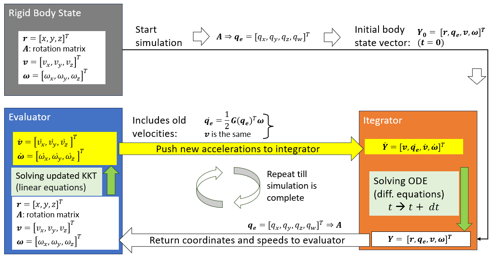

Математические основы решателя программы SimPhant базируются на математических и физических формулировках, представленных в книге А. А. Шабаны «Вычислительная динамика» (A.A. Shabana “Computational Dynamics“), с особым акцентом на описании систем твердых тел посредством дифференциально-алгебраических уравнений (ДАУ).

## Вектор состояний (Body State Vector)

Состояние движущегося твердого тела определяется следующими параметрами:

- $\mathbf r=[x,y,z]^T$: координаты центра тяжести в глобальной СК,
- $\mathbf A$: матрица поворота используется в Вычислителе (RigidBody class),
- или $\mathbf q_{e}=[q_x,q_y,q_z,q_w]^T$: кватернионы определяют ориентацию тела в Интеграторе,
- $\mathbf v=[v_x,v_y,v_z]^T$: вектор линейной скорости ЦТ тела в глобальной СК,
- $\boldsymbol\omega=[\omega_x,\omega_y,\omega_z]^T$: вектор угловой скорости тела в **локальной системе координат** тела.

Локальная система координат — это система, связанная с главными осями инерции и проходящая через центр масс (ЦМ). Матрица поворота $\mathbf A_i$ преобразует векторы из локальной системы координат в глобальную: 

$$
\mathbf x_{global}=\mathbf A\mathbf x_{local}
$$

Состояние движущегося твердого тела определяется одномерным вектором состояний $Y$: 7N параметров для положения и 6N для вращения. 

$$
\mathbf Y_1=\big[\mathbf r,\mathbf q_{e},\mathbf v,\boldsymbol\omega]^T
$$

Вектор состояния для N твердых тел в системе:

$$
\mathbf Y=\big[\mathbf q\big |\;\boldsymbol\nu\big]^T
$$

$$
\mathbf q=\big[\mathbf r_1,\mathbf q_{e1},\dots,\mathbf r_N,\mathbf q_{eN}\;\big]^T
$$

$$
\qquad \boldsymbol\nu=[\mathbf
v_1,\boldsymbol\omega_1,\dots,\mathbf v_N,\boldsymbol\omega_N]^T
$$

$\qquad \dim\mathbf Y=13N$ – размерность вектора,

$q$ – вектор обобщенных координат,

$\boldsymbol\nu$ – вектор обобщенных скоростей,

$N$ – количество тел в симуляции.

### Кватернионы  

Кватернионы определяют ориентацию тела: угловое положение главных осей тела в глобальной системе координат.

$$
q_e=[ q_{w} , \  q_{x} , \  q_{y} , \  q_{z} ]
$$

Использование кватернионов позволяет избежать ситуации «блокировки карданова подвеса» (gimbal lock) в процессе интегрирования (что могло бы привести к мгновенному сбою решателя DAE), а также обусловлено тем, что класс Rotation библиотеки SciPy глубоко оптимизирован для работы с кватернионами. 

Кватернионы преобразуются в матрицу поворота:

$$
A = \begin{bmatrix}1 \  - \  2 \left( q_{y}^{2} + \  q_{z}^{2} \right) & 2 \left( q_{x} q_{y} - \  q_{w} q_{z} \right) & 2 \left( q_{x} q_{z} + \  q_{w} q_{y} \right) \\ 2 \left( q_{x} q_{y} + \  q_{w} q_{z} \right) & 1 \  - \  2 \left( q_{x}^{2} + \  q_{z}^{2} \right) & 2 \left( q_{y} q_{z} - \  q_{w} q_{x} \right) \\ 2 \left( q_{x} q_{z} - \  q_{w} q_{y} \right) & 2 \left( q_{y} q_{z} + \  q_{w} q_{x} \right) & 1 \  - \  2 \left( q_{x}^{2} + \  q_{y}^{2} \right)\end{bmatrix}
$$

Преобразование матрицы поворота в кватернион и обратное преобразование кватерниона в матрицу поворота тела выполняется библиотекой SciPy.

### Углы Эйлера

Матрица поворота 

$$
\mathbf A=\mathbf R_z(\theta_z)\mathbf R_y(\theta_y)\mathbf R_x(\theta_x)
$$

преобразуется в углы Эйлера (углы Тейта-Брайана типа Z-Y-X):

$$
\begin{cases}\theta_{z} = \arctan \left( \frac{A_{21}}{A_{11}} \right) \\ \theta_{y} = \arcsin \left( - A_{31} \right) \\ \theta_{x} = \arctan \left( \frac{A_{32}}{A_{33}} \right)\end{cases}
$$

Реализация в коде программы:

$$
\begin{cases}\theta_{z} = \operatorname{atan2}(A_{21},A_{11}) \\ \theta_{y} = \arcsin \left( - A_{31} \right) \\ \theta_{x} = \operatorname{atan2}(A_{32},A_{33})\end{cases}
$$

Углы Эйлера заданы в градусах: [рыскание $\theta_z$, тангаж $\theta_y$, крен $\theta_x$]. Они используются преимущественно для ввода и отображения угловых значений в пользовательском интерфейсе (UI), при экспорте в формат CSV, а также в файлах проектов. В вычислительном модуле (solver) углы Эйлера для операций интегрирования не применяются, поскольку при $\theta_y=\pm90^\circ$ возникает особенность — «блокировка карданова подвеса» (gimbal lock).

Поэтому в окне 3D-визуализации используются матрица поворота $A$ и положение центра масс (CoG).

### Кинематика

Производная координат по времени:

$$
\dot{\mathbf r}_i=\mathbf v_i
$$
 
$$
\dot{\mathbf q}_{ei}=\tfrac12\mathbf G^T(\mathbf q_{ei})\boldsymbol\omega_i
$$

Соотношение между первой производной по времени кватернионов тела в трехмерном пространстве и вектором угловой скорости тела в связанной системе координат:

$$
\dot{\mathbf{q_e}} = \frac{1}{2} \mathbf{G}^{T} \mathbf{\omega_{local}}
$$

где $G$ — матрица, сформированная на основе текущих значений кватерниона.

Производная кватерниона из локальной угловой скорости вычисляется решателем:

$$
\begin{aligned}
\dot q_x &= \tfrac12 (q_w \omega_x + q_y \omega_z - q_z \omega_y) \\
\dot q_y &= \tfrac12 (q_w \omega_y + q_z \omega_x - q_x \omega_z) \\
\dot q_z &= \tfrac12 (q_w \omega_z + q_x \omega_y - q_y \omega_x) \\
\dot q_w &= -\tfrac12 (q_x \omega_x + q_y \omega_y + q_z \omega_z)
\end{aligned}
$$

## Центроидальная система координат тела (Centroidal Body Coordinate System)

В архитектуре моделирования рассматривается центроидальная система координат тела. Это частный случай в задачах пространственной динамики, когда в качестве опорной точки выбирается центр масс тела. В этом случае матрица масс твердого тела является диагональной, а вектор центробежных сил тождественно равен нулю. При использовании центроидальной системы координат (начало которой совпадает с центром масс) уравнения поступательного и вращательного движения твердого тела математически разделяются. Это позволяет представить общую матрицу масс как блочно-диагональную постоянную матрицу размерности 6NХ6N, где N — количество тел в модели. Для отдельного тела (Body_i) локальная матрица масс $$\mathbf{M}_{\mathbf{i}}$$ размерности 6Х6 полностью разделяется на блок масс 3Х3 и блок инерции 3Х3:

$$
\mathbf{M}_{\mathbf{i}} = \begin{bmatrix}m_{i} & 0 & 0 & 0 & 0 & 0 \\ 0 & m_{i} & 0 & 0 & 0 & 0 \\ 0 & 0 & m_{i} & 0 & 0 & 0 \\ 0 & 0 & 0 & J_{x x} & 0 & 0 \\ 0 & 0 & 0 & 0 & J_{y y} & 0 \\ 0 & 0 & 0 & 0 & 0 & J_{z z}\end{bmatrix}
$$

Где $$m_{i}$$ — масса, а — $$\widehat{\mathbf{J}}$$ главные моменты инерции тела Body_i.

Глобальная матрица масс системы:

$$
\mathbf{M} = \begin{bmatrix}M_{1} & \cdots & 0 \\ \vdots & \ddots & \vdots \\ 0 & \cdots & M_{n}\end{bmatrix}
$$

Начало системы координат каждого тела совпадает с его центром масс (CoG). Для тела Body_i матрица масс имеет вид $\mathbf M_i=\mathrm{diag}(m_i,m_i,m_i,J_{xx},J_{yy},J_{zz})$, где $J$ — главные моменты инерции. Глобальная матрица $\mathbf M=\mathrm(\mathbf M_1,\dots,\mathbf M_N)$  имеет размерность $6N×6N$, где $N$ — количество активных тел за исключением «земли» (Ground). Для «земли» координаты не определяются (ей присваивается индекс -1). Поскольку матрица $M$ является диагональной и постоянной, в программе хранятся только её $6N$ диагональных элементов (операция $\mathbf M^{-1}\mathbf x$ сводится к поэлементному делению, поэтому в коде не требуется выполнять обращение матрицы или её разложение).

Перемещения задаются в глобальной системе координат, а вращения — в локальной (см. раздел «Гибридная формулировка»):

$$
m_i\dot{\mathbf v}_i=\mathbf F_i
$$

$$
\qquad \mathbf J_i\dot{\boldsymbol\omega}_i+\boldsymbol\omega_i\times(\mathbf J_i\boldsymbol\omega_i)=\mathbf T_i
$$

Использование связанной с центром масс системы координат тела является одним из основных допущений при выводе фундаментальных уравнений Ньютона — Эйлера, используемых в решателе:

$$
\begin{bmatrix}M & \Phi_{q}^{T} \\ \Phi_{q} & 0\end{bmatrix} \begin{bmatrix}\dot{\nu} \\ \lambda\end{bmatrix} = \begin{bmatrix}Q \\ \gamma\end{bmatrix}
$$

Где:

$$\mathbf{M}$$: матрица масс и моментов инерции (размерностью: $$n \  \times n$$),

$$\mathbf{\Phi}_{\mathbf{q}}$$: Матрица Якобиана для кинематических связей (размерностью: $$m \  \times n$$),

$$\dot{\mathbf{\nu}}$$: неизвестные ускорения системы (размерностью: $$n \  \times 1$$),

$$\mathbf{\lambda}$$: неизвестные реакции связей (размерностью: $$m \  \times 1$$),

$$\mathbf{Q}$$: известные внешние силы и моменты,

$$\mathbf{\gamma}$$: известные кинематические ускорения (правая часть уравнений),

$$n = 6 N$$ — число степеней свободы, а — $$m$$ количество кинематических связей.

В динамике систем твердых тел процесс моделирования сводится к решению системы уравнений с расширенной матрицей масс для определения ускорений $$\dot{\mathbf{\nu}}$$ и множителей Лагранжа $$\lambda$$, представляющих собой реакции в кинематических парах (шарнирах).

## Гибридная формулирока (Hybrid Formulation)

В соответствии с пространственной формулировкой Ньютона-Эйлера, предложенной Шабаной, уравнения Ньютона-Эйлера с учетом кинематических связей записываются с использованием гибридной формулировки (также называемой формулировкой со смешанными координатами). При этом принимаются два основных допущения.

1\. Поступательное движение рассматривается в ГЛОБАЛЬНОЙ системе координат:

Координаты $$\mathbf{r} = [ x , y , z ]^{T}$$ и силы $$\mathbf{F}$$, вызывающие поступательное движение, определяются в глобальной системе координат. Это упрощает запись уравнений связей $$\Phi$$, поскольку кинематические пары физически соединяют тела именно в глобальном пространстве.

2\. Вращательное движение рассматривается в ЛОКАЛЬНОЙ системе координат (связанной с телом):

Угловая скорость $$\overline{\mathbf{\omega}} = \  \left\lbrack \overline{\omega_{x}} , \  \overline{\omega_{y}} , \  \overline{\omega_{z}} \right\rbrack^{T}$$и моменты сил$$\  ( \mathbf{T} \mathbf{)}$$ определяются в локальной системе координат, так как тензор инерции $$\widehat{\mathbf{J}}$$ остается неизменным в локальной системе отсчета, связанной с телом. Поскольку масса также является постоянной величиной, она вычисляется один раз в симуляции — в момент создания объекта решателя (solver object). Столбцы трансляционного якобиана заданы в глобальной системе координат, а столбцы вращательного якобиана — в локальной, поэтому они содержат матрицу поворота $\mathbf A^T$.

## Архитектура физического движка и потоки данных (Physics Engine Architecture & Data Flow)

Интеграторы SciPy и векторизованные пользовательские алгоритмы требуют, чтобы состояние всей системы было представлено в виде единого одномерного числового массива — вектора состояния:

$$
Y=[q \vert \nu {]}^T
$$

Для N движущихся тел вектор $$\mathbf{q}$$ (положения/углы) имеет размер 7N, а $$\nu$$ (скорости) — 6N.

Общий размер $$\mathbf{Y}$$ составляет 13N.

Архитектура симуляции разделяет физическую формулировку задачи и процесс продвижения по времени.

-   **Вычислитель системы** (System Evaluator): единая основная функция, которая принимает текущее время (t) и текущий вектор состояния ($$\mathbf{Y}$$), формирует матрицы, решает систему линейных уравнений и возвращает значения ускорений.
-   **Интегратор**: алгоритм (RK4, Euler, BDF и т. д.), который запрашивает ускорения у вычислителя системы и использует их для перевода вектора состояния на следующий временной шаг ($$t \  + \  \Delta t$$).

Вычислитель системы принимает вектор состояния $(t,Y)$ и возвращает его полную производную:

$$
\dot{Y}=[\dot{q} \vert \dot{\nu}{]}^T
$$

$$
\dot{Y}=[v_1,{\dot{q_e}}_1,\ldots,v_N,{\dot{q_e}}_N \vert {\dot{v}}_1,{\dot{\omega}}_1,\ldots,{\dot{v}}_N,{\dot{\omega}}_N{]}^T
$$

Используя эту функцию, интегратор продвигает вектор состояния $Y$ вперед во времени.

**Шаг 1: Сбор данных и инициализация (объектно-ориентированный уровень)**

Работа движка начинается на уровне пользовательского интерфейса (UI), где пользователь задает трехмерный мир.

**1.1 Объекты пользовательского интерфейса**

Данные 3D CAD и настройки пользователя хранятся в высокоуровневых классах Python:

-   **RigidBody** (Жесткое тело): хранит массу, центр масс (CoG), тензоры инерции и начальное кинематическое состояние (положение, скорость, кватернион, угловая скорость).
-   **Joint** (Соединение): хранит информацию о топологической связи между двумя телами (body_i, body_j), типе соединения (например, вращательное, поступательное) и локальных пространственных векторах, определяющих точки привязки и оси скольжения/вращения.
-   **Force** (Сила): хранит заданные пользователем внешние силы, моменты сил и векторы гравитации.

**1.2 Инициализация решателя (MBSolver.__init__)**

При создании экземпляра основного решателя динамики многозвенных систем (MBSolver) выполняется предварительная обработка входных данных:

-   **Фильтрация основания** (Ground Filtration): исключается тело, обозначаемое как «земля» (Ground), и формируется список, содержащий только подвижные тела. Решатель полностью игнорирует степени свободы «земли» (уменьшая тем самым размерность матрицы) и рассматривает её как неподвижную опору с бесконечной массой (индекс: -1).
-   **Сопоставление тел** (Body Mapping): Каждому подвижному телу присваивается уникальный целочисленный индекс (body_index_map).
-   **Предварительный расчет матрицы масс** ($$\mathbf{M}$$): Поскольку масса и локальные характеристики инерции твердых тел остаются неизменными, решатель однократно формирует глобальную блочно-диагональную матрицу масс ($$\mathbf{M}$$) размерности 6N×6N.
-   **Кинематические связи** включают строки: $m=m_{joints}+m_{gears}+m_{motions}$.

**1.3 Упаковка статических данных для Numba (prepare_static_numba_data)**

Поскольку JIT-компилятор Numba (работающий на уровне C) не может напрямую считывать объекты Python, решатель извлекает неизменяемые параметры сочленений (типы, индексы тел, локальные точки привязки и локальные оси) и преобразует их в непрерывные одномерные и двумерные массивы NumPy. Сюда входят ортогональные тройки векторов $(v,a,b)$ и данные о зубчатой передаче. Эта операция выполняется ровно один раз перед началом симуляции.
Сохраняются исходные значения для момента времени $t=0$: параметры пружины $L_0$ и $θ_0$, смещение и относительный поворот втулки, а также параметры движения $θ_0$ и $d_0$.

**Шаг 2: Ход выполнения (уровень интегрирования)**

Пользоатель выбирает один из девяти интеграторов:.
- С фиксированным временным шагом $\Delta t=t_{end}/\mathrm{int}(t_{end}\cdot\text{steps per s})$:
- Custom RK4
- Custom Euler
- Custom Symplectic Euler
- Адаптивные методы (с параметрами rtol, atol и максимальным размером шага; результаты приводятся к единой временной сетке): SciPy RK45, RK23, DOP853, Radau, BDF, LSODA.

При нажатии пользователем кнопки «Solve» (Решить) интерфейс считывает выбранный метод интегрирования (например, RK4, BDF, Symplectic Euler), который берет на себя полное управление временным циклом. Независимо от того, используется ли простой явный цикл (как в методе Эйлера) или сложный неявный решатель из библиотеки SciPy (как BDF), интегратор рассматривает физическую систему как «черный ящик» — систему обыкновенных дифференциальных уравнений (ОДУ) первого порядка:

$$
\frac{d Y}{d t} = f ( t , Y )
$$

Для определения динамики системы интегратор многократно вызывает основной математический модуль — метод evaluate_derivatives(t, Y). Этот метод выполняет роль связующего звена (или «контрольной точки»).

**Шаг 3: Построение матрицы KKT (внутри метода evaluate_derivatives)**

Каждый раз, когда интегратору требуется определить ускорения, он передает текущее время (t) и вектор состояния ($$\mathbf{Y}$$) в метод evaluate_derivatives(t, Y), который выполняет следующую последовательность действий:

**3.1 Распаковка состояния и расчет сил (**$$\mathbf{Q}$$**)**

-   Метод unpack_state(Y) преобразует плоский вектор $$\mathbf{Y}$$ обратно в объекты твердых тел (RigidBody), обновляя их глобальные матрицы поворота ($$\mathbf{A}$$), координаты ($$r$$) и скорости ($$v, \omega$$).
-   Метод build_force_vector() формирует вектор сил правой части уравнения (для системы без учета ограничений):

    $$
    \mathbf{Q =} \mathbf{Q}_{\mathbf{e}} \mathbf{+} \mathbf{Q}_{\mathbf{v}}
    $$

Где

$Q_e=Q_{external}$ : гравитация и силы упругости пружин, внешние силы в точке $p$: $F$, включая моменты этих сил $p\times (A^TF)$.

$Q_v=Q_{velocity}$ : расчетные гироскопические силы и силы Кориолиса, возникающие при вращении тел:

$$
Q_v=-\omega \times (J\omega)
$$

**3.2 Формирование матрицы Якоби (**$$\mathbf{\Phi}_{\mathbf{q}}$$ **и** $$\mathbf{\gamma}^{\mathbf{*}}$$**)**

Перебор всех кинематических пар (сочленений) и расчет кинематики для построения:

-   $$\mathbf{\Phi}_{\mathbf{q}}$$ (Матрица Якоби): матрица пространственных направлений, по которым ограничены степени свободы.
-   $$\mathbf{\gamma}^{\mathbf{*}}$$ (Вектор ускорений правой части): содержит центростремительные и кориолисовы ускорения в сочленениях ($$\gamma$$), скорректированные с помощью членов стабилизации Баумгарте ($$- 2 \alpha \dot{\Phi} - \beta^{2}$$) для предотвращения расхождения сочленений.

**Шаг 4: Решение системы дифференциально-алгебраических уравнений (метод дополнения Шура)**

После формирования матриц и векторов $$M , Q , \Phi_{q} , \gamma^{*}$$ система принимает вид, соответствующий расширенной матрице условий Каруша-Куна-Таккера (KKT)

$$
\left[\begin{matrix}M & \Phi_q^T \\ \Phi_q & 0\end{matrix}\right] \left[\begin{matrix}\dot{\nu} \\ \lambda\end{matrix}\right] =\left[\begin{matrix}Q \\ \gamma^{*}\end{matrix}\right]
$$

Решение этой системы относительно множителей Лагранжа $$\mathbf{\lambda}$$ и ускорений $\dot{\nu}$ выполняется с использованием высокоэффективного метода дополнения Шура.

**Шаг 5: Возврат к Интегратору**

Вычислитель передает $\dot{Y}$ (скорости тел ($\dot{q}$) и заново рассчитанные ускорения ($\dot{\nu}$)) интегратору (выбранному пользователем), который продвигает систему вперед по времени. Затем цикл повторяется, начиная с шага 3, до тех пор, пока симуляция не завершится.

### Метод дополнения Шура и решение KKT (Schur Complement method)

Дополнение Шура используется вместо стандартного метода решения матричных уравнений (например, метода исключения Гаусса). Математический вывод и структурные преимущества метода дополнения Шура.

**Математическое обоснование дополнения Шура**

В динамике систем твердых тел физическая система описывается системой дифференциально-алгебраических уравнений (ДАУ). При записи в матричном виде она принимает форму классической расширенной матрицы (система KKT — Каруша-Куна-Таккера):

$$
\left[\begin{matrix}M & \Phi_q^T \\ \Phi_q & 0\end{matrix}\right] \left[\begin{matrix}\dot{\nu} \\ \lambda\end{matrix}\right] =\left[\begin{matrix}Q \\ \gamma^{*}\end{matrix}\right]
$$

Где:

$$\mathbf{M}$$: матрица масс и моментов инерции (размерностью $$n \  \times n$$),

$$\mathbf{\Phi}_{\mathbf{q}}$$: Матрица Якобиана для кинематических связей (размерностью $$m \  \times n$$),

$$\dot{\nu}$$: неизвестные ускорения системы (размерностью $$n \  \times 1$$),

$$\mathbf{\lambda}$$: неизвестные реакции связей (размерностью $$m \  \times 1$$),

$$\mathbf{Q}$$: известные внешние силы и моменты,

$$\mathbf{\gamma}^{\mathbf{*}}$$: Известная правая часть, представляющая собой кинематические ускорения ($$\gamma$$) с учетом стабилизации Баумгарте:

$$
\gamma^{*} = \gamma - 2 \alpha \dot{\Phi} - \beta^{2}
$$

$$n$$ — количество степеней свободы, а $$m$$ —количество ограничений.

**Вывод**

Если расписать матрицу в виде двух отдельных уравнений, получим:

1.  Уравнение **динамики:** $M\dot{\nu}+\Phi_q^T\lambda =Q$
2.  Кинематическое **уравнение:** $\Phi_q\dot{\nu}=\gamma^{*}$

Метод дополнения Шура решает эту задачу путем алгебраической подстановки. Сначала выделим ускорения ($$\dot{\nu}$$) в уравнении (1), умножив его на обратную матрицу масс ($$\mathbf{M}^{\mathbf{- 1}}$$):

$$
\dot{\nu}=M^{-1}\left(Q-\Phi_q^T\lambda\right)
$$

Далее мы подставляем это выражение для $$\dot{\nu}$$ непосредственно в уравнение 2:

$$
\Phi_{q} \left( M^{- 1} \left( Q - \Phi_{q}^{T} \lambda \right) \right) = \gamma^{*}
$$

Теперь раскроем скобки для $$\Phi_{q}$$ и преобразуем уравнение так, чтобы выделить неизвестные силы реакции ($$\lambda$$) в левой части:

$$
\left( \Phi_{q} M^{- 1} \Phi_{q}^{T} \right) \lambda = \Phi_{q} M^{- 1} Q - \gamma^{*}
$$

Таким образом, мы свели систему к одному линейному уравнению: $$C \lambda = \text{RHS}$$

Где:

-   $$C = \Phi_{q} M^{- 1} \Phi_{q}^{T}$$ —  **матрица дополнения Шура** (иногда называемая ведущей матрицей Якоби или матрицей Якоби, ортогонализованной по массе).
-   $$\text{RHS} = \Phi_{q} M^{- 1} Q - \gamma^{*}$$ — известный вектор правой части.

Решив уравнение $$C \lambda = \text{RHS}$$ относительно множителей Лагранжа ($$\lambda$$), мы подставляем их обратно в уравнение динамики и без труда вычисляем искомые ускорения ($\dot{\nu}$).

### Решение с использованием регуляризации Тихонова (Tikhonov Regularization Solution)

Когда кинематическая цепь образует замкнутый контур (например, четырехзвенный механизм) или когда несколько шарниров ограничивают одну и ту же степень свободы, матрица Якоби для связей ($$\Phi_{q}$$) теряет строчный ранг. Без регуляризации матрица дополнения Шура ($$C$$) становится вырожденной, ее определитель обращается в ноль, и решатель немедленно аварийно завершает работу с ошибкой «Singular Matrix» (вырожденная матрица).

Использование **регуляризации Тихонова** вместо задания бесконечно жестких связей позволяет внести ничтожно малую величину «податливости» (упругости) непосредственно на диагональ матрицы. Это мгновенно устраняет проблему вырожденности матрицы, не меняя ее размерности. Мы заменяем нулевой блок в правом нижнем углу на $$\mathbf{-} \mathbf{\epsilon} \mathbf{I}$$, и система принимает следующий вид:

$$
\begin{bmatrix}\mathbf{M} & \mathbf{\Phi}_{\mathbf{q}}^{\mathbf{T}} \\ \mathbf{\Phi}_{\mathbf{q}} & \mathbf{- \epsilon I}\end{bmatrix} \begin{bmatrix}\dot{\mathbf{\nu}} \\ \mathbf{\lambda}\end{bmatrix} \mathbf{=} \begin{bmatrix}\mathbf{Q} \\ \mathbf{\gamma}^{\mathbf{*}}\end{bmatrix}
$$

Где:

$$\epsilon$$ — это значение (например: -1E-7), физически представляющая податливость связи — величину, обратную массе $$kg^{-1}$$ (или инерции $$1/kgm^2$$ для вращения),

$$I = \begin{bmatrix}1 & \cdots & 0 \\ \vdots & 1 & \vdots \\ 0 & \cdots & 1\end{bmatrix}$$ — единичная матрица.

При выполнении блочного исключения для формирования дополнения Шура ($$C$$), используемого для нахождения множителей Лагранжа ($$\lambda$$), уравнение преобразуется из вида

$$
C = \Phi_{q} M^{- 1} \Phi_{q}^{T}
$$

в

$$
C_{r e g} = \Phi_{q} M^{- 1} \Phi_{q}^{T} + \epsilon I
$$

Просто добавив $$\epsilon$$ к главной диагонали матрицы $$C$$, мы гарантируем, что все собственные числа будут строго больше нуля, а матрица становится безусловно положительно определенной, что исключает возможность аварийного завершения вычислений.

**Использование дополнения Шура** дает значительные преимущества по сравнению со стандартным методом исключения Гаусса. Полная матрица KKT имеет размерность $$( n + m ) \times ( n + m )$$, где $$n$$ — число степеней свободы, а $$m$$ — число ограничений. Используя дополнение Шура, мы сводим размер неизвестной матрицы с $$( n + m ) \times ( n + m )$$ до всего лишь $$( m \  \times m )$$. Поскольку в локальных системах координат матрица $$M$$ постоянна, ее обратная матрица ($$M^{- 1}$$) вычисляется или факторизуется заранее (один раз). Решение системы с матрицей малого размера $$m \  \times m$$ на каждом шаге происходит значительно быстрее, чем решение огромной матрицы KKT методом исключения Гаусса.

## Кинематические ограничения /связи и матрицы Якоби (Kinematic Constraints /Joints and Jacobian Matrices)

В этой главе описывается математическая основа кинематических связей.

### Кинематическая формулировка сферического шарнира (Spherical Joint)

В динамике многозвенных систем сферический шарнир (часто называемый шаровым шарниром) ограничивает три поступательные степени свободы, но допускает все три вращательные степени свободы.

Определение понятий:

-   $$r_{i} , r_{j}$$: Глобальные трёхмерные векторы положения центра тяжести (ЦТ) для тела i и тела j.
-   $$A_{i} , A_{j}$$: $$3 \  \times 3$$ Глобальные матрицы поворота тел Body_i и Body_j .
-   $$\overline{u_{i}} , \overline{u_{j}}$$: Локальные трехмерные векторы, соединяющие центр масс с точкой привязки шарнира на телах Body_i и Body_j.
-   $$\overline{\omega_{i}} , \overline{\omega_{j}}$$: **Локальные** трёхмерные векторы угловой скорости.
-   $$\widetilde{u}$$: Кососимметричная матрица $$3 \  \times 3$$ вектора $$\mathbf{u}$$, математически реализующая операцию векторного произведения $$\left( \widetilde{u} x = u \times x \right)$$.

**1. Уравнение кинематической связи по положению (**$$\mathbf{\Phi}$$**)**

Физическая сущность сферического шарнира заключается в том, что точка привязки на теле Body_i и точка привязки на теле Body_j должны в любой момент времени занимать одно и то же положение в глобальной системе координат.

Глобальное положение точки привязки на теле Body_i определяется как: $$r_{i} + A_{i} \overline{u_{i}}$$.

Таким образом, уравнение связи даёт **3 строки** (X, Y, Z) в нашей системе:

$$
\Phi ( q , t ) = r_{i} + A_{i} \overline{u_{i}} - r_{j} - A_{j} \overline{u_{j}} = \begin{bmatrix}0 \\ 0 \\ 0\end{bmatrix}
$$

**2. Ограничение скорости и Якобиан (**$$\mathbf{\Phi}_{\mathbf{q}}$$**)**

В общем случае матрица ограничений Якоби определяется следующим образом:

$$
\Phi_{q} = \begin{bmatrix}\frac{\partial \Phi_{1}}{\partial q_{1}} & \frac{\partial \Phi_{1}}{\partial q_{2}} & \frac{\partial \Phi_{1}}{\partial q_{3}} & \cdots & \frac{\partial \Phi_{1}}{\partial q_{n}} \\ \frac{\partial \Phi_{2}}{\partial q_{1}} & \frac{\partial \Phi_{2}}{\partial q_{2}} & \frac{\partial \Phi_{2}}{\partial q_{3}} & \cdots & \frac{\partial \Phi_{2}}{\partial q_{n}} \\ \vdots & \vdots & \vdots & \ddots & \vdots \\ \frac{\partial \Phi_{m}}{\partial q_{1}} & \frac{\partial \Phi_{m}}{\partial q_{2}} & \frac{\partial \Phi_{m}}{\partial q_{3}} & \cdots & \frac{\partial \Phi_{m}}{\partial q_{n}}\end{bmatrix}
$$

Где:

n — количество координат системы,

m — число уравнений связей.

Для нахождения якобиана в рамках гибридной формулировки мы берем первую производную по времени от уравнения связи по положению ($$\dot{\Phi} = 0$$). Необходимо выделить скорости, определяющие состояние системы: глобальную линейную скорость ($$v$$) и локальную угловую скорость ($$\overline{\omega}$$).

Скорость точки привязки выражается следующим образом:

$$
\dot{\Phi} = v_{i} + A_{i} \left( \overline{\omega_{i}} \times \overline{u_{i}} \right) - v_{j} - A_{j} \left( \overline{\omega_{j}} \times \overline{u_{j}} \right) = 0
$$

Используя свойство кососимметричности векторного произведения ($$\overline{\omega} \times \overline{u} = - \widetilde{u} \overline{\omega}$$), перепишем уравнение так, чтобы выделить коэффициенты якобиана, которые войдут в расширенную матрицу:

$$
\dot{\Phi} = [ I ] v_{i} + \left\lbrack - A_{i} \widetilde{\overline{u}_{i}} \right\rbrack \overline{\omega_{i}} + [ - I ] v_{j} + \left\lbrack A_{j} \widetilde{\overline{u}_{j}} \right\rbrack \overline{\omega_{j}} = 0
$$

На основе этого выделяем $$3 \  \times 12$$ **матрицу Якоби (**$$\mathbf{\Phi}_{\mathbf{q}}$$**) для сферического соединения**:

$$
\Phi_{q} = \begin{bmatrix}I_{3 \times 3} & - A_{i} \widetilde{\overline{u}_{i}} & - I_{3 \times 3} & A_{j} \widetilde{\overline{u}_{j}}\end{bmatrix}
$$

### Кинематическая формулировка шарнира вращения (Revolute Joint)

Шарнир вращения (revolute joint) ограничивает 5 степеней свободы, оставляя ровно одну вращательную степень свободы (вращение вокруг оси шарнира). Математически он формируется путем объединения двух типов ограничений:

1.  Сферическое ограничение (3 строки): фиксирует точку привязки тела Body_i относительно точки привязки тела Body_j.
2.  Два ограничения ортогональности DP-1 на основе скалярного произведения (2 строки): обеспечивают строгую параллельность оси шарнира на теле Body_i оси шарнира на теле Body_j.

**Определение векторов:**

Для предотвращения изгиба шарнира определяются «ось Z шарнира» (вектор $$v$$) и две ортогональные «оси плоскости» (векторы $$\mathbf{a}$$ и $$\mathbf{b}$$).

-   $$\overline{u_{i}} , \overline{u_{j}}$$: **Локальные** векторы точек привязки (от центра масс до шарнира).
-   $$\overline{v_{i}}$$: **Локальный** вектор оси Z шарнира на теле Body_i.
-   $$\overline{a_{j}} , \overline{b_{j}}$$: **Локальные** векторы осей X и Y на теле Body_j (перпендикулярные оси шарнира).
-   $$v_{i} , a_{j} , b_{j}$$: **Глобальные** версии этих векторов (например, $$v_{i} = A_{i} \overline{v_{i}}$$).

**1. Уравнение связи по положению (**$$\mathbf{\Phi}$$**)**

Матрица связей содержит **5 строк**. Первые три строки соответствуют уже рассмотренной нами сферической связи. Две последние строки обеспечивают условие, при котором ось шарнира тела Body_i остается строго перпендикулярной осям X и Y тела Body_j. Если вектор $$v_{i}$$ перпендикулярен векторам $$a_{j}$$ и $$b_{j}$$, то математически он оказывается зафиксированным параллельно вектору $$v_{j}$$.

$$
\Phi ( q , t ) = \begin{bmatrix}r_{i} + A_{i} \overline{u_{i}} - r_{j} - A_{j} \overline{u_{j}} \\ v_{i} \cdot a_{j} \\ v_{i} \cdot b_{j}\end{bmatrix} = \begin{bmatrix}0 \\ 0 \\ 0 \\ 0 \\ 0\end{bmatrix}
$$

**2.** **Ограничение по скоростям и матрица Якоби (**$$\mathbf{\Phi}_{\mathbf{q}}$$**)**

Для нахождения матрицы Якоби мы вычисляем первую производную по времени от уравнений связей. Первые 3 строки (блоки сферического шарнира) нам уже известны. Остается вывести выражения для строк 4 и 5.

Производная по времени от скалярного произведения двух вращающихся векторов, заданных в глобальной системе координат, имеет вид:

$$
\frac{d}{d t} \left( v_{i} \cdot a_{j} \right) = \dot{v_{i}} \cdot a_{j} + v_{i} \cdot \dot{a_{j}} = 0
$$

Поскольку скорости векторов в глобальной системе координат определяются через векторное произведение ($$\dot{v_{i}} = \omega_{i} \times v_{i}$$), мы можем преобразовать смешанные произведения так, чтобы выделить искомые скорости состояния ($$v$$ и $$\overline{\omega}$$). Это позволяет получить точные блоки матрицы Якоби, отвечающие за вращение, для расширенной матрицы:

**Строка 4 (Ортогональность вектору** $$\mathbf{a}_{\mathbf{j}}$$**):**

-   Блок вращения для тела Body_i: $$A_{i}^{T} \left( v_{i} \times a_{j} \right)$$
-   Блок вращения для тела Body_j: $$A_{j}^{T} \left( a_{j} \times v_{i} \right)$$

**Строка 5 (Ортогональность вектору** $$\mathbf{b}_{\mathbf{j}}$$**):**

-   Блок вращения для тела Body_i: $$A_{i}^{T} \left( v_{i} \times b_{j} \right)$$
-   Блок вращения для тела Body_j: $$A_{j}^{T} \left( b_{j} \times v_{i} \right)$$

Блоки матрицы Якоби, отвечающие за поступательное движение для строк 4 и 5, равны нулю [0, 0, 0], так как чистое вращение тела не приводит к перемещению его центра масс.

**Полностью сформированный блок матрицы Якоби размерности 5 × 12 для вращательного шарнира:**

$$
\Phi_{q} = \begin{bmatrix}I_{3 \times 3} & - A_{i} \widetilde{\overline{u}_{i}} & - I_{3 \times 3} & A_{j} \widetilde{\overline{u}_{j}} \\ \lbrack \begin{matrix}0 & 0 & 0\end{matrix} \rbrack & A_{i}^{T} \left( v_{i} \times a_{j} \right) & \lbrack \begin{matrix}0 & 0 & 0\end{matrix} \rbrack & A_{j}^{T} \left( a_{j} \times v_{i} \right) \\ \lbrack \begin{matrix}0 & 0 & 0\end{matrix} \rbrack & A_{i}^{T} \left( v_{i} \times b_{j} \right) & \lbrack \begin{matrix}0 & 0 & 0\end{matrix} \rbrack & A_{j}^{T} \left( b_{j} \times v_{i} \right)\end{bmatrix}
$$

### Кинематическая формулировка поступательного соединения (Prismatic Joint)

Поступательное соединение (prismatic joint) ограничивает 5 степеней свободы:

1.  Три ограничения типа DP-1 на основе скалярного произведения (3 строки): полностью фиксируют взаимную ориентацию двух тел, исключая возможность их поворота друг относительно друга (крена, тангажа и рыскания).
2.  Два ограничения типа DP-2 на основе скалярного произведения (2 строки): обеспечивают строгое нахождение опорной точки ползуна внутри математической «направляющей», заданной другим телом.

**1. Уравнение связи по положению (**$$\mathbf{\Phi}$$**)**

Определение векторов:

Пусть Body_i — это «направляющая» (Track), а Body_j — «ползун» (Slider).

-   $$P_{i} , P_{j}$$: Глобальные координаты локальных точек привязки (например, $$P_{i} = r_{i} + A_{i} \overline{u_{i}}$$)
-   $$d$$: Глобальный вектор расстояния между точками привязки: $$d = P_{j} - P_{i}$$
-   $$v_{i}$$: Глобальный вектор оси скольжения (ось Z) на теле Body_i.
-   $$a_{i} , b_{i}$$: Глобальные векторы ортогональных осей плоскости (оси X и Y) на теле Body_i.
-   $$a_{j} , b_{j}$$: Глобальные векторы ортогональных осей плоскости (оси X и Y) на теле Body_j.

**Условия связи:**

Необходимо предотвратить вращение тела Body_j относительно тела Body_i. Это достигается путем обеспечения строгого перпендикулярного расположения (угол 90°) их ортогональных осей, что проверяется с помощью скалярного произведения.

Далее, необходимо предотвратить соскальзывание тела Body_j с направляющей. Если ползун движется исключительно вдоль оси $$v_{i}$$, то проекции вектора расстояния d на оси $$a_{i}$$ (ось X) и $$b_{i}$$ (ось Y) направляющей должны быть равны нулю.

В результате получаем систему из **5 уравнений**:

$$
\Phi ( q , t ) = \begin{bmatrix}v_{i} \cdot a_{j} \\ v_{i} \cdot b_{j} \\ a_{i} \cdot b_{j} \\ d \cdot a_{i} \\ d \cdot b_{i}\end{bmatrix} \, = \begin{bmatrix}0 \\ 0 \\ 0 \\ 0 \\ 0\end{bmatrix}
$$

Строки 1–3 задают ограничения вращения. Строки 4–5 задают ограничения поступательного движения.

**2. Ограничение скоростей и Якобиан (**$$\mathbf{\Phi}_{\mathbf{q}}$$**)**

Для формирования блоков расширенной матрицы мы берем первую производную ($$\dot{\Phi} = 0$$).

**Строки 1–3 (блокировка вращения):**

Это стандартные ограничения типа DP-1 (аналогичные ограничениям на изгиб в шарнире вращения Revolute). Поскольку чистое вращение не вызывает перемещения центра масс, соответствующие блоки матрицы Якоби для поступательного движения равны нулю: [0, 0, 0].

Для **строки 1** ($$v_{i} \cdot a_{j} = 0$$):

-   Блок вращения тела Body_: $$A_{i}^{T} \left( v_{i} \times a_{j} \right)$$
-   Блок вращения тела Body_j: $$A_{j}^{T} \left( a_{j} \times v_{i} \right)$$

Аналогичная схема применяется для **строки 2** (с использованием векторов $$v_{i} , b_{j}$$) и для **строки 3** (с использованием векторов $$a_{i} , b_{j}$$).

**Строки 4 и 5 (блокировка поступательного движения):**

Дифференцирование уравнения $$d \cdot a_{i} = 0$$ требует применения правила производной произведения: $$\dot{\Phi_{4}} = \dot{d} \cdot a_{i} + d \cdot \dot{a_{i}} = 0$$.

Подставив выражение $$\dot{d} = v_{j} + \left( \omega_{j} \times s_{j} \right) - v_{i} - \left( \omega_{i} \times s_{i} \right)$$ (где $$s$$ — вектор в глобальной системе координат от центра масс до точки привязки), можно выделить переменные состояния скоростей и определить блоки матрицы Якоби:

Для **строки 4** ($$d \cdot a_{i} = 0$$):

-   Блок поступательного движения тела Body_i: $$- a_{i}^{T}$$
-   Блок вращения тела Body_i: $$A_{i}^{T} \left( a_{i} \times \left( d + s_{i} \right) \right)$$
-   Блок поступательного движения тела Body_j: $$a_{i}^{T}$$
-   Блок вращения тела Body_j: $$A_{j}^{T} \left( s_{j} \times a_{i} \right)$$

**Строка 5** использует точно такую же структуру, заменяя вектор $$a_{i}$$ на $$b_{i}$$.

**Полностью собранная матрица Якоби для поступательного соединения (**$$\mathbf{\Phi}_{\mathbf{q}}$$**)**

$$
\Phi_{q} = \begin{bmatrix}\begin{bmatrix}0 & 0 & 0\end{bmatrix} & A_{i}^{T} \left( v_{i} \times a_{j} \right) & \begin{bmatrix}0 & 0 & 0\end{bmatrix} & A_{j}^{T} \left( a_{j} \times v_{i} \right) \\ \begin{bmatrix}0 & 0 & 0\end{bmatrix} & A_{i}^{T} \left( v_{i} \times b_{j} \right) & \begin{bmatrix}0 & 0 & 0\end{bmatrix} & A_{j}^{T} \left( b_{j} \times v_{i} \right) \\ \begin{bmatrix}0 & 0 & 0\end{bmatrix} & A_{i}^{T} \left( a_{i} \times b_{j} \right) & \begin{bmatrix}0 & 0 & 0\end{bmatrix} & A_{j}^{T} \left( b_{j} \times a_{i} \right) \\ - a_{i}^{T} & A_{i}^{T} \left( a_{i} \times \left( d + s_{i} \right) \right) & a_{i}^{T} & A_{j}^{T} \left( s_{j} \times a_{i} \right) \\ - b_{i}^{T} & A_{i}^{T} \left( b_{i} \times \left( d + s_{i} \right) \right) & b_{i}^{T} & A_{j}^{T} \left( s_{j} \times b_{i} \right)\end{bmatrix}
$$

### Кинематическая формулировка цилиндрического шарнира (Cylindrical Joint)

Цилиндрический шарнир ограничивает ровно 4 степени свободы. Он позволяет телу Body_j скользить вдоль оси Z тела Body_i и свободно вращаться вокруг этой же оси Z.

Определение векторов:

Пусть Body_i — это «направляющая/вал», а Body_j — «втулка».

-   $$P_{i} , P_{j}$$: **Глобальные** координаты локальных точек привязки.
-   $$d$$: **Глобальный** вектор расстояния между точками привязки: $$d = P_{j} - P_{i}$$
-   $$v_{i}$$: **Глобальный** вектор оси скольжения/вращения (ось Z) на теле Body_i.
-   $$a_{i} , b_{i}$$: **Глобальные** векторы ортогональных осей плоскости (оси X и Y) на теле Body_i.
-   $$a_{j} , b_{j}$$: **Глобальные** векторы ортогональных осей плоскости (оси X и Y) на теле Body_j.

**1. Уравнение ограничений положения (**$$\mathbf{\Phi}$$**)**

Для создания цилиндрического шарнира используются 4 уравнения:

**Два ограничения вращения (строки 1 и 2)**: Мы обеспечиваем строгую параллельность оси Z втулки ($$v_{j}$$) оси Z вала ($$v_{i}$$). Это достигается путем требования, чтобы ось $$v_{i}$$ была перпендикулярна (угол 90°) осям X и Y втулки ($$a_{j} , b_{j}$$). Мы намеренно не используем третье ограничение вращения ($$a_{i} \cdot b_{j} = 0$$), что позволяет втулке свободно вращаться.

**Два ограничения поступательного движения (строки 3 и 4)**: Мы требуем, чтобы проекция вектора расстояния $$d$$ на оси X и Y вала ($$a_{i} , b_{i}$$) была равна нулю. Это гарантирует, что втулка не сместится вбок относительно вала.

Это даёт нам **4 строки**:

$$
\Phi ( q , t ) = \begin{bmatrix}v_{i} \cdot a_{j} \\ v_{i} \cdot b_{j} \\ d \cdot a_{i} \\ d \cdot b_{i}\end{bmatrix} \, = \begin{bmatrix}0 \\ 0 \\ 0 \\ 0\end{bmatrix}
$$

**2. Ограничение скоростей и Якобиан (**$$\mathbf{\Phi}_{\mathbf{q}}$$**)**

Для получения блоков матрицы Якоби, входящих в расширенную матрицу, вычисляется первая производная по времени ($$\dot{\Phi} = 0$$). Поскольку используются те же уравнения, что и для поступательного шарнира, блоки матрицы Якоби идентичны.

**Строки 1 и 2 (ограничения вращения)**:

Чистое вращение не вызывает перемещения центра масс , поэтому блоки матрицы Якоби, отвечающие за поступательное движение, равны нулю: [0, 0, 0].

Для строки 1 ($$v_{i} \cdot a_{j} = 0$$):

-   Блок вращения для тела Body_i: $$A_{i}^{T} \left( v_{i} \times a_{j} \right)$$
-   Блок вращения для тела Body_j: $$A_{j}^{T} \left( a_{j} \times v_{i} \right)$$

**Строка 2** имеет аналогичную структуру, но вектор $$a_{j}$$ заменен на $$b_{j}$$.

**Строки 3 и 4 (ограничения перемещения)**:

Дифференцирование уравнения $$d \cdot a_{i} = 0$$ позволяет выделить переменные состояния скоростей. Пусть $$s_{i}$$ и $$s_{j}$$ — глобальные векторы, соединяющие центры масс с точками привязки.

Для **строки 3** ($$d \cdot a_{i} = 0$$):

-   Блок поступательного движения для тела Body_i: $$- a_{i}^{T}$$
-   Блок вращения для тела Body_i: $$A_{i}^{T} \left( a_{i} \times \left( d + s_{i} \right) \right)$$
-   Блок поступательного движения для тела Body_j: $$a_{i}^{T}$$
-   Блок вращения для тела Body_j: $$A_{j}^{T} \left( s_{j} \times a_{i} \right)$$

**Строка 4** имеет аналогичную структуру, но вектор $$a_{i}$$ заменен на $$b_{i}$$.

**Полная матрица Якоби для цилиндрического шарнира (**$$\mathbf{\Phi}_{\mathbf{q}}$$**):**

$$
\Phi_{q} = \begin{bmatrix}\begin{bmatrix}0 & 0 & 0\end{bmatrix} & A_{i}^{T} \left( v_{i} \times a_{j} \right) & \begin{bmatrix}0 & 0 & 0\end{bmatrix} & A_{j}^{T} \left( a_{j} \times v_{i} \right) \\ \begin{bmatrix}0 & 0 & 0\end{bmatrix} & A_{i}^{T} \left( v_{i} \times b_{j} \right) & \begin{bmatrix}0 & 0 & 0\end{bmatrix} & A_{j}^{T} \left( b_{j} \times v_{i} \right) \\ - a_{i}^{T} & A_{i}^{T} \left( a_{i} \times \left( d + s_{i} \right) \right) & a_{i}^{T} & A_{j}^{T} \left( s_{j} \times a_{i} \right) \\ - b_{i}^{T} & A_{i}^{T} \left( b_{i} \times \left( d + s_{i} \right) \right) & b_{i}^{T} & A_{j}^{T} \left( s_{j} \times b_{i} \right)\end{bmatrix}
$$

### Кинематическая формулировка плоского соединения (Planar Joint)

Плоское сочленение устраняет ровно **3 степени свободы**:

1.  Ограничивает поступательное движение вдоль вектора нормали (удерживает шайбу на столе).
2.  Ограничивает вращение вокруг осей тангажа и рыскания (удерживает шайбу в горизонтальном положении на столе).

Плоское сочленение сохраняет 3 степени свободы: свободное скольжение по плоскости (вдоль осей X и Y) и свободное вращение вокруг вектора нормали.

Определение векторов:

Пусть Body_i — «Плоскость» (например, стол), а Body_j — «Шайба».

-   $$P_{i} , P_{j}$$: Глобальные координаты локальных точек привязки.
-   $$d$$: Глобальный вектор расстояния между точками привязки: $$d = P_{j} - P_{i}$$
-   $$v_{i}$$: Глобальный вектор нормали к плоскости на теле Body_i (ось Z сочленения).
-   $$a_{j} , b_{j}$$: Глобальные ортогональные оси плоскости (оси X и Y) на теле Body_j.

**1. Уравнение ограничений положения (**$$\mathbf{\Phi}$$**)**

Необходимо предотвратить отрыв тела Body_j от плоскости и его наклон.

Два ограничения вращения (строки 1 и 2): Мы задаем условие, при котором оси плоскости шайбы ($$a_{j} , b_{j}$$) всегда перпендикулярны вектору нормали стола ($$v_{i}$$) (угол 90 градусов). Это гарантирует, что две поверхности остаются математически параллельными, позволяя при этом шайбе свободно вращаться.

Одно ограничение поступательного движения (строка 3): Мы задаем условие, при котором проекция вектора расстояния d на вектор нормали стола ($$v_{i}$$) равна нулю. Это фиксирует шайбу непосредственно на поверхности.

В результате получаем следующие **3 строки**:

$$
\Phi ( q , t ) = \begin{bmatrix}v_{i} \cdot a_{j} \\ v_{i} \cdot b_{j} \\ d \cdot v_{i}\end{bmatrix} \, = \begin{bmatrix}0 \\ 0 \\ 0\end{bmatrix}
$$

**2. Кинематическое ограничение по скоростям и матрица Якоби (**$$\mathbf{\Phi}_{\mathbf{q}}$$**)**

Мы вычисляем первую производную по времени ($$\dot{\Phi} = 0$$), чтобы получить блоки матрицы Якоби для расширенной матрицы.

**Строки 1 и 2 (ограничения вращения)**:

Это стандартные ограничения типа «скалярное произведение» (DP1 или Dot-1), которые мы использовали для вращательных и поступательных кинематических пар. Поскольку чистое вращение не вызывает перемещения центра масс, блоки матрицы Якоби, отвечающие за поступательное движение, равны нулю: [0, 0, 0].

Для **строки 1** ($$v_{i} \cdot a_{j} = 0$$):

-   Блок вращения для тела Body_i: $$A_{i}^{T} \left( v_{i} \times a_{j} \right)$$
-   Блок вращения для тела Body_j: $$A_{j}^{T} \left( a_{j} \times v_{i} \right)$$

**Строка 2** имеет точно такую ​​же структуру, но вектор $$a_{j}$$ заменен на $$b_{j}$$.

**Строка 3** (ограничение поступательного движения):

Дифференцируя скалярное произведение, получаем $$\dot{\Phi_{3}} = \dot{d} \cdot v_{i} + d \cdot \dot{v_{i}} = 0$$.

Подставляя выражения для кинематики скоростей в глобальной системе координат

$$\left( \dot{d} = v_{j} + \left( \omega_{j} \times s_{j} \right) - v_{i} - \left( \omega_{i} \times s_{i} \right) \right)$$,

мы выделяем переменные состояния и получаем следующие блоки матрицы Якоби:

Для **строки 3** ($$d \cdot v_{i} = 0$$):

-   Блок поступательного движения для тела Body_i: $$- v_{i}^{T}$$
-   Блок вращения для тела Body_i: $$A_{i}^{T} \left( v_{i} \times \left( d + s_{i} \right) \right)$$
-   Блок поступательного движения для тела Body_j: $$v_{i}^{T}$$
-   Блок вращения для тела Body_j: $$A_{j}^{T} \left( s_{j} \times v_{i} \right)$$

Это полностью повторяет математическое описание поступательной пары, с той лишь разницей, что вместо двух векторов направляющих ($$a_{i} , b_{i}$$) используется один нормальный вектор $$v_{i}$$.

**Полная матрица Якоби для плоского соединения (**$$\mathbf{\Phi}_{\mathbf{q}}$$**):**

$$
\Phi_{q} = \begin{bmatrix}\begin{bmatrix}0 & 0 & 0\end{bmatrix} & A_{i}^{T} \left( v_{i} \times a_{j} \right) & \begin{bmatrix}0 & 0 & 0\end{bmatrix} & A_{j}^{T} \left( a_{j} \times v_{i} \right) \\ \begin{bmatrix}0 & 0 & 0\end{bmatrix} & A_{i}^{T} \left( v_{i} \times b_{j} \right) & \begin{bmatrix}0 & 0 & 0\end{bmatrix} & A_{j}^{T} \left( b_{j} \times v_{i} \right) \\ - v_{i}^{T} & A_{i}^{T} \left( v_{i} \times \left( d + s_{i} \right) \right) & v_{i}^{T} & A_{j}^{T} \left( s_{j} \times v_{i} \right)\end{bmatrix}
$$

### Кинематическая формулировка жесткого соединения (Fixed Joint)

Жесткое соединение (Fixed Joint) представляет собой наиболее полное ограничение: оно устраняет все 6 степеней свободы (6 DOF). Оно исключает любое относительное поступательное перемещение и вращение. Два тела жестко скреплены друг с другом и действуют как единое твердое тело.

Жесткое соединение — это, по сути, объединение ограничений на поступательное движение (как у сферического шарнира) и ограничений на вращение (как у призматического шарнира).

Определение векторов:

Пусть тело Body_i — «базовое» (Base), а тело Body_j — «присоединяемое» (Attachment).

-   $$\overline{u_{i}} , \overline{u_{j}}$$: Локальные координаты точек привязки (от центра масс до шарнира).
-   $$v_{i} , a_{i} , b_{i}$$: **Глобальная** ортогональная триада (оси Z, X, Y) для тела Body_i.
-   $$v_{j} , a_{j} , b_{j}$$: **Глобальная** ортогональная триада (оси Z, X, Y) для тела Body_j.

**1. Уравнение ограничений положения (**$$\mathbf{\Phi}$$**)**

Необходимо исключить расхождение точек привязки, а также предотвратить взаимный поворот тел (крен, тангаж и рыскание).

1.  **Три ограничения на поступательное движение (строки 1–3)**: Глобальная точка привязки тела Body_i должна точно совпадать с глобальной точкой привязки тела Body_j (ограничение сферического шарнира).
2.  **Три ограничения на вращение (строки 4–6)**: Ортогональные оси тела Body_i должны сохранять строго перпендикулярное положение относительно ортогональных осей тела Body_j (ограничения вращения призматического шарнира).

В результате получается ровно **6 строк**:

$$
\Phi ( q , t ) = \begin{bmatrix}r_{i} + A_{i} \overline{u_{i}} - r_{j} - A_{j} \overline{u_{j}} \\ v_{i} \cdot a_{j} \\ v_{i} \cdot b_{j} \\ a_{i} \cdot b_{j}\end{bmatrix} = \begin{bmatrix}0 \\ 0 \\ 0 \\ 0 \\ 0 \\ 0\end{bmatrix}
$$

**2. Кинематическое ограничение по скоростям и матрица Якоби (**$$\mathbf{\Phi}_{\mathbf{q}}$$**)**

Мы берем первую производную по времени ($$\dot{\Phi} = 0$$), чтобы получить блоки матрицы Якоби для расширенной матрицы системы. Поскольку мы объединяем два уже рассмотренных нами типа сочленений, нам достаточно просто скомпоновать (сложить) их матрицы Якоби.

**Строки с 1-й по 3-ю (ограничения на поступательное движение)**:

Это те же самые блоки, что и для сферического шарнира.

Пусть $$s_{i} = A_{i} \overline{u_{i}}$$ и $$s_{j} = A_{j} \overline{u_{j}}$$, тогда

-   Блок поступательного движения для тела Body_i: $$I$$ (3x3 единичная матрица)
-   Блок вращательного движения для тела Body_i: $$- A_{i} \widetilde{s_{i}}$$ (кососимметричная матрица вектора $$s_{i}$$)
-   Блок поступательного движения для тела Body_j: $$- I$$
-   Блок вращательного движения для тела Body_j: $$A_{j} \widetilde{s_{j}}$$

**Строки с 4-й по 6-ю (ограничения на вращательное движение):**

Это те же самые блоки (типа DP1 «скалярное произведение — 1»), что и для поступательной кинематической пары. Чистое вращение не вызывает перемещения центра масс (CoG), поэтому блоки матрицы Якоби, отвечающие за поступательное движение, равны нулю: [0, 0, 0].

Для **строки 4** ($$v_{i} \cdot a_{j} = 0$$):

-   Блок вращательного движения для тела Body_i: $$A_{i}^{T} \left( v_{i} \times a_{j} \right)$$
-   Блок вращательного движения для тела Body_j: $$A_{j}^{T} \left( a_{j} \times v_{i} \right)$$

**В 5-й строке** используются векторы $$v_{i} , b_{j}$$, а в 6-й — $$a_{i} , b_{j}$$**.**

**Полностью сформированный блок** 6 × 12 **матрицы Якоби для жесткого соединения (**$$\mathbf{\Phi}_{\mathbf{q}}$$**):**

$$
\Phi_{q} = \begin{bmatrix}I_{3 \times 3} & - A_{i} \widetilde{s_{i}} & - I_{3 \times 3} & A_{j} \widetilde{s_{j}} \\ \lbrack \begin{matrix}0 & 0 & 0\end{matrix} \rbrack & A_{i}^{T} \left( v_{i} \times a_{j} \right) & \lbrack \begin{matrix}0 & 0 & 0\end{matrix} \rbrack & A_{j}^{T} \left( a_{j} \times v_{i} \right) \\ \lbrack \begin{matrix}0 & 0 & 0\end{matrix} \rbrack & A_{i}^{T} \left( v_{i} \times b_{j} \right) & \lbrack \begin{matrix}0 & 0 & 0\end{matrix} \rbrack & A_{j}^{T} \left( b_{j} \times v_{i} \right) \\ \lbrack \begin{matrix}0 & 0 & 0\end{matrix} \rbrack & A_{i}^{T} \left( a_{i} \times b_{j} \right) & \lbrack \begin{matrix}0 & 0 & 0\end{matrix} \rbrack & A_{j}^{T} \left( b_{j} \times a_{i} \right)\end{bmatrix}
$$

## Ограничение по ускорению (гамма) для всех типов соединений

Вектор ускорения в правой части уравнения ($$\gamma$$ или $$Q_{d}$$) описывает, как в матричном решателе определяются центростремительная сила и сила Кориолиса.

**Математические определения и переменные**

В **глобальной** системе координат определены следующие векторы:

-   $$\omega_{i} , \omega_{j}$$: векторы глобальной угловой скорости тел Body_i и Body_j.
-   $$s_{i} , s_{j}$$: векторы глобального расстояния от центра масс тела до точки привязки сочленения (Anchor).
-   $$v_{i} , a_{i} , b_{i}$$: глобальная ортогональная триада (оси Z, X, Y) на теле Body_i.
-   $$v_{j} , a_{j} , b_{j}$$: Г глобальная ортогональная триада (оси Z, X, Y) на теле Body_j.
-   $$d$$: вектор глобального расстояния между точками привязки, где $$d = \left( r_{j} + s_{j} \right) - \left( r_{i} + s_{i} \right)$$.

Для сочленений, допускающих скольжение (призматических, цилиндрических, плоских), также определяются производные вектора расстояния $$d$$, связанные со скоростью и центростремительным ускорением:

-   **Скорость изменения расстояни:**

    $$
    \dot{d} = \left( v e l_{j} + \left( \omega_{j} \times s_{j} \right) \right) - \left( v e l_{i} + \left( \omega_{i} \times s_{i} \right) \right)
    $$

-   **Центростремительная составляющая изменения расстояния:**

    $$
    \ddot{d_{c e n t}} = \left( \omega_{j} \times \left( \omega_{j} \times s_{j} \right) \right) - \left( \omega_{i} \times \left( \omega_{i} \times s_{i} \right) \right)
    $$

В приведенных ниже уравнениях индексы x, y, z обозначают скалярные декартовы компоненты результирующего трехмерного вектора.

**1) Сферический шарнир (устраняет 3 степени свободы)**

Ограничивает поступательное перемещение исключительно в точках крепления.

-   $$
    \gamma_{1} = - \left( \omega_{i} \times \left( \omega_{i} \times s_{i} \right) \right)_{x} + \left( \omega_{j} \times \left( \omega_{j} \times s_{j} \right) \right)_{x}
    $$
-   $$
    \gamma_{2} = - \left( \omega_{i} \times \left( \omega_{i} \times s_{i} \right) \right)_{y} + \left( \omega_{j} \times \left( \omega_{j} \times s_{j} \right) \right)_{y}
    $$
-   $$
    \gamma_{3} = - \left( \omega_{i} \times \left( \omega_{i} \times s_{i} \right) \right)_{z} + \left( \omega_{j} \times \left( \omega_{j} \times s_{j} \right) \right)_{z}
    $$

**2) Вращательный шарнир (устраняет 5 степеней свободы)**

Сочетает в себе сферическую фиксацию (строки 1–3) с двумя ортогональными фиксаторами изгиба (строки 4–5) относительно оси шарнира $$v_{i}$$.

-   $$
    \gamma_{1} = - \left( \omega_{i} \times \left( \omega_{i} \times s_{i} \right) \right)_{x} + \left( \omega_{j} \times \left( \omega_{j} \times s_{j} \right) \right)_{x}
    $$
-   $$
    \gamma_{2} = - \left( \omega_{i} \times \left( \omega_{i} \times s_{i} \right) \right)_{y} + \left( \omega_{j} \times \left( \omega_{j} \times s_{j} \right) \right)_{y}
    $$
-   $$
    \gamma_{3} = - \left( \omega_{i} \times \left( \omega_{i} \times s_{i} \right) \right)_{z} + \left( \omega_{j} \times \left( \omega_{j} \times s_{j} \right) \right)_{z}
    $$
-   $$
    \gamma_{4} = - \left\lbrack \left( \left( \omega_{i} \times \left( \omega_{i} \times v_{i} \right) \right) \cdot a_{j} \right) + 2 \left( \left( \omega_{i} \times v_{i} \right) \cdot \left( \omega_{j} \times a_{j} \right) \right) + \left( v_{i} \cdot \left( \omega_{j} \times \left( \omega_{j} \times a_{j} \right) \right) \right) \right\rbrack
    $$
-   $$
    \gamma_{5} = - \left\lbrack \left( \left( \omega_{i} \times \left( \omega_{i} \times v_{i} \right) \right) \cdot b_{j} \right) + 2 \left( \left( \omega_{i} \times v_{i} \right) \cdot \left( \omega_{j} \times b_{j} \right) \right) + \left( v_{i} \cdot \left( \omega_{j} \times \left( \omega_{j} \times b_{j} \right) \right) \right) \right\rbrack
    $$

**3) Поступательное соединение (устраняет 5 степеней свободы)**

Сочетает в себе полную блокировку вращения (строки 1–3) и блокировку перемещения по двум направлениям (строки 4–5) вдоль оси направляющей $$v_{i}$$.

-   $$
    \gamma_{1} = - \left\lbrack \left( \left( \omega_{i} \times \left( \omega_{i} \times v_{i} \right) \right) \cdot a_{j} \right) + 2 \left( \left( \omega_{i} \times v_{i} \right) \cdot \left( \omega_{j} \times a_{j} \right) \right) + \left( v_{i} \cdot \left( \omega_{j} \times \left( \omega_{j} \times a_{j} \right) \right) \right) \right\rbrack
    $$
-   $$
    \gamma_{2} = - \left\lbrack \left( \left( \omega_{i} \times \left( \omega_{i} \times v_{i} \right) \right) \cdot b_{j} \right) + 2 \left( \left( \omega_{i} \times v_{i} \right) \cdot \left( \omega_{j} \times b_{j} \right) \right) + \left( v_{i} \cdot \left( \omega_{j} \times \left( \omega_{j} \times b_{j} \right) \right) \right) \right\rbrack
    $$
-   $$
    \gamma_{3} = - \left\lbrack \left( \left( \omega_{i} \times \left( \omega_{i} \times a_{i} \right) \right) \cdot b_{j} \right) + 2 \left( \left( \omega_{i} \times a_{i} \right) \cdot \left( \omega_{j} \times b_{j} \right) \right) + \left( a_{i} \cdot \left( \omega_{j} \times \left( \omega_{j} \times b_{j} \right) \right) \right) \right\rbrack
    $$
-   $$
    \gamma_{4} = - \left\lbrack \left( \ddot{d_{c e n t}} \cdot a_{i} \right) + 2 \left( \dot{d} \cdot \left( \omega_{i} \times a_{i} \right) \right) + \left( d \cdot \left( \omega_{i} \times \left( \omega_{i} \times a_{i} \right) \right) \right) \right\rbrack
    $$
-   $$
    \gamma_{5} = - \left\lbrack \left( \ddot{d_{c e n t}} \cdot b_{i} \right) + 2 \left( \dot{d} \cdot \left( \omega_{i} \times b_{i} \right) \right) + \left( d \cdot \left( \omega_{i} \times \left( \omega_{i} \times b_{i} \right) \right) \right) \right\rbrack
    $$

**4) Цилиндрическое соединение (устраняет 4 степени свободы)**

Позволяет выполнять скольжение и вращение вдоль оси $$v_{i}$$.

-   $$
    \gamma_{1} = - \left\lbrack \left( \left( \omega_{i} \times \left( \omega_{i} \times v_{i} \right) \right) \cdot a_{j} \right) + 2 \left( \left( \omega_{i} \times v_{i} \right) \cdot \left( \omega_{j} \times a_{j} \right) \right) + \left( v_{i} \cdot \left( \omega_{j} \times \left( \omega_{j} \times a_{j} \right) \right) \right) \right\rbrack
    $$
-   $$
    \gamma_{2} = - \left\lbrack \left( \left( \omega_{i} \times \left( \omega_{i} \times v_{i} \right) \right) \cdot b_{j} \right) + 2 \left( \left( \omega_{i} \times v_{i} \right) \cdot \left( \omega_{j} \times b_{j} \right) \right) + \left( v_{i} \cdot \left( \omega_{j} \times \left( \omega_{j} \times b_{j} \right) \right) \right) \right\rbrack
    $$
-   $$
    \gamma_{3} = - \left\lbrack \left( \ddot{d_{c e n t}} \cdot a_{i} \right) + 2 \left( \dot{d} \cdot \left( \omega_{i} \times a_{i} \right) \right) + \left( d \cdot \left( \omega_{i} \times \left( \omega_{i} \times a_{i} \right) \right) \right) \right\rbrack
    $$
-   $$
    \gamma_{4} = - \left\lbrack \left( \ddot{d_{c e n t}} \cdot b_{i} \right) + 2 \left( \dot{d} \cdot \left( \omega_{i} \times b_{i} \right) \right) + \left( d \cdot \left( \omega_{i} \times \left( \omega_{i} \times b_{i} \right) \right) \right) \right\rbrack
    $$

**5) Плоское соединение (устраняет 3 степени свободы)**

Ограничивает перемещение и наклон относительно нормального вектора $$v_{i}$$.

-   $$
    \gamma_{1} = - \left\lbrack \left( \left( \omega_{i} \times \left( \omega_{i} \times v_{i} \right) \right) \cdot a_{j} \right) + 2 \left( \left( \omega_{i} \times v_{i} \right) \cdot \left( \omega_{j} \times a_{j} \right) \right) + \left( v_{i} \cdot \left( \omega_{j} \times \left( \omega_{j} \times a_{j} \right) \right) \right) \right\rbrack
    $$
-   $$
    \gamma_{2} = - \left\lbrack \left( \left( \omega_{i} \times \left( \omega_{i} \times v_{i} \right) \right) \cdot b_{j} \right) + 2 \left( \left( \omega_{i} \times v_{i} \right) \cdot \left( \omega_{j} \times b_{j} \right) \right) + \left( v_{i} \cdot \left( \omega_{j} \times \left( \omega_{j} \times b_{j} \right) \right) \right) \right\rbrack
    $$
-   $$
    \gamma_{3} = - \left\lbrack \left( \ddot{d_{c e n t}} \cdot v_{i} \right) + 2 \left( \dot{d} \cdot \left( \omega_{i} \times v_{i} \right) \right) + \left( d \cdot \left( \omega_{i} \times \left( \omega_{i} \times v_{i} \right) \right) \right) \right\rbrack
    $$

**6) Жесткое соединение (устраняются все 6 степеней свободы)**

Полностью скрепляет два тела, объединяя сферическую фиксацию и три фиксации вращения.

-   $$
    \gamma_{1} = - \left( \omega_{i} \times \left( \omega_{i} \times s_{i} \right) \right)_{x} + \left( \omega_{j} \times \left( \omega_{j} \times s_{j} \right) \right)_{x}
    $$
-   $$
    \gamma_{2} = - \left( \omega_{i} \times \left( \omega_{i} \times s_{i} \right) \right)_{y} + \left( \omega_{j} \times \left( \omega_{j} \times s_{j} \right) \right)_{y}
    $$
-   $$
    \gamma_{3} = - \left( \omega_{i} \times \left( \omega_{i} \times s_{i} \right) \right)_{z} + \left( \omega_{j} \times \left( \omega_{j} \times s_{j} \right) \right)_{z}
    $$
-   $$
    \gamma_{4} = - \left\lbrack \left( \left( \omega_{i} \times \left( \omega_{i} \times v_{i} \right) \right) \cdot a_{j} \right) + 2 \left( \left( \omega_{i} \times v_{i} \right) \cdot \left( \omega_{j} \times a_{j} \right) \right) + \left( v_{i} \cdot \left( \omega_{j} \times \left( \omega_{j} \times a_{j} \right) \right) \right) \right\rbrack
    $$
-   $$
    \gamma_{5} = - \left\lbrack \left( \left( \omega_{i} \times \left( \omega_{i} \times v_{i} \right) \right) \cdot b_{j} \right) + 2 \left( \left( \omega_{i} \times v_{i} \right) \cdot \left( \omega_{j} \times b_{j} \right) \right) + \left( v_{i} \cdot \left( \omega_{j} \times \left( \omega_{j} \times b_{j} \right) \right) \right) \right\rbrack
    $$
-   $$
    \gamma_{6} = - \left\lbrack \left( \left( \omega_{i} \times \left( \omega_{i} \times a_{i} \right) \right) \cdot b_{j} \right) + 2 \left( \left( \omega_{i} \times a_{i} \right) \cdot \left( \omega_{j} \times b_{j} \right) \right) + \left( a_{i} \cdot \left( \omega_{j} \times \left( \omega_{j} \times b_{j} \right) \right) \right) \right\rbrack
    $$

**Стабилизация Баумгарте – корректор дрейфа (Baumgarte Stabilization)**

Численное интегрирование приводит к возникновению незначительных ошибок округления. В результате со временем элементы сочленения (Joint) физически расходятся. Необходимо применить стабилизацию Баумгарте, чтобы математически вернуть их в исходное положение, подобно действию системы «пружина-демпфер».

В расширенной матрице для всех сочленений мы заменяем стандартный параметр $$\gamma$$ на стабилизированный $$\gamma^{*}$$:

$$
\gamma^{*} = \gamma - 2 \alpha \dot{\Phi} - \beta^{2}
$$

Где:

-   $$\Phi$$ — текущая ошибка положения (рассчитывается на шаге 1),
-   $$\dot{\Phi}$$ — текущая ошибка скорости (рассчитывается на шаге 2).
-   $$\alpha$$ и $$\beta$$ — настраиваемые константы (см. раздел «Стабилизация Баумгарте»).
