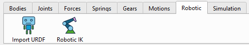
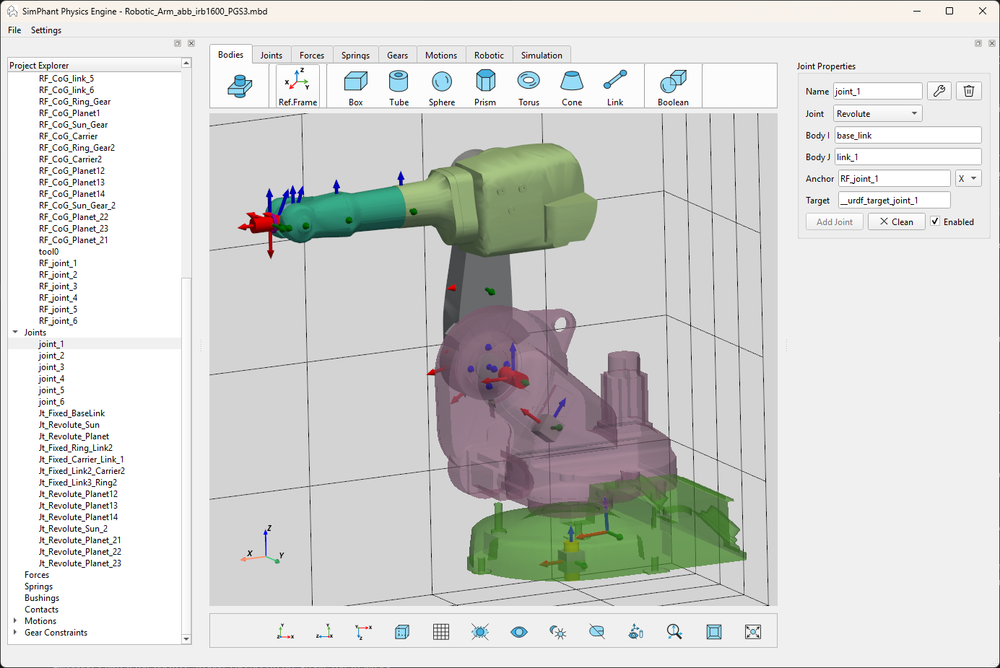
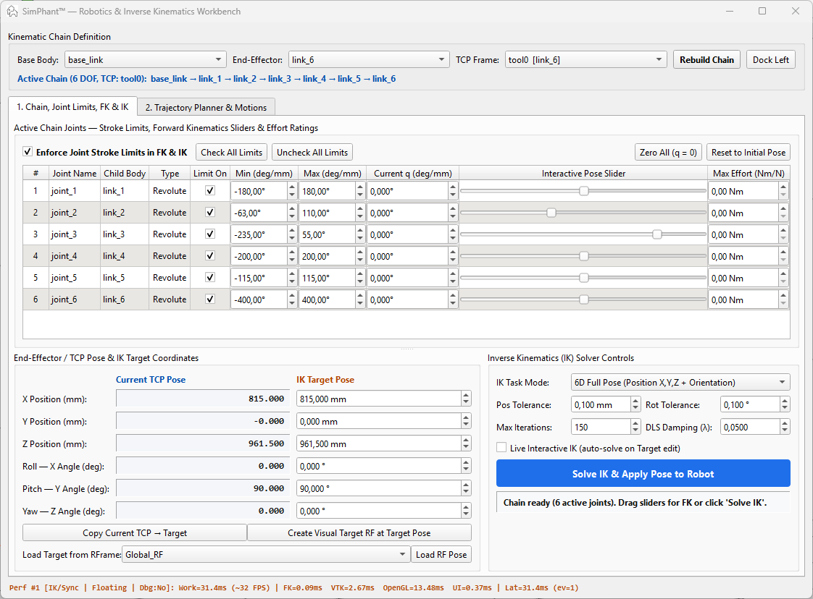
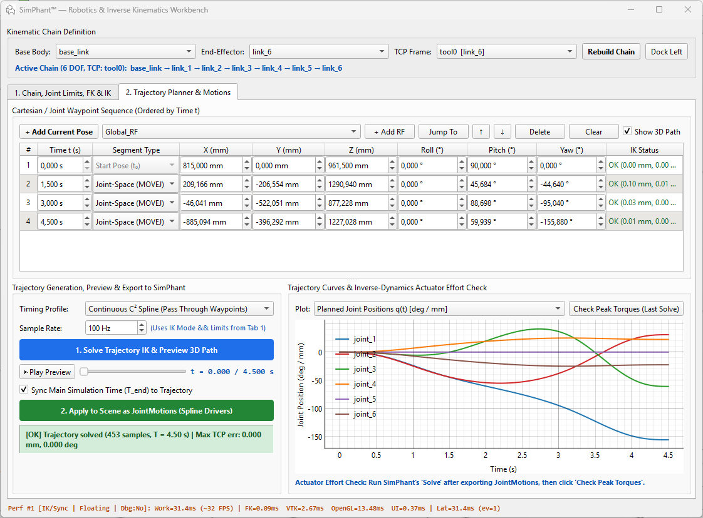
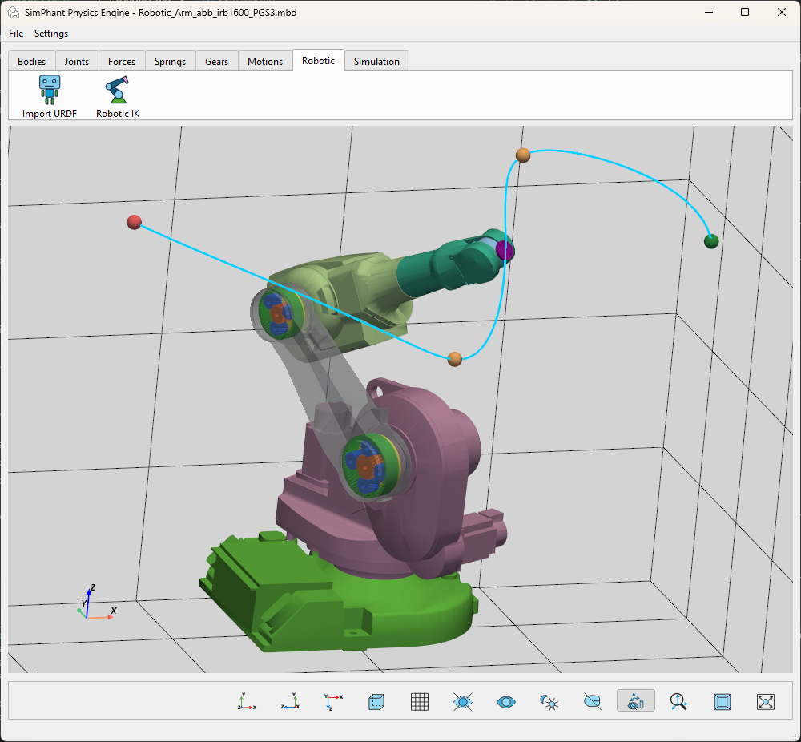
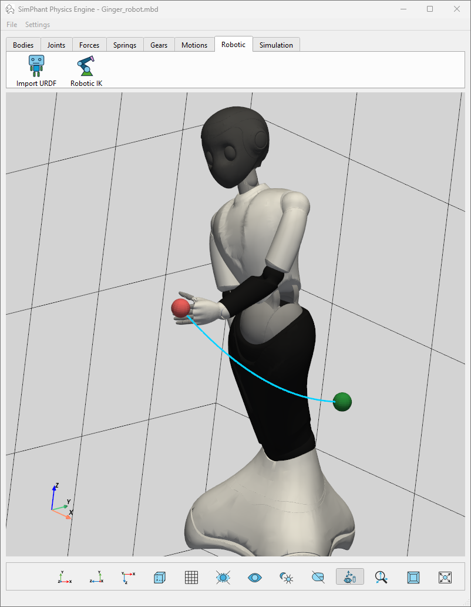

# Рабочая среда робототехники и обратной кинематики SimPhant

## 1. Введение и основные термины робототехники

**Рабочая среда робототехники и обратной кинематики** (*Robotics & Inverse Kinematics Workbench*, открываемая кнопкой **`Robotic_IK`** рядом с кнопкой **`Import URDF`** на вкладке панели инструментов **`Robotic`**) предоставляет полный цикл кинематического и динамического расчёта шарнирных механизмов в двух взаимосвязанных вкладках:

* **Вкладка 1 (`1. Chain, Joint Limits, FK & IK`):** Настройка механических ограничений хода шарниров и номинальных усилий/моментов приводов, интерактивное позиционирование механизма ползунками прямой кинематики в реальном времени, а также решение задачи обратной кинематики (6D / 5D / 3D) для любого целевого положения и ориентации.
* **Вкладка 2 (`2. Trajectory Planner & Motions`):** Построение многоточечных траекторий в декартовом пространстве и пространстве обобщённых координат шарниров, предварительный 3D-просмотр траектории в реальном времени, экспорт гладких сплайновых приводов движения **`JointMotion`** непосредственно в динамический решатель SimPhant и проверка пиковых крутящих моментов двигателей относительно их допустимых паспортных значений.

Если вы только начинаете знакомство с робототехникой, ниже приведены основные понятия и сокращения, используемые в этом инструменте:

* **Кинематическая цепь (*Kinematic Chain*):** Последовательность твёрдых тел (*звеньев*), соединённых друг за другом механическими *шарнирами* (связями) — подобно тому, как плечо, предплечье и кисть человека соединены плечевым, локтевым и лучезапястным суставами.
* **Базовое тело (*Base Body / Root Link*):** Начальное (корневое) звено кинематической цепи (например, неподвижное основание `base_link` промышленного манипулятора или таз `pelvis` / корпус `torso` антропоморфного робота). При кинематическом позиционировании базовое тело остаётся неподвижным, а все последующие звенья перемещаются относительно него.
* **Конечное звено / схват (*End-Effector, EE*):** Последнее тело на конце выбранной кинематической цепи (например, фланец запястья робота, захватное устройство, сварочная горелка или стопа шагающего робота).
* **TCP (*Tool Center Point* — центральная точка инструмента):** Специальная **система координат (`RFrame`)**, жёстко связанная с конечным звеном (`End-Effector`), которая задаёт точную рабочую точку и оси инструмента (например, кончик схвата или центр фланца, в промышленных роботах обычно называемый `tool0`). Если отдельная система координат TCP не выбрана, SimPhant использует в качестве TCP собственную систему координат **центра масс (*Center of Gravity, CoG*)** конечного звена.
* **DOF (*Degrees of Freedom* — степени свободы):** Число независимых подвижных обобщённых координат шарниров ($q_1, q_2, \dots, q_N$) вдоль активной кинематической цепи. Каждый **вращательный шарнир (`Revolute`)** добавляет 1 вращательную степень свободы (измеряется в градусах, $^\circ$), а каждый **поступательный шарнир (`Prismatic`)** — 1 линейную степень свободы (измеряется в миллиметрах, $\text{мм}$).
* **FK (*Forward Kinematics* — прямая задача кинематики):** *«Прямая»* задача: **по заданным углам/перемещениям в шарнирах** $(q_1, \dots, q_N)$ вычислить результирующее 3D-положение и ориентацию каждого звена робота и рабочей точки инструмента TCP.
* **IK (*Inverse Kinematics* — обратная задача кинематики):** *«Обратная»* задача: **по заданному желаемому 3D-положению и ориентации точки TCP** автоматически найти такие углы/перемещения в шарнирах $(q_1, \dots, q_N)$, которые приведут TCP в целевую точку без нарушения механических ограничений хода шарниров.
* **Опорная точка траектории (*Waypoint*):** Ключевая поза в 3D-пространстве (положение + ориентация) в паре с моментом времени прибытия $t_m$ вдоль планируемого движения — своего рода пространственно-временные контрольные точки, задающие маршрут робота.
* **Планирование траектории (*Trajectory Planning*):** Преобразование набора дискретных опорных точек в гладкие, непрерывные функции обобщённых координат от времени $\mathbf{q}(t)$, благодаря которым робот плавно разгоняется из состояния покоя, движется без рывков и плавно тормозит без скачков скорости и бесконечных пиков ускорения.
* **`MOVEL` и `MOVEJ` (типы сегментов движения):** Стандартные команды движения промышленных роботов:
  * **`Linear TCP (MOVEL)`:** Перемещает точку TCP строго по **прямой линии в 3D-пространстве** с плавным поворотом ориентации инструмента. Незаменимо для технологических операций: сварки, резки, нанесения клея или точной сборки/вставки деталей.
  * **`Joint-Space (MOVEJ)`:** Плавная интерполяция непосредственно углов/перемещений каждого шарнира от начального до конечного значения. При этом точка TCP описывает естественную криволинейную дугу в пространстве, что обеспечивает быстрое перемещение между точками и позволяет избегать кинематических сингулярностей при больших холостых переходах.
* **SLERP (*Spherical Linear Interpolation* — сферическая линейная интерполяция):** Математический метод на основе единичных кватернионов, обеспечивающий плавный поворот 3D-системы координат по кратчайшей дуге между двумя ориентациями с контролируемой угловой скоростью, без эффекта «складывания рамок» (*gimbal lock*) углов Эйлера и неестественного закручивания инструмента.
* **Обратная задача динамики (*Inverse Dynamics*) и усилие/момент привода ($\tau(t)$):** Когда рассчитанная кинематическая траектория $\mathbf{q}(t)$ передаётся в динамический решатель многотельных систем SimPhant (`MBSolver`), решение **обратной задачи динамики** определяет точные физические **крутящие моменты двигателей ($\text{Н·м}$)** или **усилия линейных приводов ($\text{Н}$)** в каждом шарнире, необходимые для преодоления силы тяжести, пространственной инерции звеньев, кориолисовых и центробежных сил, упругих элементов (пружин/втулок), внешних нагрузок и контактных взаимодействий.

---

## 2. Требования к модели (к каким моделям SimPhant применим инструмент?)

Рабочая среда робототехники является **универсальной** — она не требует специального формата файлов и одинаково эффективно работает как с моделями роботов, импортированными из **URDF** (например, промышленными манипуляторами ABB или антропоморфным роботом Unitree G1), так и с **пользовательскими многотельными механизмами**, созданными непосредственно в SimPhant.

Для использования инструмента ваша модель в SimPhant должна удовлетворять следующим требованиям:

1. **Минимум два активных твёрдых тела:**
   Сцена должна содержать как минимум два включённых (`enabled`), не являющихся «Землёй» (`Ground`) компонента `RigidBody`: одно тело выступает в роли **базового звена (`Base Body`)**, а другое — в роли **конечного звена (`End-Effector Body`)**.
2. **Непрерывная цепь поддерживаемых соединений (шарниров):**
   Между базовым и конечным звеном должен существовать непрерывный путь из активных соединений. Вдоль кинематической цепи поддерживаются следующие типы соединений:
   * **Вращательное соединение (`JointType.REVOLUTE`):** 1 вращательная степень свободы вокруг локальной оси $Z$ шарнира.
   * **Поступательное соединение (`JointType.PRISMATIC`):** 1 поступательная степень свободы вдоль локальной оси $Z$ шарнира.
   * **Фиксированное соединение (`JointType.FIXED`):** 0 степеней свободы (жёстко связывает два тела; удобно, когда между подвижными звеньями установлены датчики, фланцы или переходные плиты).
   *(Примечание: соединения с несколькими степенями свободы — сферические `Spherical`, цилиндрические `Cylindrical` и плоские `Planar` — не могут входить в активную последовательную цепь обратной кинематики.)*
3. **Древовидная / последовательная топология вдоль активного пути:**
   Путь между выбранным базовым телом и конечным звеном должен образовывать единую последовательную цепь (без замкнутых четырёхзвенных контуров вдоль самого активного пути).
   * **Разветвлённые роботы (гуманоиды и двурукие системы) полностью поддерживаются:** Если ваша модель представляет собой разветвлённое дерево (например, гуманоид, у которого левая рука, правая рука, голова и ноги ответвляются от корпуса/таза), достаточно выбрать **базовое тело** (например, `pelvis`) и **конечное звено** нужной конечности (например, `right_hand`). SimPhant автоматически определяет все **боковые поддеревья** (например, левую руку и голову, прикреплённые к движущемуся корпусу) и перемещает их как единое целое вместе с родительским звеном, чтобы ни одно соединение не разрывалось.
4. **Рекомендуемое число степеней свободы (DOF) для задач обратной кинематики:**
   * **Полная 6D-поза (`6D Full Pose` — 3D-положение + 3D-ориентация):** Требует не менее **6 степеней свободы** (например, 6-осевой промышленный робот) для достижения произвольных положений и ориентаций в пространстве.
   * **5D-задача (`5D Position + Tool Z-Axis Alignment` — положение + выравнивание оси Z инструмента):** Требует не менее **5 степеней свободы** (удобно для осесимметричных инструментов — свёрл, шпинделей, лазерных головок, где вращение вокруг собственной оси $Z$ инструмента не имеет значения).
   * **3D-позиционирование (`3D Position Only` — только координаты X, Y, Z):** Работает на цепях с **3 и более степенями свободы** (а также с 1–2 DOF, если цель лежит в пределах рабочей плоскости/дуги механизма).
   * **Кинематически избыточные цепи ($N_{\text{dof}} > 6$):** Полностью поддерживаются (например, 7-осевые манипуляторы или цепь «корпус + рука»); решатель использует дополнительные степени свободы для удержания шарниров ближе к середине их рабочего диапазона, вдали от механических упоров.
5. **Закрепление базового звена (`Base Body`) на «Земле» (`Ground`) для динамического расчёта (`MBSolver`):**
   При чисто кинематическом позиционировании и предпросмотре траектории внутри окна `RoboticsWindow` **базовое звено** (например, `base_link`) удерживается неподвижным автоматически. Однако перед запуском динамического расчёта SimPhant по кнопке **`Solve`** со сгенерированными сплайновыми приводами **`JointMotion`** (особенно после свежего импорта файла `.urdf`) **базовое тело (`base_link`) обязательно должно быть жёстко связано с телом `Ground` активным фиксированным соединением (`Fixed Joint`)**. В противном случае весь робот останется незакреплённым в пространстве и начнёт свободно падать под действием силы тяжести во время динамического моделирования.

---

## 3. Описание пользовательского интерфейса (`RoboticsWindow`)

При нажатии кнопки **`Robotic_IK`** на верхней вкладке **`Robotic`** открывается окно **SimPhant™ — Robotics & Inverse Kinematics Workbench**. Оно состоит из **общей верхней панели выбора кинематической цепи**, **двух основных рабочих вкладок** (`1. Chain, Joint Limits, FK & IK` и `2. Trajectory Planner & Motions`) и **строки телеметрии производительности** в нижней части окна:

---

### 3.1 Общая верхняя панель: определение кинематической цепи

Эта панель задаёт, какая именно часть вашей многотельной модели выступает в качестве активной цепи робота одновременно для Вкладки 1 и Вкладки 2:

| Элемент интерфейса | Тип | Назначение и функции для пользователя |
| :--- | :---: | :--- |
| **`Base Body`** | Выпадающий список (`QComboBox`) | Выбирает начальное (базовое) тело кинематической цепи (например, `base_link` у манипулятора или `pelvis` у гуманоида). Это тело остаётся неподвижным в пространстве при позиционировании цепи. При открытии окна SimPhant автоматически выбирает корневое звено модели. |
| **`End-Effector`** | Выпадающий список (`QComboBox`) | Выбирает конечное звено цепи, которым вы хотите управлять (например, `link_6`, `right_hand` или `left_ankle_roll_link`). По умолчанию автоматически выбирается наиболее удалённое концевое звено модели. |
| **`TCP Frame`** | Выпадающий список (`QComboBox`) | Выбирает систему координат (`RFrame`), представляющую **центральную точку инструмента (TCP)** для отслеживания и расчёта IK. Если на конечном звене имеется инструментальная СК (например, `tool0`), она подставляется автоматически. Также можно выбрать `<End-Effector CoG>` для управления непосредственно центром масс конечного тела или любую другую пользовательскую СК сцены. |
| **`Rebuild Chain`** | Кнопка (`QPushButton`) | Повторно сканирует тела, соединения и системы координат сцены для перестроения кинематической цепи (полезно, если вы добавили, включили или отключили шарниры либо СК в главном окне SimPhant при открытом окне робототехники). |
| **`Dock Left` / `Float Window`** | Кнопка (`QPushButton`) | Переключает окно рабочей среды между режимом закреплённой панели слева в главном окне SimPhant (`Dock Left`) и независимым плавающим окном изменяемого размера (`Float Window`). |
| **Информационная строка `Active Chain (...)`** | Текстовый индикатор (`QLabel`) | Отображает сводку найденной цепи с автоматическим переносом строк: общее число подвижных степеней свободы (`DOF`), имя активной точки TCP и полную последовательность звеньев от базы до схвата (`base_link → link_1 → ... → link_6`). Если допустимый путь между выбранными телами отсутствует, выводится поясняющее предупреждение. |

---

### 3.2 Вкладка 1 — Верхняя панель: Шарниры активной цепи — ограничения хода, ползунки прямой кинематики и номинальные усилия

Эта панель представляет собой сводную интерактивную таблицу всех подвижных шарниров активной цепи, позволяющую просматривать и редактировать ограничения шарниров, а также задавать позу робота методом прямой кинематики (FK):

#### Панель управления над таблицей шарниров
* **`Enforce Joint Stroke Limits in FK & IK` (Флажок):**
  Главный переключатель учёта ограничений хода шарниров. Когда флажок установлен (по умолчанию), как интерактивные ползунки/поля ввода FK, так и решатель IK строго удерживают каждый ограниченный шарнир внутри его диапазона `[Min, Max]`. Снимите флажок, если требуется протестировать математическое решение без ограничений хода.
* **`Check All Limits` / `Uncheck All Limits` (Кнопки):**
  Быстро включают или отключают индивидуальные флажки `Limit On` сразу для всех шарниров цепи.
* **`Zero All (q = 0)` (Кнопка):**
  Устанавливает все обобщённые координаты шарниров активной цепи в нулевое положение $q = 0$ (с учётом активных ограничений `[Min, Max]`, если `0` выходит за допустимый диапазон) и мгновенно обновляет 3D-модель робота.
* **`Reset to Initial Pose` (Кнопка):**
  Возвращает все тела и системы координат сцены точно в то положение, которое они занимали в момент инициализации цепи.

#### Столбцы таблицы шарниров (`tblJoints`)
Каждая строка таблицы соответствует одному подвижному шарниру (в порядке от базового звена $\rightarrow$ к конечному звену):

1. **`#`:** Порядковый номер ($1 \dots N_{\text{dof}}$) шарнира вдоль кинематической цепи.
2. **`Joint Name`:** Имя компонента соединения `Joint` в SimPhant (например, `joint_1` или `left_knee_joint`).
3. **`Child Body`:** Имя ведомого звена, приводимого в движение данным шарниром.
4. **`Type`:** Тип шарнира: `Revolute` (вращательный, отображается в градусах `°`) или `Prismatic` (поступательный, отображается в миллиметрах `mm`).
5. **`Limit On` (Флажок):** Включает или отключает ограничения хода для данного конкретного шарнира. Для моделей, импортированных из URDF, этот флажок автоматически включается и заполняется из тега `<limit>`.
6. **`Min (deg/mm)` (Редактируемое числовое поле `SpinBox`):** Нижний механический предел хода шарнира ($q_{\min}$). Изменение этого значения сразу обновляет диапазон интерактивного ползунка и сохраняется в файле проекта `.mbd`.
7. **`Max (deg/mm)` (Редактируемое числовое поле `SpinBox`):** Верхний механический предел хода шарнира ($q_{\max}$).
8. **`Current q (deg/mm)` (Редактируемое числовое поле `SpinBox`):** Отображает и позволяет точно ввести текущий угол ($^\circ$) или линейное смещение ($\text{мм}$) шарнира. Ввод значения мгновенно перемещает 3D-модель робота с помощью прямой кинематики. *(Если при решении задачи IK шарнир упирается в свой механический предел, это поле подсвечивается жёлто-янтарным цветом, наглядно показывая насыщение шарнира.)*
9. **`Interactive Pose Slider` (Ползунок `QSlider`):** Перетаскивание ползунка плавно вращает или перемещает звено в реальном времени в 3D-окне с непрерывным обновлением координат **Current TCP Pose** ниже.
10. **`Max Effort (Nm/N)` (Редактируемое числовое поле `SpinBox`):** Хранит паспортный максимальный крутящий момент ($\text{Н·м}$ для вращательного шарнира) или усилие ($\text{Н}$ для поступательного шарнира) двигателя привода (автоматически импортируется из атрибута URDF `<limit effort="..."/>` и сохраняется в файлах `.mbd` для проверки нагрузочной способности приводов).

---

### 3.3 Вкладка 1 — Нижняя левая панель: Текущая поза TCP и целевые координаты обратной кинематики

Эта сдвоенная панель позволяет сопоставить, где рабочая точка TCP находится **сейчас**, и куда вы **хотите её переместить**:

* **Столбец `Current TCP Pose` (Поля только для чтения):**
  Отображает в реальном времени глобальное положение и ориентацию выбранной системы координат TCP при перемещении ползунков FK или решении IK:
  * **`X Position (mm)` / `Y Position (mm)` / `Z Position (mm)`:** Глобальные декартовы координаты в миллиметрах.
  * **`Roll — X Angle (deg)` / `Pitch — Y Angle (deg)` / `Yaw — Z Angle (deg)`:** Глобальные внешние углы Эйлера в градусах (полностью соответствующие соглашению об углах `RFrame` в SimPhant).
* **Столбец `IK Target Pose` (Редактируемые поля `SpinBox`):**
  Задаёт желаемые глобальные координаты цели (`X, Y, Z` в $\text{мм}$ и углы `Roll, Pitch, Yaw` в градусах), в которые решатель IK должен привести точку TCP.
* **`Copy Current TCP → Target` (Кнопка):**
  Копирует все 6 текущих координат TCP напрямую в поля `IK Target Pose`. Это самый удобный способ начать работу: выставьте приближённую позу ползунками (или начните из исходного положения), нажмите **Copy Current TCP → Target**, а затем измените нужную координату `X`, `Y`, `Z` или угол на требуемое смещение (например, $+100\text{ мм}$ вдоль оси $Z$).
* **`Create Visual Target RF at Target Pose` (Кнопка):**
  Создаёт наглядную 3D-систему координат (`IK_Target_1`, `IK_Target_2`, ...) в 3D-окне SimPhant и в дереве модели точно по координатам, введённым в `IK Target Pose`. Это позволяет визуально контролировать положение и тройку осей цели в 3D до и после расчёта IK.
* **`Load Target from RFrame` (Выпадающий список + кнопка `Load RF Pose`):**
  Позволяет выбрать любую существующую систему координат (`RFrame`) в сцене SimPhant и одним нажатием загрузить её 3D-положение и ориентацию в поля `IK Target Pose`.

---

### 3.4 Вкладка 1 — Нижняя правая панель: Управление решателем обратной кинематики (IK)

Эта панель настраивает параметры численного решателя обратной кинематики:

* **`IK Task Mode` (Выпадающий список режима задачи IK):**
  Определяет, какие именно координаты точки TCP удерживаются решателем IK:
  1. **`6D Full Pose (Position X,Y,Z + Orientation)`:** Совмещает как 3D-положение $(X, Y, Z)$, так и полную 3D-ориентацию $(\text{Roll, Pitch, Yaw})$ с целевой позой. Оптимальный режим для 6- и 7-осевых манипуляторов.
  2. **`3D Position Only (X, Y, Z — Free Orientation)`:** Помещает точку TCP в целевые координаты $(X, Y, Z)$ без ограничения ориентации инструмента (поля углов Roll/Pitch/Yaw при этом блокируются). Идеально подходит для механизмов с числом степеней свободы менее 6, задач точечного позиционирования или достижения целей на границе рабочей зоны.
  3. **`5D Position + Tool Z-Axis Alignment`:** Совмещает 3D-положение $(X, Y, Z)$ и выравнивает синюю стрелку **оси Z инструмента (TCP)** вдоль оси Z цели, оставляя вращение вокруг самой оси Z свободным. Оптимально для осесимметричных инструментов (шпинделей, свёрл, цилиндрических захватов, лазерных излучателей).
* **`Pos Tolerance` (Поле `mm`):**
  Максимально допустимая погрешность по положению между TCP и целью, при которой решение IK считается сошедшимся (по умолчанию: `0.100 mm`).
* **`Rot Tolerance` (Поле `°`):**
  Максимально допустимая угловая погрешность между ориентацией TCP и целевой ориентацией (по умолчанию: `0.100 °`).
* **`Max Iterations` (Числовое поле):**
  Максимальное число итераций алгоритма Левенберга–Марквардта на одну попытку расчёта (по умолчанию: `150`).
* **`DLS Damping (λ)` (Числовое поле):**
  Коэффициент демпфирования сингулярностей $\lambda$ (по умолчанию: `0.0500`). Меньшие значения обеспечивают более быстрые шаги ньютоновского типа вдали от особых положений; большие значения делают движение более плавным и устойчивым вблизи границ рабочей зоны.
* **`Live Interactive IK` (Флажок):**
  При включении решатель IK запускается **автоматически в реальном времени** при каждом изменении любого поля `IK Target Pose` (`X, Y, Z, Roll, Pitch, Yaw`), позволяя плавно «вести» инструмент робота в декартовых координатах и сразу наблюдать перестроение всей кинематической цепи.
* **`Solve IK & Apply Pose to Robot` (Синяя кнопка запуска):**
  Выполняет расчёт обратной кинематики для текущих значений `IK Target Pose`, обновляет все углы/перемещения шарниров в таблице и перестраивает 3D-модель робота в окне просмотра.
* **Индикатор статуса решения (под кнопкой расчёта):**
  Отображает результат работы решателя:
  * **Зелёная панель (`[OK] IK Converged...`):** Показывает затраченное число итераций и итоговую достигнутую погрешность положения ($\text{мм}$) и ориентации ($\text{град}$).
  * **Жёлто-янтарная предупреждающая панель (`[WARN] Target not fully reached...`):** Указывает, что целевая точка находится за пределами досягаемой рабочей зоны робота или недостижима из-за ограничений хода шарниров. Робот перемещается в ближайшую физически реализуемую позу, выводится список шарниров, достигших упора (`Limit reached: ...`), а соответствующие ячейки в таблице подсвечиваются.

---

### 3.5 Вкладка 2 — Верхняя панель: Последовательность опорных точек траектории (`tblWaypoints`)

Переход на вкладку **`2. Trajectory Planner & Motions`** превращает статический решатель IK из Вкладки 1 в генератор движения по времени. Верхняя панель задаёт упорядоченную последовательность **опорных точек (*Waypoints*)**, через которые должна пройти точка TCP робота в заданные моменты времени.

#### Кнопки управления опорными точками (над таблицей)
* **`+ Add Current Pose` (Кнопка):**
  Считывает текущее 3D-положение и ориентацию точки TCP робота в окне просмотра и добавляет их новой строкой в таблицу опорных точек. Первой точке по умолчанию присваивается время $t = 0.000\text{ с}$, а каждой следующей — автоматическое приращение $+1.5\text{ с}$ (все значения времени можно свободно редактировать).
* **Выпадающий список СК сцены (`QComboBox`) + кнопка `+ Add RF`:**
  Позволяет выбрать любую существующую систему координат `RFrame` в сцене SimPhant (например, `IK_Target_1`, `IK_Target_2`, созданные на Вкладке 1, или импортированные целевые СК из CAD) и одним нажатием добавить её точное 3D-положение и ориентацию как новую точку траектории.
* **`Jump To` (Кнопка):**
  Решает задачу IK для выделенной в таблице строки и мгновенно перемещает 3D-робота в эту опорную точку, позволяя заранее проверить достижимость, конфигурацию звеньев и отсутствие геометрических пересечений до расчёта всей траектории.
* **`↑` / `↓` (Кнопки изменения порядка):**
  Перемещают выбранную опорную точку раньше или позже по маршруту, сохраняя монотонный порядок меток времени сверху вниз по таблице.
* **`Delete` (Кнопка):**
  Удаляет выбранную строку опорной точки из таблицы.
* **`Clear` (Кнопка):**
  Полностью очищает таблицу опорных точек и удаляет 3D-линию предпросмотра траектории и маркеры из окна вида.
* **`Show 3D Path` (Флажок):**
  Когда флажок установлен (по умолчанию), в 3D-окне SimPhant отображаются рассчитанная пространственная кривая движения TCP (голубая линия) и маркеры опорных точек (оранжевые 3D-сферы).

#### Столбцы таблицы опорных точек (`tblWaypoints`)
Каждая строка задаёт одну привязанную ко времени целевую позу вдоль маршрута робота:

1. **`#`:** Порядковый номер опорной точки ($1 \dots M$).
2. **`Time t (s)` (Редактируемое поле `SpinBox`):** Точный момент времени (в секундах), когда точка TCP должна прийти в данную опорную точку. Время должно строго возрастать сверху вниз ($t_1 < t_2 < \dots < t_M$).
3. **`Segment Type` (Выпадающий список):** Задаёт закон интерполяции при движении *от предыдущей опорной точки к данной*:
   * **Строка 1 (`Start Pose (t₀)`):** Обозначает начальную позу пользовательской последовательности точек.
   * **`Linear TCP (MOVEL)`:** Ведёт точку TCP строго по **прямой линии в 3D** в декартовом пространстве с плавным поворотом ориентации инструмента методом кватернионной интерполяции **SLERP**. Оптимально для рабочих технологических проходов (сварка, резка, подвод/вставка детали).
   * **`Joint-Space (MOVEJ)`:** Решает IK в конечной точке сегмента и плавно интерполирует движение непосредственно в **обобщённых координатах шарниров**. Оптимально для быстрых и свободных от сингулярностей переходов в свободном пространстве. В рамках одной траектории можно свободно комбинировать сегменты `MOVEL` и `MOVEJ` (при выборе профиля `Quintic Rest-to-Rest`).
4. **`X (mm)`, `Y (mm)`, `Z (mm)` (Редактируемые поля `SpinBox`):** Глобальные декартовы координаты опорной точки в миллиметрах. Редактирование любой координаты мгновенно перемещает соответствующую 3D-сферу в окне вида.
5. **`Roll (°)`, `Pitch (°)`, `Yaw (°)` (Редактируемые поля `SpinBox`):** Глобальные внешние углы Эйлера опорной точки в градусах (в соглашении `RFrame` программы SimPhant).
6. **`IK Status` (Ячейка статуса только для чтения):** До расчёта отображает `Pending`, а после расчёта траектории показывает зелёный статус **`OK (err mm)`**, если точка достигнута в пределах допуска, либо янтарный статус **`WARN (err mm)`**, если точка выходит за рабочую зону или упирается в предел хода шарнира.

---

### 3.6 Вкладка 2 — Нижняя левая панель: Генерация траектории, предпросмотр и экспорт в SimPhant

Эта панель рассчитывает непрерывные законы движения шарниров, позволяет кинематически просмотреть анимацию в 3D и экспортирует траекторию в виде физических сплайновых приводов `JointMotion`:

* **`Timing Profile` (Выпадающий список временного профиля):**
  Выбирает закон изменения скорости и ускорения между опорными точками:
  1. **`Quintic Rest-to-Rest (Smooth Stop at Each Waypoint)`:** Применяет полином 5-й степени минимального рывка на каждом сегменте, благодаря чему робот **начинает движение из покоя и плавно останавливается с непрерывностью $C^2$** (нулевая скорость и нулевое ускорение) в каждой опорной точке. Поддерживает произвольное чередование сегментов `MOVEL` и `MOVEJ`.
  2. **`Continuous C² Spline (Pass Through Waypoints)`:** Строит глобально гладкий $C^2$-непрерывный сплайн через все точки, так что TCP **плавно проходит промежуточные точки без остановки**, сохраняя при этом строго нулевую скорость и нулевое ускорение в самый начальный и конечный моменты движения.
* **`Sample Rate` (Поле частоты дискретизации `Hz`):**
  Задаёт число расчётных точек IK в секунду (по умолчанию: `100 Hz`, диапазон: `20–1000 Hz`), используемых как для 3D-предпросмотра, так и при записи выходных CSV-таблиц сплайнов. *(Примечание: планировщик траектории автоматически использует активный режим **`IK Task Mode`** — 6D, 3D или 5D — и настройку ограничений **`Enforce Joint Stroke Limits`**, выбранные на Вкладке 1.)*
* **`1. Solve Trajectory IK & Preview 3D Path` (Синяя кнопка расчёта траектории):**
  Последовательно решает задачу обратной кинематики с «тёплым стартом» (*warm start*) для каждого шага сетки времени, отрисовывает 3D-траекторию TCP и сферы опорных точек, обновляет столбец `IK Status`, разблокирует элементы предпросмотра и строит графики запланированных координат шарниров.
  * **Автоматическое согласование с нулевой позой (`q = 0`):** Поскольку динамический решатель `MBSolver` в SimPhant перед запуском всегда приводит робота в детерминированное базовое положение **`Zero All (q = 0)`**, в случае если ваша первая опорная точка задана при $t_1 > 0\text{ с}$ и отличается от позы `q = 0`, планировщик автоматически добавляет плавный участок подхода из `q = 0` (при $t = 0\text{ с}$) к Точке 1 (при $t = t_1$), полностью исключая начальный рывок в динамическом расчёте.
* **Панель интерактивного предпросмотра траектории:**
  * **`▶ Play Preview` / `⏸ Pause` (Кнопка):** Воспроизводит рассчитанную кинематическую траекторию непосредственно в 3D-окне в реальном времени, позволяя оценить конфигурацию локтя/запястья и зазоры до препятствий *ещё до запуска* полного динамического расчёта.
  * **Ползунок времени (`QSlider`) и индикатор `t = ... / ... s`:** Перетаскивайте ползунок для покадрового осмотра положения робота в любой момент времени вдоль маршрута.
* **`Sync Main Simulation Time (T_end) to Trajectory` (Флажок):**
  Если флажок установлен (по умолчанию), при экспорте траектории поле времени моделирования **Simulation Time** (`T_end`) в главном окне SimPhant автоматически приравнивается ко времени последней опорной точки.
* **`2. Apply to Scene as JointMotions (Spline Drivers)` (Зелёная кнопка экспорта движений):**
  Одним нажатием передаёт рассчитанную траекторию в подсистему динамики многотельных систем SimPhant:
  1. Устанавливает 3D-модель робота в точное начальное положение **`Zero All (q = 0)`**.
  2. Записывает высокоточные CSV-файлы относительных перемещений (`splines/<ИмяПроекта>_IK/IK_Motion_<ИмяШарнира>.csv`) в радианах ($\text{рад}$) для вращательных шарниров и в миллиметрах ($\text{мм}$) для поступательных шарниров.
  3. Автоматически создаёт (или обновляет) по одному активному компоненту **`JointMotion`** (`spline(...)`) для каждого подвижного шарнира цепи в папке **Motions** дерева модели SimPhant.
  4. **Автоматическая проверка закрепления базы на `Ground`:** Проверяет, связано ли активное **базовое звено** (например, `base_link`) с «Землёй» (`Ground`) включённым **фиксированным соединением (`Fixed Joint`)**, и выводит предупреждающее окно и янтарный статус, если перед нажатием **`Solve`** базовое тело ещё необходимо закрепить.
* **Панель статуса траектории (под кнопкой экспорта):**
  Выводит общее число точек дискретизации, длительность траектории, максимальную погрешность отслеживания TCP ($\text{мм}$), список шарниров, достигших предела хода, а также подтверждение создания приводов `JointMotion`.

---

### 3.7 Вкладка 2 — Нижняя правая панель: Графики траектории и проверка усилий/моментов приводов по обратной динамике

Эта панель содержит интерактивный научный график (`pyqtgraph`) для анализа как запланированной кинематики, так и динамически рассчитанных крутящих моментов и усилий двигателей:

* **Выпадающий список `Plot` (Выбор режима графика):**
  Переключает область построения между четырьмя многоканальными представлениями:
  1. **`Planned Joint Positions q(t) [deg / mm]`:** Графики обобщённых координат всех активных шарниров $q_k(t)$ во времени.
  2. **`Planned Joint Velocities dq/dt [deg/s / mm/s]`:** Графики скоростей шарниров $\dot{q}_k(t)$, позволяющие убедиться в гладкости колоколообразных профилей скорости и нулевых скоростях на концах.
  3. **`Planned TCP Tracking Error [mm]`:** График 3D-расстояния (евклидовой ошибки) между желаемой декартовой траекторией $\mathbf{p}_{\text{des}}(t)$ и фактически достигнутым положением точки TCP $\mathbf{p}_{\text{tcp}}(t)$ в каждый момент времени.
  4. **`Solved Actuator Effort τ(t) from Last MBSolver Run [Nm / N]`:** Графики физических **крутящих моментов ($\text{Н·м}$)** и **сил приводов ($\text{Н}$)**, вычисленных динамическим решателем `MBSolver` в ходе последнего расчёта динамики.
* **`Check Peak Torques (Last Solve)` (Кнопка проверки пиковых моментов):**
  Извлекает историю реакций кинематических приводов из последнего расчёта `MBSolver`, автоматически переключает график в режим `Solved Actuator Effort τ(t)` и сравнивает пиковую нагрузку каждого шарнира $|\tau_k(t)|_{\max}$ с его допустимым паспортным значением **`Max Effort (Nm/N)`** из Вкладки 1.
* **Интерактивное поле графика:**
  Поддерживает масштабирование колесом мыши, панорамирование перетаскиванием и цветовую легенду шарниров.
* **Сводная строка нагрузки приводов (под графиком):**
  * **Зелёная сводка (`[OK] Peak Actuator Efforts...`):** Перечисляет пиковый момент/усилие каждого шарнира и процент загрузки привода от номинала, если все двигатели работают в допустимом режиме (например, `joint_1: 142.3 Nm (45%)`).
  * **Красная сводка (`[WARN] Peak Effort Exceeds Rating...`):** Выделяет перегруженные приводы пометкой `OVER!`, сигнализируя о необходимости увеличить время перехода между точками, скорректировать траекторию, уменьшить массу груза или выбрать более мощный привод.

---

### 3.8 Индикатор производительности и переносимость проектов `.mbd`

* **Нижняя строка живой телеметрии производительности:** В самом низу окна `RoboticsWindow` зелёная моноширинная строка в реальном времени показывает текущую частоту кадров (`FPS`), а также время расчёта прямой кинематики в ядрах Numba, обновления матриц VTK и отрисовки OpenGL при перемещении ползунков или прокрутке траектории.
* **Сохранение опорных точек и переносимые архивы `.mbd` со встроенными сплайнами:**
  * Все **ограничения шарниров на Вкладке 1**, **таблица опорных точек траектории на Вкладке 2** и **настройки планировщика** автоматически сохраняются внутри проектного файла `.mbd` и восстанавливаются при следующем открытии проекта.
  * Если в проекте используются CSV-файлы **`spline(...)`** (для приводов движения **`JointMotion`** или силовых элементов **`Force`**), SimPhant сохраняет в архиве `.mbd` как исходный путь к CSV-файлу, так и встроенную резервную копию самого CSV-файла. При открытии проекта на другом компьютере (где внешняя папка со сплайнами отсутствует) SimPhant автоматически извлекает встроенные CSV-файлы из `.mbd`, обеспечивая полную переносимость модели без ошибок потерянных путей.

---

## 4. Практическое руководство для пользователей (быстрый старт)

### 4.1 Сценарий работы на Вкладке 1: Интерактивная прямая (FK) и статическая обратная кинематика (IK)

1. **Загрузите модель робота:** Откройте проект `Robotic_Arm_abb_irb1600.mbd` (`File → Load Project`) или импортируйте любого робота из файла `.urdf` с помощью кнопки **`Import URDF`** на вкладке панели инструментов **`Robotic`**.
2. **Откройте рабочую среду:** Перейдите на вкладку **`Robotic`** верхней панели инструментов и нажмите **`Robotic_IK`**.
3. **Проверьте найденную цепь:** Убедитесь, что SimPhant автоматически выбрал `base_link` в качестве базового звена (`Base Body`), `link_6` в качестве конечного звена (`End-Effector`) и `tool0` в качестве рабочей системы координат инструмента (`TCP Frame`).
4. **Исследуйте прямую кинематику (FK):** Перемещайте любой ползунок **Interactive Pose Slider** в таблице шарниров и наблюдайте, как звенья робота, шарниры и координаты `Current TCP Pose` плавно обновляются в 3D-окне.
5. **Решите задачу обратной кинематики (IK):**
   * Нажмите кнопку **`Copy Current TCP → Target`**.
   * Измените целевую координату `X`, `Y` или `Z` (например, уменьшите `X` на `150 мм` и увеличьте `Y` на `200 мм`) либо включите флажок **`Live Interactive IK`** и плавно меняйте значения стрелками счётчиков.
   * Нажмите **`Solve IK & Apply Pose to Robot`** (при желании нажмите **`Create Visual Target RF at Target Pose`**, чтобы отобразить целевую СК в 3D-окне).
6. **Возврат в исходное положение:** В любой момент нажмите **`Reset to Initial Pose`** или **`Zero All (q = 0)`**, чтобы вернуть робота в начальную конфигурацию.

---

### 4.2 Сценарий работы на Вкладке 2: Планирование многоточечной траектории и проверка крутящих моментов приводов

1. **Задайте опорные точки траектории (Waypoints):**
   * Выставьте нужную позу робота на Вкладке 1 (ползунками FK или через IK), перейдите на вкладку **`2. Trajectory Planner & Motions`** и нажимайте **`+ Add Current Pose`** для каждой контрольной точки — либо выбирайте заранее созданные целевые СК (`IK_Target_1`, `IK_Target_2`, ...) в выпадающем списке и нажимайте **`+ Add RF`**.
   * Отредактируйте столбец времени **`Time t (s)`** (например, `0.0 s`, `1.5 s`, `3.0 s`, `4.5 s`) и выберите тип сегмента: **`Linear TCP (MOVEL)`** для прямолинейного движения инструмента или **`Joint-Space (MOVEJ)`** для быстрых переходов в пространстве шарниров.
2. **Рассчитайте и проверьте траекторию кинематически:**
   * Выберите временной профиль **`Timing Profile`** (`Quintic Rest-to-Rest` с плавной остановкой в точках или `Continuous C² Spline` для безостановочного прохождения промежуточных точек) и нажмите **`1. Solve Trajectory IK & Preview 3D Path`**.
   * Оцените голубую 3D-линию пути и оранжевые сферы точек в окне вида, прокрутите **ползунок времени** или нажмите **`▶ Play Preview`**, а также просмотрите графики положений `q(t)`, скоростей `dq/dt` и ошибки отслеживания TCP справа.
3. **Экспортируйте сплайновые приводы `JointMotion`:**
   * Нажмите **`2. Apply to Scene as JointMotions (Spline Drivers)`**. SimPhant установит робота в базовую конфигурацию `Zero All (q = 0)`, сформирует CSV-файлы сплайнов для каждого шарнира, добавит приводы в раздел **Motions** дерева проекта и синхронизирует время расчёта **Simulation Time**.
4. **Выполните полный динамический расчёт и проверьте моменты двигателей:**
   * Убедитесь, что **базовое тело** робота (например, `base_link`) закреплено на **`Ground`** с помощью активного соединения **`Fixed Joint`** (если вы только что импортировали файл `.urdf`, создайте `Fixed Joint` между `Ground` и `base_link`, чтобы робот не падал под действием гравитации).
   * В главной панели инструментов SimPhant нажмите **`Solve`** для запуска динамического решателя `MBSolver` (который автоматически стартует из согласованной позы `Zero All (q = 0)` и интегрирует уравнения движения с учётом гравитации, 3D-тензоров инерции звеньев, полезной нагрузки, пружин и контактов).
   * Вернитесь на Вкладку 2 окна `RoboticsWindow` и нажмите **`Check Peak Torques (Last Solve)`** (либо откройте окно **`Telemetry`**), чтобы построить графики требуемых крутящих моментов приводов $\tau_k(t)$ в $\text{Н·м}$ и убедиться, что пиковая нагрузка каждого двигателя не превышает его допустимого значения **`Max Effort`**.

---

## 5. Математические основы

### 5.1 Определение обобщённой координаты шарнира ($q_k$)
В SimPhant каждое соединение между телом `body_i` (родительским) и телом `body_j` (дочерним) хранит локальный ортонормированный базис (тройку осей) на каждом из тел:

$$\mathbf{F}_i = \begin{bmatrix} \mathbf{a}_i & \mathbf{b}_i & \mathbf{u}_i \end{bmatrix} \in SO(3), \qquad \mathbf{F}_j = \begin{bmatrix} \mathbf{a}_j & \mathbf{b}_j & \mathbf{u}_j \end{bmatrix} \in SO(3)$$

где $\mathbf{u}_i, \mathbf{u}_j$ — локальные оси шарнира, а единичные векторы $\mathbf{a}, \mathbf{b}$ образуют плоскость, ортогональную оси шарнира. При известных глобальных матрицах ориентации тел $\mathbf{A}_i, \mathbf{A}_j \in SO(3)$ и положениях их центров масс $\mathbf{r}_i, \mathbf{r}_j \in \mathbb{R}^3$:

* **Угол вращательного шарнира (`Revolute`, $q_k = \theta_k \in [-\pi, \pi]\text{ рад}$):**
  Вычисляется через четырёхквадрантную функцию $\operatorname{atan2}$ проекции опорного вектора тела $j$ на плоскость шарнира тела $i$ вокруг глобальной оси вращения $\mathbf{v}_i = \mathbf{A}_i \mathbf{u}_i$:

  $$\theta_k = \operatorname{atan2}\!\Big(\big(\mathbf{v}_i \times (\mathbf{A}_i \mathbf{a}_i)\big) \cdot \mathbf{p}_{\perp},\; (\mathbf{A}_i \mathbf{a}_i) \cdot \mathbf{p}_{\perp}\Big)$$

* **Смещение поступательного шарнира (`Prismatic`, $q_k = d_k \text{ в м}$):**
  Вычисляется как знаковая проекция вектора между точками привязки шарнира на глобальную ось скольжения $\mathbf{v}_i$:

  $$d_k = \big((\mathbf{r}_j + \mathbf{A}_j \mathbf{s}_j) - (\mathbf{r}_i + \mathbf{A}_i \mathbf{s}_i)\big) \cdot \mathbf{v}_i$$

---

### 5.2 Распространение прямой кинематики (FK)
Для заданного вектора обобщённых координат шарниров $\mathbf{q} = [q_1, q_2, \dots, q_{N_{\text{dof}}}]^T$ прямая кинематика последовательно проходит по цепи от **базового тела** ($\mathbf{r}_0, \mathbf{A}_0$) к **конечному звену** ($\mathbf{r}_{\text{ee}}, \mathbf{A}_{\text{ee}}$).

На каждом шаге цепи, соединяющем родительское тело $p$ с дочерним телом $c$ со знаком обхода шарнира $\sigma \in \{+1, -1\}$:
1. **Глобальная точка привязки и ось шарнира:**
   $$\mathbf{p}_{\text{anchor}} = \mathbf{r}_p + \mathbf{A}_p \mathbf{s}_p, \qquad \mathbf{u}_{\text{glob}} = \sigma (\mathbf{A}_p \mathbf{u}_p)$$

2. **Ориентация $\mathbf{A}_c$ и положение центра масс $\mathbf{r}_c$ дочернего тела:**
   * **Вращательный шарнир (`Revolute`):**
     $$\mathbf{A}_c = \mathbf{A}_p \, \mathbf{F}_p \, \mathbf{R}_z(\sigma q_k) \, \mathbf{F}_c^T, \qquad \mathbf{r}_c = \mathbf{p}_{\text{anchor}} - \mathbf{A}_c \mathbf{s}_c$$
     где $\mathbf{R}_z(\theta)$ — элементарная матрица поворота $3 \times 3$ вокруг локальной оси $Z$.
   * **Поступательный шарнир (`Prismatic`):**
     $$\mathbf{A}_c = \mathbf{A}_p \, \mathbf{F}_p \, \mathbf{F}_c^T, \qquad \mathbf{r}_c = \mathbf{p}_{\text{anchor}} + q_k \mathbf{u}_{\text{glob}} - \mathbf{A}_c \mathbf{s}_c$$
   * **Фиксированное соединение (`Fixed`):**
     $$\mathbf{A}_c = \mathbf{A}_p \, \mathbf{F}_p \, \mathbf{F}_c^T, \qquad \mathbf{r}_c = \mathbf{p}_{\text{anchor}} - \mathbf{A}_c \mathbf{s}_c$$

3. **Положение и ориентация точки TCP в глобальной системе координат:**
   По постоянному локальному смещению $(\mathbf{p}_{\text{tcp}}^{\text{loc}}, \mathbf{R}_{\text{tcp}}^{\text{loc}})$ системы координат TCP относительно конечного звена:
   $$\mathbf{p}_{\text{tcp}}(\mathbf{q}) = \mathbf{r}_{\text{ee}} + \mathbf{A}_{\text{ee}} \mathbf{p}_{\text{tcp}}^{\text{loc}}, \qquad \mathbf{R}_{\text{tcp}}(\mathbf{q}) = \mathbf{A}_{\text{ee}} \mathbf{R}_{\text{tcp}}^{\text{loc}}$$

---

### 5.3 Аналитическая геометрическая матрица Якоби $\mathbf{J}(\mathbf{q})$
Чтобы определить, как малые приращения координат шарниров $\Delta \mathbf{q}$ влияют на линейную и угловую скорость точки TCP в 3D-пространстве, SimPhant аналитически формирует точную **геометрическую матрицу Якоби** размерности $6 \times N_{\text{dof}}$:

$$\begin{bmatrix} \mathbf{v}_{\text{tcp}} \\ \boldsymbol{\omega}_{\text{tcp}} \end{bmatrix} = \mathbf{J}(\mathbf{q}) \, \dot{\mathbf{q}}, \qquad \mathbf{J}(\mathbf{q}) = \begin{bmatrix} \mathbf{J}_v(\mathbf{q}) \\ \mathbf{J}_\omega(\mathbf{q}) \end{bmatrix} \in \mathbb{R}^{6 \times N_{\text{dof}}}$$

Для каждого активного шарнира $k \in \{1, \dots, N_{\text{dof}}\}$ с глобальным единичным вектором оси $\mathbf{u}_k$ и глобальной точкой привязки $\mathbf{p}_k$:
* **Если шарнир $k$ — вращательный (`Revolute`):**
  $$\mathbf{J}_v[:, k] = \mathbf{u}_k \times (\mathbf{p}_{\text{tcp}} - \mathbf{p}_k), \qquad \mathbf{J}_\omega[:, k] = \mathbf{u}_k$$
* **Если шарнир $k$ — поступательный (`Prismatic`):**
  $$\mathbf{J}_v[:, k] = \mathbf{u}_k, \qquad \mathbf{J}_\omega[:, k] = \mathbf{0}_{3 \times 1}$$

---

### 5.4 Вектор невязки позы и решатель обратной кинематики методом демпфированных наименьших квадратов (DLS)
Для заданного целевого положения $\mathbf{p}_{\text{target}} \in \mathbb{R}^3$ и целевой матрицы ориентации $\mathbf{R}_{\text{target}} \in SO(3)$ 6-мерный вектор ошибки в пространстве задачи $\mathbf{e}(\mathbf{q}) \in \mathbb{R}^6$ имеет вид:

$$\mathbf{e}(\mathbf{q}) = \begin{bmatrix} \mathbf{e}_{\text{pos}} \\ \mathbf{e}_{\text{rot}} \end{bmatrix}, \qquad \mathbf{e}_{\text{pos}} = \mathbf{p}_{\text{target}} - \mathbf{p}_{\text{tcp}}(\mathbf{q})$$

где вектор угловой ошибки ориентации $\mathbf{e}_{\text{rot}} \in \mathbb{R}^3$ зависит от выбранного **режима задачи IK (`IK Task Mode`)**:
* **Режим полной 6D-позы (`6D Full Pose`):** Использует точное логарифмическое отображение на группе вращений $SO(3)$ (вектор конечного поворота) для матрицы относительного вращения:
  $$\mathbf{e}_{\text{rot}} = \log_{SO(3)}\!\big(\mathbf{R}_{\text{target}} \, \mathbf{R}_{\text{tcp}}(\mathbf{q})^T\big)$$
* **Режим 5D (`5D Position + Tool Z-Axis Alignment`):** Использует вектор кратчайшего поворота, совмещающий текущую ось $Z$ инструмента $\mathbf{z}_{\text{tcp}}$ с целевой осью $\mathbf{z}_{\text{target}}$:
  $$\mathbf{e}_{\text{rot}} = \frac{\mathbf{z}_{\text{tcp}} \times \mathbf{z}_{\text{target}}}{\|\mathbf{z}_{\text{tcp}} \times \mathbf{z}_{\text{target}}\|} \operatorname{atan2}\!\big(\|\mathbf{z}_{\text{tcp}} \times \mathbf{z}_{\text{target}}\|,\; \mathbf{z}_{\text{tcp}} \cdot \mathbf{z}_{\text{target}}\big)$$
* **Режим 3D-позиционирования (`3D Position Only`):** Решаются только верхние 3 уравнения ($\mathbf{e}_{\text{pos}}$ и подматрица $\mathbf{J}_v$); ориентация остаётся свободной.

На каждой итерации приращение обобщённых координат $\Delta \mathbf{q}$ вычисляется по **методу демпфированных наименьших квадратов (Левенберга–Марквардта / DLS)**:

$$\Delta \mathbf{q} = \mathbf{J}_W^T \left( \mathbf{J}_W \mathbf{J}_W^T + \lambda_{\text{eff}}^2 \mathbf{I} \right)^{-1} \mathbf{e}_W + \alpha_{\text{null}} \left(\mathbf{I} - \mathbf{J}_W^+ \mathbf{J}_W\right)(\mathbf{q}_{\text{mid}} - \mathbf{q})$$

* **Устойчивость вблизи сингулярностей ($\lambda_{\text{eff}}$):** Обычное обращение матрицы Якоби $\mathbf{J}^{-1}$ стремится к бесконечности, когда манипулятор полностью выпрямляется или когда совпадают две оси запястья (*кинематическая сингулярность*). Введение коэффициента демпфирования $\lambda > 0$ гарантирует конечный, гладкий и устойчивый шаг во всей рабочей области.
* **Проекция на множество активных ограничений хода:** При включённой опции `Enforce Joint Stroke Limits` любой шарнир, достигший нижней или верхней границы ($q_k = q_{\min,k}$ или $q_{\max,k}$) и стремящийся выйти наружу допустимого интервала, временно фиксируется на текущей итерации, позволяя остальным свободным шарнирам перераспределить движение и довести инструмент до цели.
* **Центрирование в нуль-пространстве (для избыточных роботов, $N_{\text{dof}} > 6$):** Второе слагаемое мягко смещает избыточные степени свободы к середине рабочего хода шарниров $\mathbf{q}_{\text{mid}} = \frac{1}{2}(\mathbf{q}_{\min} + \mathbf{q}_{\max})$, не ухудшая точность позиционирования TCP.

---

### 5.5 Полиномиальная траектория 5-го порядка с остановкой в точках (`Quintic Rest-to-Rest`)
На каждом сегменте времени $[t_m, t_{m+1}]$ длительностью $T_m = t_{m+1} - t_m > 0$ вводится безразмерное нормализованное время $\tau = \frac{t - t_m}{T_m} \in [0, 1]$. Чтобы гарантировать гладкое $C^2$-непрерывное движение с **нулевой скоростью и нулевым ускорением** в начале и в конце каждого сегмента (что исключает ударные инерционные всплески моментов в узлах $t_m$ и $t_{m+1}$), SimPhant применяет **полином 5-й степени минимального рывка (*minimum-jerk polynomial*)**:

$$s(\tau) = 10\tau^3 - 15\tau^4 + 6\tau^5$$

производные которого по времени точно обращаются в нуль при $\tau = 0$ и $\tau = 1$:

$$\dot{s}(\tau) = \frac{30\tau^2(1 - \tau)^2}{T_m}, \qquad \ddot{s}(\tau) = \frac{60\tau(1 - \tau)(1 - 2\tau)}{T_m^2}$$

В зависимости от выбранного в строке **`Segment Type`** закон $s(\tau)$ управляет интерполяцией либо в пространстве шарниров, либо в декартовом пространстве:

* **Сегмент в пространстве шарниров (`MOVEJ`):**
  После однократного решения IK для конечной точки сегмента $\mathbf{q}_{m+1}$ (с непрерывной развёрткой углов вращательных шарниров на $2\pi$ относительно $\mathbf{q}_m$) обобщённые координаты интерполируются напрямую:

  $$\mathbf{q}(t) = \big(1 - s(\tau)\big)\,\mathbf{q}_m + s(\tau)\,\mathbf{q}_{m+1}$$

* **Прямолинейный декартов сегмент (`MOVEL`):**
  Желаемое положение точки TCP движется строго по отрезку прямой, а желаемая 3D-ориентация поворачивается по кратчайшей геодезической дуге на группе $SO(3)$ с помощью **сферической линейной интерполяции (SLERP)**:

  $$\mathbf{p}_{\text{des}}(t) = \big(1 - s(\tau)\big)\,\mathbf{p}_m + s(\tau)\,\mathbf{p}_{m+1}$$

  $$\mathbf{R}_{\text{des}}(t) = \operatorname{SLERP}\!\big(\mathbf{R}_m, \mathbf{R}_{m+1};\, s(\tau)\big) = \mathbf{R}_m \exp_{SO(3)}\!\Big(s(\tau)\,\log_{SO(3)}\!\big(\mathbf{R}_m^T \mathbf{R}_{m+1}\big)\Big)$$

  В каждый дискретный момент времени $t_n$ решатель DLS IK запускается с **«тёплым стартом» (*warm start*)** от предыдущего вектора координат шарниров $\mathbf{q}(t_{n-1})$, что обеспечивает быструю сходимость и непрерывность конфигурации робота без внезапных перебросов локтя или запястья.

---

### 5.6 Непрерывная $C^2$-сплайновая траектория без остановки в промежуточных точках (`Continuous C² Spline`)
Когда инструмент робота должен плавно проходить *сквозь* внутренние опорные точки $(t_1, \dots, t_{M-2})$ без остановки, SimPhant строит глобально $C^2$-гладкую траекторию по всем узлам $(t_0, t_1, \dots, t_{M-1})$:

1. **Оценка скоростей и ускорений во внутренних узлах:** Через узловые значения $\mathbf{y}_m$ проводится зажатый (*clamped*) $C^2$-кубический сплайн $\mathbf{c}(t)$ с нулевыми производными на концах ($\dot{\mathbf{c}}(t_0) = \dot{\mathbf{c}}(t_{M-1}) = \mathbf{0}$), из которого извлекаются гладкие внутренние скорости $\mathbf{v}_m = \dot{\mathbf{c}}(t_m)$ и ускорения $\mathbf{a}_m = \ddot{\mathbf{c}}(t_m)$ для $m = 1, \dots, M - 2$.
2. **Построение кусочно-полиномиального сплайна Эрмита 5-й степени:** На основе полиномов Бернштейна (`BPoly.from_derivatives`) формируется кусочно-полиномиальная кривая 5-го порядка, непрерывно сшивающая $(\mathbf{y}_m, \mathbf{v}_m, \mathbf{a}_m)$ во внутренних узлах и строго удовлетворяющая **граничным условиям полного покоя** в начале и в конце маршрута:

   $$\dot{\mathbf{y}}(t_0) = \ddot{\mathbf{y}}(t_0) = \mathbf{0}, \qquad \dot{\mathbf{y}}(t_{M-1}) = \ddot{\mathbf{y}}(t_{M-1}) = \mathbf{0}$$

3. **Антиподальная непрерывность кватернионов на сфере $S^3$:** Для декартовых траекторий `smooth_spline` матрицы ориентации в опорных точках переводятся в единичные кватернионы $\mathbf{q}_{\text{rot},m} \in S^3$ с согласованием знака полусферы ($\mathbf{q}_{\text{rot},m} \cdot \mathbf{q}_{\text{rot},m-1} \ge 0$, чтобы эквивалентные кватернионы $\mathbf{q}$ и $-\mathbf{q}$ никогда не вызывали ложного переворота на $360^\circ$), интерполируются $C^2$-сплайном 5-й степени и непрерывно перенормируются на единичную сферу $S^3$ перед расчётом IK:

   $$\mathbf{q}_{\text{unit}}(t) = \frac{\tilde{\mathbf{q}}_{\text{rot}}(t)}{\|\tilde{\mathbf{q}}_{\text{rot}}(t)\|}$$

---

### 5.7 Экспорт реономных связей `JointMotion` и расчёт усилий приводов методом обратной динамики ($\boldsymbol{\tau}$)
При нажатии кнопки **`2. Apply to Scene as JointMotions`** SimPhant переводит механизм в детерминированное базовое положение $\mathbf{q}_0 = \mathbf{0}$ (с учётом активных пределов хода) и записывает для каждого шарнира закон относительного перемещения с учётом топологического знака направления шарнира $\sigma_k \in \{+1, -1\}$:

$$f_k(t) = \sigma_k \big(q_k(t) - q_{k,0}\big)$$

Внутри динамического решателя SimPhant **`MBSolver`** каждый компонент `JointMotion` вводит зависящее от времени (*реономное*) скалярное уравнение кинематической связи, требующее, чтобы текущая физическая координата шарнира многотельной системы $p_k(\mathbf{q}_{\text{sys}})$ в точности отслеживала сплайновую функцию привода $f_k(t)$:

$$\Phi_{\text{mot},k}(\mathbf{q}_{\text{sys}}, t) = p_k(\mathbf{q}_{\text{sys}}) - \big(p_k(\mathbf{q}_{\text{sys}}(0)) + f_k(t)\big) = 0$$

Двукратное дифференцирование по времени (с вычислением $\dot{f}_k(t)$ и $\ddot{f}_k(t)$ методом центральных конечных разностей в компиляторе сплайнов и стабилизацией связей по методу Баумгарте с коэффициентами $\alpha, \beta$) добавляет строки матрицы Якоби движений $\mathbf{\Phi}_{q,\text{mot}}$ в полную расширенную систему дифференциально-алгебраических уравнений (ДАУ индекса 1, матрицу ККТ) решателя SimPhant:

$$\begin{bmatrix} \mathbf{M} & \mathbf{\Phi}_q^T \\ \mathbf{\Phi}_q & \epsilon \mathbf{I} \end{bmatrix} \begin{bmatrix} \ddot{\mathbf{q}}_{\text{sys}} \\ \boldsymbol{\lambda} \end{bmatrix} = \begin{bmatrix} \mathbf{Q}_{\text{ext}} + \mathbf{Q}_v \\ \boldsymbol{\gamma}^* \end{bmatrix}$$

Согласно принципу Д’Аламбера–Лагранжа и методу множителей Лагранжа, вектор обобщённых реакций связей $-\mathbf{\Phi}_{q,\text{mot}}^T \boldsymbol{\lambda}_{\text{mot}}$ в точности равен обобщённым силам и моментам, с которыми приводы движения воздействуют на многотельную систему. Следовательно, каждый найденный решателем множитель Лагранжа ограничения движения $\tau_k(t) = \lambda_{\text{mot},k}(t)$ представляет собой **точный крутящий момент ($\text{Н·м}$ для вращательных шарниров) или усилие ($\text{Н}$ для поступательных шарниров) привода по обратной задаче динамики**, автоматически учитывающий одновременно:
* Силу тяжести всех звеньев манипулятора и полезного груза на схвате,
* Полные массы, смещения центров масс и пространственные $3 \times 3$ тензоры инерции всех звеньев ($\mathbf{M}\ddot{\mathbf{q}}_{\text{sys}}$),
* Гироскопические, кориолисовы и центробежные силы инерции ($\mathbf{Q}_v$),
* Пассивные пружины, демпферы, втулки, внешние приложенные силы/моменты и реакции пространственного контактного взаимодействия 3D-сеток ($\mathbf{Q}_{\text{ext}}$).

Наконец, нажатие кнопки **`Check Peak Torques (Last Solve)`** проверяет критерий нагрузочной способности электроприводов на всём интервале расчёта $[0, T_{\text{end}}]$:

$$\tau_{k,\text{peak}} = \max_{t \in [0, T_{\text{end}}]} \big|\tau_k(t)\big| \le \tau_{k,\max}$$

выводя коэффициент использования номинального момента/усилия $\tau_{k,\text{peak}} / \tau_{k,\max}$ для каждого приводного шарнира кинематической цепи.
