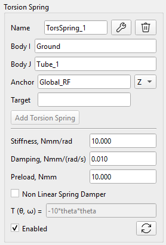
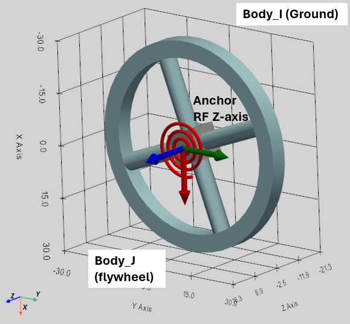
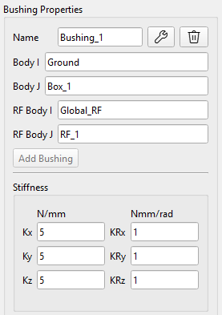
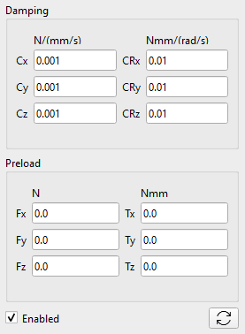

Раздел «Пружины» включает следующие компоненты:

-   Компрессионная пружина (Compression Spring), которая действует как поступательный пружинный амортизатор,
-   Торсионная пружина (Torsion Spring), которая действует как вращательный пружинный амортизатор,
-   Втулка (Bushing), действующая как гибкий соединительный элемент поступательного и вращательного движения.

## Компрессионная пружина (Compression Spring)

Пружина сжатия может быть задана между любыми двумя жёсткими телами и землёй в конкретных точках пространства, определённых выбором систем отсчёта.

Пружина одновременно действует на оба тела (Body_I, Body_J).

### Определение пружины сжатия

Пружина сжатия определяется следующими параметрами в пользовательском интерфейсе:

-   Body_I: первое Тело или земля,
-   Body_J: второе Тело или земля,
-   RF Body I: Система отсчёта как точка действия на Body_I,
-   RF Body J: Система отсчёта как точка действия на Body_J,
-   Stiffness (N/mm) - Жесткость пружины (k),
-   Damping (Ns/mm): коэффициент затухания (C),
-   Preload (N): предварительная натяжка или сжатие пружины: толкает при положительном значении и сжимает при отрицательном.

 

После того как пружина задана, параметры жесткости, затухания и предварительного натяга можно впоследствии изменить, однако связанные с ней независимые системы координат становятся недоступными для редактирования. В то же время при необходимости связанные пружиной тела Body_I или Body_J можно перемещать вместе с пружиной.

Между одними и теми же телами можно определить сразу несколько пружин.

### Расчёт силы пружины сжатия

Величина силы пружины сжатия рассчитывается следующим образом:

$$
F_{s p r i n g} = F_{p r e l o a d} - k \mathrm{\Delta} L - C \dot{L}
$$

$$
\mathrm{\Delta} L = L - L_{i n i t i a l}
$$

где:

$$L_{i n i t i a l}$$ — начальное расстояние между RF_Body_I и RF_Body_J в момент времени t=0,

$$L$$ — фактическое расстояние как величина вектора между RF_Body_I и RF_Body_J динамически вычисляемого решателем,

$$\mathrm{\Delta} L$$ — это деформация пружины,

$$\dot{L}$$ — относительная скорость точек присоединения пружины RF_Body_I и RF_Body_J,

Рассчитанная сила пружины ($$F_{s p r i n g}$$) прикладывается к телам Body_I и Body_J по принципу «действие — противодействие». Также прикладываются локальные моменты, определяемые как векторное произведение рычагов, проведенных от центров масс тел к точкам приложения силы пружины («RF Body I» и «RF Body J»).

### Специально заданная нелинейная пружина сжатия

Пользователь может задать нелинейную силу пружины F(x, v) в виде любой функции.

Используется следующий формат для определения силы пружины:

$$
F_{spring}=F_{preload}-F\left(x,v\right)
$$

где:
x = ΔL = L - L_initial (в мм; положительное значение соответствует растяжению пружины).

v = d(ΔL)/dt (скорость деформации в мм/с).

Функция F(x, v) должна возвращать значение в ньютонах (Н).

Пример: для моделирования линейной жесткости K и демпфирования C следует ввести:

 -K\*x - C\*v.

Допускается использование префикса «np.» для вызова любых стандартных математических функций библиотеки NumPy, например:

np.cosh(x), np.sign(v) и т. д.

В программе также поддерживаются следующие пользовательские функции:

Функция STEP обеспечивает плавный переход между двумя заданными значениями.

Синтаксис: step(x; x0; F0; x1; F1)

Функция IF:

Синтаксис: if(\<условие\>; \<значение если меньше или равно 0\>; \<значение если больше 0\>).

## Торсионная пружина (Torsion Spring)

Торсионная пружина может быть задана между любыми двумя жёсткими телами (или землёй) в конкретной точке вдоль определённого направления.

Торсионная пружина одновременно добавляет пару крутящих моментов «действия-реакцию» к двум телам (Body_I, Body_J).

### Определение торсионной пружины

Торсионная пружина определяется следующими параметрами в пользовательском интерфейсе:

-   Body_I: первое Тело или Земля,
-   Body_J: второе Тело или Земля,
-   Anchor: система координат пружины,
-   XYZ-выпадающее меню: ось систеиы координат Anchor RF. Она определяет ось крутящего момента пружины и учитывается только, если система координат Target не определена.
-   Target: эта система отсчёта определяет направление крутящего момента пружины как ось между системами отсчёта Anchor и Target. Выпадающее меню XYZ игнорируется, если задана система координат Target.
-   Stiffness (Nmm/rad): Жёсткость пружины (k),
-   Damping (Nmms/ rad): коэффициент затухания (C),
-   Preload (Nmm): Начальная натяжка пружины.

Как видно из определения, после определения системы координат пружины Anchor существует два способа задания оси крутящего момента пружины:

1.  Если ось крутящего момента — одна из осей Anchor RF, то эту ось можно выбрать с помощью выпадающего меню XYZ;
2.  Если задана система координат Target RF, то ось крутящего момента соединит системы отсчёта Anchor и Target. В этом случае выпадающий список XYZ не рассматривается.

 

После того как пружина задана, параметры жесткости, затухания и предварительного натяга можно впоследствии изменить, однако связанные с ней независимые системы координат становятся недоступными для редактирования. В то же время при необходимости связанные пружиной тела Body_I или Body_J можно перемещать вместе с пружиной.

Можно определить несколько торсионных пружин между одними и теми же телами.

### Расчет крутящего момента для торсионной пружины

Действие торсионной пружины ограничено вращением вокруг главной оси, определяемой системами отсчета «Опора» (Anchor) и (опционально) «Цель» (Target). Величина крутящего момента торсионной пружины рассчитывается следующим образом:

$$
T_{s p r i n g} = T_{p r e l o a d} - k \mathrm{\Delta} \theta - C \dot{\theta}
$$

где:

$$\mathrm{\Delta} \theta$$ — деформация пружины, рассчитанная как относительное вращение Body_I и Body_J вдоль оси крутящего момента,

$$\dot{\theta}$$ — относительная угловая скорость Body_I и Body_J вдоль оси крутящего момента.

Рассчитанная величина крутящего момента пружины ($$T_{s p r i n g}$$) применяется как момент действия и реакции к Body_I и Body_J.

### Специально заданная нелинейная торсионная пружина

Пользователь может задать нелинейный крутящий момент пружины T(theta, omega) в виде любой функции.

Используется следующий формат для определения силы пружины:

$$
T_{spring}=T_{preload}-T\left(\theta,\omega\right),
$$

где:

theta — угол закручивания относительно начального угла (в радианах);

omega = d(theta)/dt — угловая скорость деформации (в рад/с).

Значение T(theta, omega) должно быть выражено в Н·мм.

Пример: для моделирования линейной жесткости K и демпфирования C следует ввести выражение: 

-K\*theta - C\*omega

Допускается использование префикса «np.» для вызова любых стандартных математических функций библиотеки NumPy, например:

np.cosh(x), np.sign(v) и т. д.

В программе также поддерживаются следующие пользовательские функции:

Функция STEP обеспечивает плавный переход между двумя заданными значениями.

Синтаксис: step(x; x0; F0; x1; F1)

Функция IF:

Синтаксис: if(\<условие\>; \<значение если меньше или равно 0\>; \<значение если больше 0\>).

## Втулка (Bushing)

Втулка (Bushing) — это обобщенный податливый элемент, который создает поступательные и вращательные силы упругости и демпфирования по всем 6 степеням свободы.

Математически он работает исключительно в локальной системе координат своей опорной системы отсчета (RF Body_I). Элемент Bushing действует как три пружины сжатия и три торсионные пружины, приложенные к одной точке.

### Определение втулки

Втулка — это податливое соединение с 6 степенями свободы (пружина-демпфер) между двумя Телами (Bodies). В пользовательском интерфейсе оно определяется следующими параметрами:

* Body_I: первое взаимодействующее Тело (Body) или Земля (Ground). Body_I несет на себе систему координат втулки (RF Body I).
* Body_J: второе взаимодействующее Тело или Земля. Сила и крутящий момент втулки действуют на Body_J; реакция действует на Body_I.
* RF Body I (обязательно): глобальная система отсчета (Reference Frame), определяющая положение втулки на Body_I (точка привязки/анкерная точка) и ориентацию осей втулки X, Y, Z. Жесткость, демпфирование и предварительный натяг действуют вдоль этих осей. Оси жестко привязаны к Body_I: они перемещаются и вращаются вместе с Body_I. Можно использовать любую систему отсчета (например, глобальную (Global RF) или систему отсчета центра тяжести (CoG RF)).
* RF Body J (необязательно): глобальная система отсчета, определяющая точку привязки на Body_J. Если оставить поле пустым, точка привязки на Body_J размещается точно в положении и ориентации RF Body I.
* Жесткость (Stiffness) Kx, Ky, Kz (Н/мм): поступательная жесткость вдоль осей RF Body I.
* Жесткость (Stiffness) KRx, KRy, KRz (Н·мм/рад): вращательная жесткость вокруг осей RF Body I.
* Демпфирование (Damping) Cx, Cy, Cz (Н/(мм/с)): поступательное демпфирование.
* Демпфирование (Damping) CRx, CRy, CRz (Н·мм/(рад/с)): вращательное демпфирование.
* Предварительный натяг (Preload) Fx, Fy, Fz (Н): постоянная начальная сила вдоль осей RF Body I, действующая на Body_J в том числе при нулевой деформации.
* Предварительный натяг (Preload) Tx, Ty, Tz (Н·мм): постоянный начальный крутящий момент вокруг осей RF Body I.

 

**Эталонная (ненагруженная) конфигурация** 

Деформация измеряется от начальной конфигурации модели, то есть от положения тел в начале симуляции (t = 0). В этот момент деформации равны нулю и действует только предварительный натяг. Поэтому RF Body I и RF Body J не обязательно должны совпадать: начальное смещение между точками привязки или различная ориентация двух систем отсчета не является деформацией и не создает силы. RF Body J определяет только положение точки привязки на Body_J, к которой прикладывается сила; ее ориентация не влияет на результаты.

### Расчет сил реакций и крутящих моментов втулки

Втулка (также известная как пружина-демпфер с 6 степенями свободы) по сути представляет собой 3 независимые пружины сжатия и 3 независимые торсионные пружины, объединенные в один элемент. Они действуют вдоль и вокруг осей X, Y и Z системы RF Body I. Поскольку RF Body I привязана к Body_I, эти оси следуют за Body_I, а не за Body_J. Если Body_I — Земля (Ground), они фиксируются в глобальной системе отсчета (Global RF).

**Обозначения** (k = I, J; нижний индекс 0 = значение при t = 0):

| Символ | Значение |
| --- | --- |
| $\mathbf r_k$, $\mathbf v_k$ | положение и скорость центра тяжести Тела (в Global RF) |
| $\mathbf A_k$ | матрица вращения Тела (главные оси в Global RF) |
| $\boldsymbol\omega_k$, $\boldsymbol\omega_k^{glob}=\mathbf A_k\boldsymbol\omega_k$ | угловая скорость в локальной системе координат тела и в глобальной системе координат |
| $\mathbf s_k=\mathbf A_k\bar{\mathbf s}_k$ | вектор от центра тяжести до точки привязки ($\bar{\mathbf s}_k$ постоянна в локальной системе координат тела) |
| $\mathbf p_k=\mathbf r_k+\mathbf s_k$ | положение точки привязки |
| $\mathbf E_k=\mathbf A_k\bar{\mathbf E}_k$ | матрица вращения системы RF Body k в глобальной системе отсчета ($\bar{\mathbf E}_k$ постоянна; для k = J это RF Body I, если RF Body J не задана) |
| $\mathbf d=\mathbf p_J-\mathbf p_I$ | вектор между точками привязки |
| $\Delta\mathbf x$, $\Delta\boldsymbol\theta$ | Относительное положение и ориентация Body_J относительно Body_I |
| $\mathbf v_{rel}$, $\boldsymbol\omega_{rel}$ | Относительные поступательные и вращательные скорости тела Body_J относительно тела Body_I |
| $R_Δ$ | матрица вращения 3×3, содержащая вращение Body_J относительно RF Body I с момента t = 0, выраженная в осях RF Body I. Является единичной матрицей при отсутствии относительного вращения. |
| $tr(R_Δ)$ | след R_Δ, т.е. сумма ее диагональных элементов (R₁₁ + R₂₂ + R₃₃). Для вращения на угол α, tr(R_Δ) = 1 + 2 cos α. Это соотношение используется для восстановления угла. |
| $α$ | угол вращения R_Δ в радианах, от 0 до π, находится из α = arccos((tr(R_Δ) − 1)/2). Он равен длине вектора вращения, |Δθ| = α. Ось вращения получается из разностей внедиагональных элементов (R₃₂ − R₂₃, …), которые равны 2 sin α, умноженному на единичный вектор оси. Следовательно, Δθ = α × единичный вектор оси. |

**Деформации** 

Относительное положение и ориентация точки привязки Body_J измеряются в движущихся осях RF Body I и отсчитываются от t = 0:

$$\Delta\mathbf x=\mathbf E_I^{\top}\mathbf d-\mathbf E_{I,0}^{\top}\mathbf d_0$$

$$\mathbf R_\Delta=\left(\mathbf E_I^{\top}\mathbf E_J\right)\left(\mathbf E_{I,0}^{\top}\mathbf E_{J,0}\right)^{\top},\qquad \alpha=\arccos\frac{\operatorname{tr}(\mathbf R_\Delta)-1}{2}$$

$$\Delta\boldsymbol\theta=\frac{\alpha}{2\sin\alpha}\begin{bmatrix}R_{\Delta,32}-R_{\Delta,23}\\ R_{\Delta,13}-R_{\Delta,31}\\ R_{\Delta,21}-R_{\Delta,12}\end{bmatrix}$$

$\Delta\boldsymbol\theta$ — вектор вращения (ось × угол) матрицы $\mathbf R_\Delta$, действительный для $\vert{}\Delta\boldsymbol\theta\vert{}<180^\circ$. Для малых углов он примерно равен половине вектора в квадратных скобках.

**Скорости** 

RF Body I вращается вместе с Body_I, поэтому ее вращение вычитается из скорости точки привязки:

$$\mathbf v_{P,k}=\mathbf v_k+\boldsymbol\omega_k^{glob}\times\mathbf s_k,$$

$$\qquad \mathbf v_{rel}=\mathbf E_I^{\top}\left(\mathbf v_{P,J}-\mathbf v_{P,I}-\boldsymbol\omega_I^{glob}\times\mathbf d\right),$$

$$\qquad \boldsymbol\omega_{rel}=\mathbf E_I^{\top}\left(\boldsymbol\omega_J^{glob}-\boldsymbol\omega_I^{glob}\right)$$

$\mathbf v_{rel}$ — производная по времени от $\Delta\mathbf x$. Если оба Тела движутся как единое твердое тело, все четыре величины $\Delta\mathbf x$, $\Delta\boldsymbol\theta$, $\mathbf v_{rel}$, $\boldsymbol\omega_{rel}$ равны нулю, и втулка не создает силы (включая демпфирование).

**Силы и крутящие моменты**

Стандартные уравнения пружины-демпфера, компоненты вдоль осей RF Body I:

$$\mathbf F_{loc}=-\mathbf K_{trans}\Delta\mathbf x-\mathbf C_{trans}\mathbf v_{rel}+\mathbf F_{preload}$$

$$\mathbf T_{loc}=-\mathbf K_{rot}\Delta\boldsymbol\theta-\mathbf C_{rot}\boldsymbol\omega_{rel}+\mathbf T_{preload}$$

где $\mathbf K_{trans}=\mathrm{diag}(K_x,K_y,K_z)$, $\mathbf K_{rot}=\mathrm{diag}(K_{Rx},K_{Ry},K_{Rz})$ и аналогично для $\mathbf C$. 

$\mathbf F_{loc}$ и $\mathbf T_{loc}$ действуют на Body_J, причем сила приложена в его точке привязки. В глобальной системе отсчета:

$$\mathbf F_{glob}=\mathbf E_I\mathbf F_{loc},$$

$$\qquad \mathbf T_{glob}=\mathbf E_I\mathbf T_{loc}$$

**Нагрузки, прикладываемые к Телам** 

Body_J получает $\mathbf F_{glob}$ и $\mathbf T_{glob}$. Body_I получает реакцию:

$$\mathbf F_{glob,J}=\mathbf F_{glob},$$

$$\quad \mathbf T_{glob,J}=\mathbf T_{glob},$$

$$\qquad \mathbf F_{glob,I}=-\mathbf F_{glob},$$

$$\quad \mathbf T_{glob,I}=-\mathbf T_{glob}-\mathbf d\times\mathbf F_{glob}$$

Слагаемое $\mathbf d\times\mathbf F_{glob}$ переносит момент силы между двумя точками привязки. Каждая сила действует в своей собственной точке привязки на расстоянии $\mathbf s_k$ от центра тяжести Тела (CoG), поэтому она создает дополнительный крутящий момент на каждом Теле. Суммарный крутящий момент относительно центра тяжести равен:

$$\mathbf T_{total,I}=\mathbf T_{glob,I}+\mathbf s_I\times\mathbf F_{glob,I},$$

$$\qquad \mathbf T_{total,J}=\mathbf T_{glob,J}+\mathbf s_J\times\mathbf F_{glob,J}$$

**Свойства**

- Нагрузки на Body_I и Body_J равны и противоположны, а их суммарный момент относительно любой точки равен нулю: втулка сохраняет линейный и угловой моменты.
- Накопленная упругая энергия и рассеиваемая мощность равны:

$$U_{el}=\tfrac12\Delta\mathbf x^{\top}\mathbf K_{trans}\Delta\mathbf x+\tfrac12\Delta\boldsymbol\theta^{\top}\mathbf K_{rot}\Delta\boldsymbol\theta,$$

$$\qquad P_d=\mathbf v_{rel}^{\top}\mathbf C_{trans}\mathbf v_{rel}+\boldsymbol\omega_{rel}^{\top}\mathbf C_{rot}\boldsymbol\omega_{rel}\ \ge 0$$

Выражение для $U_{el}$ является точным для изотропной вращательной жесткости (KRx = KRy = KRz). Для различных значений оно является приближенным, и ошибка растет с увеличением угла поворота, как и в других моделях втулок с 6 степенями свободы.

**Результаты** 

Данные телеметрии и CSV выдаются в единицах СИ (м, рад, Н, Н·м) и вдоль осей RF Body I:

* Отклонение (Deflection) X, Y, Z = $\Delta\mathbf x$
* Вращение (Rotation) X, Y, Z = $\Delta\boldsymbol\theta$
* Сила (Force) X, Y, Z = $\mathbf F_{loc}$
* Крутящий момент (Torque) X, Y, Z = $\mathbf T_{loc}$

Это нагрузки, действующие на Body_J; реакция на Body_I вытекает из уравнений выше.

**Примечания**

* Порядок Тел имеет значение: оси принадлежат Body_I. Если поменять местами Body_I и Body_J, оси переместятся на другое Тело.
* Если Земля (Ground) выбрана в качестве Body_J, точка привязки на Земле фиксируется в пространстве, а нагрузка на Землю игнорируется; оси по-прежнему следуют за Body_I.
* Жесткая втулка на малой массе или моменте инерции требует малого шага по времени. При использовании метода Рунге-Кутты (RK4) поддерживайте $\omega_{max}\Delta t\lesssim 0.2$, где $\omega_{max}=\sqrt{K/m}$ для поступательного движения и $\sqrt{(K_R+K s^2)/J}$ для вращательного (член $K s^2$ появляется, когда точка привязки смещена от центра тяжести).
