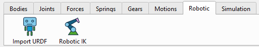
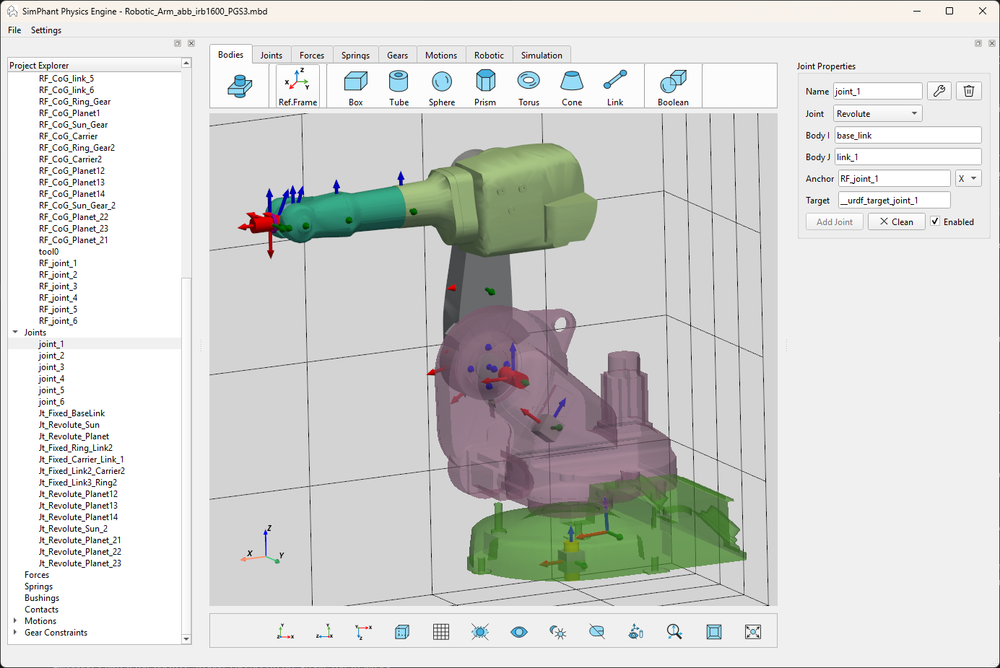
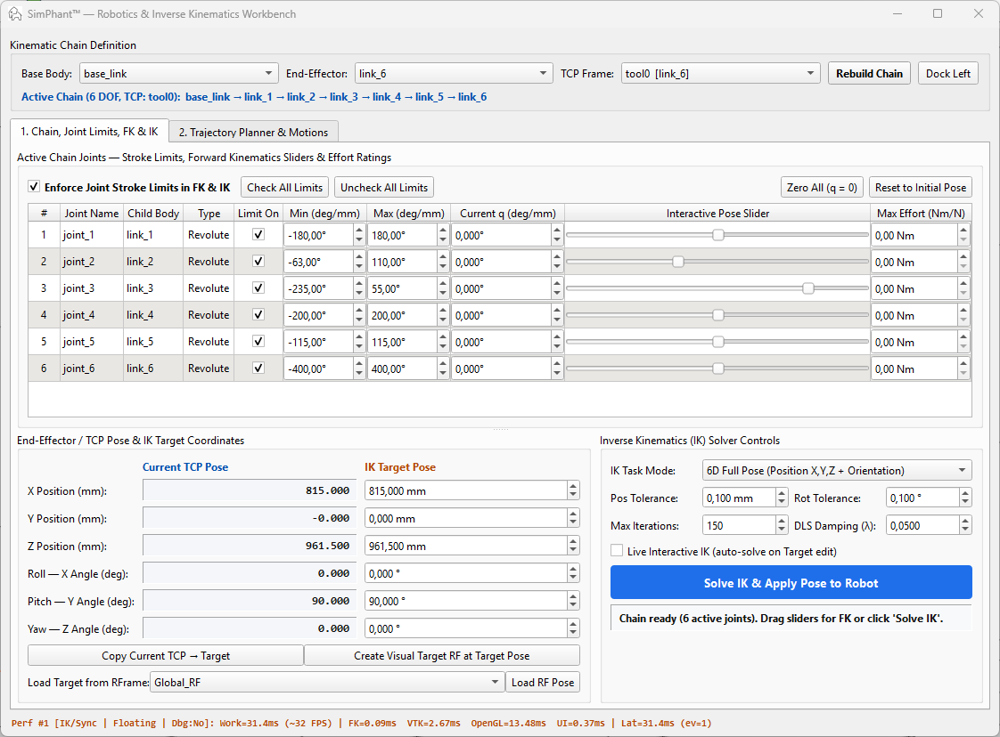
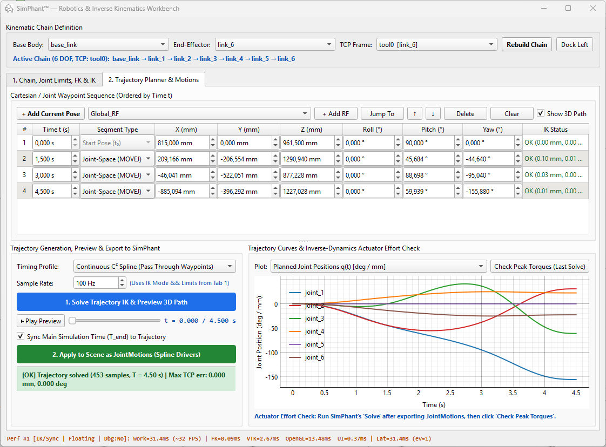
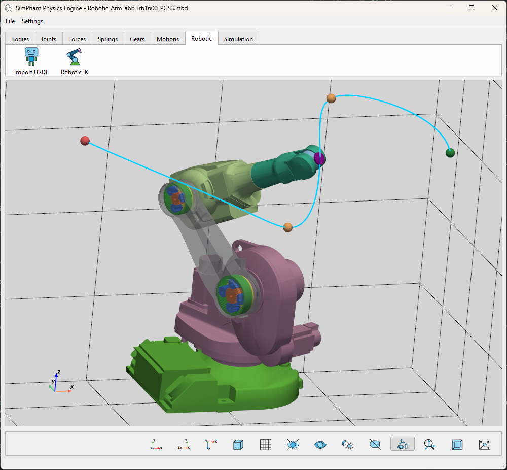
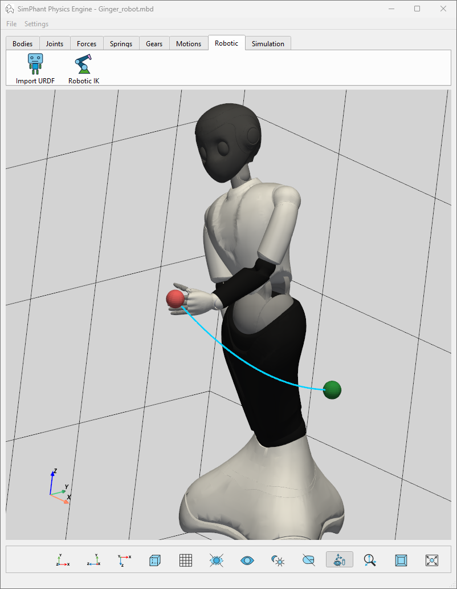

# Робоче середовище робототехніки та оберненої кінематики SimPhant

## 1. Вступ та основні терміни робототехніки

**Робоче середовище робототехніки та оберненої кінематики** (*Robotics & Inverse Kinematics Workbench*, яке відкривається кнопкою **`Robotic_IK`** поруч із кнопкою **`Import URDF`** на вкладці панелі інструментів **`Robotic`**) забезпечує повний цикл кінематичного та динамічного розрахунку шарнірних механізмів у двох взаємопов'язаних вкладках:

* **Вкладка 1 (`1. Chain, Joint Limits, FK & IK`):** Налаштування механічних обмежень ходу шарнірів і номінальних зусиль/моментів приводів, інтерактивне позиціювання механізму повзунками прямої кінематики в реальному часі, а також розв'язання задачі оберненої кінематики (6D / 5D / 3D) для будь-якого цільового положення та орієнтації.
* **Вкладка 2 (`2. Trajectory Planner & Motions`):** Побудова багатоточкових траєкторій у декартовому просторі та просторі узагальнених координат шарнірів, попередній 3D-перегляд траєкторії в реальному часі, експорт плавних сплайнових приводів руху **`JointMotion`** безпосередньо до динамічного розв'язувача SimPhant і перевірка пікових крутних моментів двигунів відносно їхніх допустимих паспортних значень.

Якщо ви лише знайомитеся з робототехнікою, нижче наведено основні поняття та скорочення, що використовуються в цьому інструменті:

* **Кінематичний ланцюг (*Kinematic Chain*):** Послідовність твердих тіл (*ланок*), з'єднаних одне за одним механічними *шарнірами* (з'єднаннями) — подібно до того, як плече, передпліччя та кисть людини з'єднані плечовим, ліктьовим і променево-зап'ястковим суглобами.
* **Базове тіло (*Base Body / Root Link*):** Початкова (коренева) ланка кінематичного ланцюга (наприклад, нерухома основа `base_link` промислового маніпулятора або таз `pelvis` / корпус `torso` антропоморфного робота). Під час кінематичного позиціювання базове тіло залишається нерухомим, а всі наступні ланки рухаються відносно нього.
* **Кінцева ланка / захват (*End-Effector, EE*):** Останнє тіло на кінці вибраного кінематичного ланцюга (наприклад, фланець зап'ястка робота, захватний пристрій, зварювальний пальник або стопа крокуючого робота).
* **TCP (*Tool Center Point* — центральна точка інструмента):** Спеціальна **система координат (`RFrame`)**, жорстко пов'язана з кінцевою ланкою (`End-Effector`), яка задає точну робочу точку та осі інструмента (наприклад, кінчик захвата або центр фланця, у промислових роботах зазвичай називається `tool0`). Якщо окрему систему координат TCP не вибрано, SimPhant використовує як TCP власну систему координат **центра мас (*Center of Gravity, CoG*)** кінцевої ланки.
* **DOF (*Degrees of Freedom* — ступені свободи):** Кількість незалежних рухомих узагальнених координат шарнірів ($q_1, q_2, \dots, q_N$) уздовж активного кінематичного ланцюга. Кожен **обертальний шарнір (`Revolute`)** додає 1 обертальний ступінь свободи (вимірюється в градусах, $^\circ$), а кожен **поступальний шарнір (`Prismatic`)** — 1 лінійний ступінь свободи (вимірюється в міліметрах, $\text{мм}$).
* **FK (*Forward Kinematics* — пряма задача кінематики):** *«Пряма»* задача: **за відомими кутами/переміщеннями в шарнірах** $(q_1, \dots, q_N)$ обчислити результуюче 3D-положення та орієнтацію кожної ланки робота і робочої точки інструмента TCP.
* **IK (*Inverse Kinematics* — обернена задача кінематики):** *«Обернена»* задача: **за заданим бажаним 3D-положенням та орієнтацією точки TCP** автоматично знайти такі кути/переміщення в шарнірах $(q_1, \dots, q_N)$, які приведуть TCP у цільову точку без порушення механічних обмежень ходу шарнірів.
* **Опорна точка траєкторії (*Waypoint*):** Ключова поза у 3D-просторі (положення + орієнтація) у парі з моментом часу прибуття $t_m$ уздовж запланованого руху — своєрідні просторово-часові контрольні точки, що визначають маршрут робота.
* **Планування траєкторії (*Trajectory Planning*):** Перетворення набору дискретних опорних точок на гладкі, неперервні функції узагальнених координат від часу $\mathbf{q}(t)$, завдяки яким робот плавно розганяється зі стану спокою, рухається без ривків і плавно гальмує без стрибків швидкості та нескінченних піків прискорення.
* **`MOVEL` та `MOVEJ` (типи сегментів руху):** Стандартні команди руху промислових роботів:
  * **`Linear TCP (MOVEL)`:** Переміщує точку TCP строго вздовж **прямої лінії у 3D-просторі** з плавним поворотом орієнтації інструмента. Незамінно для технологічних операцій: зварювання, різання, нанесення клею або точного складання/вставлення деталей.
  * **`Joint-Space (MOVEJ)`:** Плавна інтерполяція безпосередньо кутів/переміщень кожного шарніра від початкового до кінцевого значення. При цьому точка TCP описує природну криволінійну дугу в просторі, що забезпечує швидке переміщення між точками та дозволяє уникати кінематичних сингулярностей під час великих холостих переходів.
* **SLERP (*Spherical Linear Interpolation* — сферична лінійна інтерполяція):** Математичний метод на основі одиничних кватерніонів, який забезпечує плавний поворот 3D-системи координат уздовж найкоротшої дуги між двома орієнтаціями з контрольованою кутовою швидкістю, без ефекту «блокування карданового підвісу» (*gimbal lock*) кутів Ейлера та неприродного закручування інструмента.
* **Обернена задача динаміки (*Inverse Dynamics*) та зусилля/момент приводу ($\tau(t)$):** Коли розрахована кінематична траєкторія $\mathbf{q}(t)$ передається до динамічного розв'язувача багатотільних систем SimPhant (`MBSolver`), розв'язання **оберненої задачі динаміки** визначає точні фізичні **крутні моменти двигунів ($\text{Н·м}$)** або **зусилля лінійних приводів ($\text{Н}$)** у кожному шарнірі, необхідні для подолання сили тяжіння, просторової інерції ланок, коріолісових і відцентрових сил, пружних елементів (пружин/втулок), зовнішніх навантажень і контактних взаємодій.

---

## 2. Вимоги до моделі (до яких моделей SimPhant можна застосовувати цей інструмент?)

Робоче середовище робототехніки є **універсальним** — воно не вимагає спеціального формату файлів і однаково ефективно працює як із моделями роботів, імпортованими з **URDF** (наприклад, промисловими маніпуляторами ABB або антропоморфним роботом Unitree G1), так і з **користувацькими багатотільними механізмами**, створеними безпосередньо в SimPhant.

Для використання інструмента ваша модель у SimPhant має задовольняти такі вимоги:

1. **Щонайменше два активні тверді тіла:**
   Сцена повинна містити принаймні два увімкнені (`enabled`), не пов'язані із «Землею» (`Ground`) компоненти `RigidBody`: одне тіло відіграє роль **базової ланки (`Base Body`)**, а інше — роль **кінцевої ланки (`End-Effector Body`)**.
2. **Неперервний ланцюг підтримуваних з'єднань (шарнірів):**
   Між базовою та кінцевою ланкою має існувати неперервний шлях з активних з'єднань. Уздовж кінематичного ланцюга підтримуються такі типи з'єднань:
   * **Обертальне з'єднання (`JointType.REVOLUTE`):** 1 обертальний ступінь свободи навколо локальної осі $Z$ шарніра.
   * **Поступальне з'єднання (`JointType.PRISMATIC`):** 1 поступальний ступінь свободи вздовж локальної осі $Z$ шарніра.
   * **Фіксоване з'єднання (`JointType.FIXED`):** 0 ступенів свободи (жорстко скріплює два тіла між собою; зручно, коли між рухомими ланками встановлено датчики, фланці або перехідні плити).
   *(Примітка: з'єднання з кількома ступенями свободи — сферичні `Spherical`, циліндричні `Cylindrical` та плоскі `Planar` — не можуть входити до активного послідовного ланцюга оберненої кінематики.)*
3. **Деревоподібна / послідовна топологія вздовж активного шляху:**
   Шлях між вибраним базовим тілом і кінцевою ланкою має утворювати єдиний послідовний ланцюг (без замкнених чотириланкових контурів уздовж самого активного шляху).
   * **Розгалужені роботи (гуманоїди та дворукі системи) повністю підтримуються:** Якщо ваша модель є розгалуженим деревом (наприклад, гуманоїд, у якого ліва рука, права рука, голова та ноги відгалужуються від корпусу/таза), достатньо вибрати **базове тіло** (наприклад, `pelvis`) і **кінцеву ланку** потрібної кінцівки (наприклад, `right_hand`). SimPhant автоматично знаходить усі **бічні піддерева** (наприклад, ліву руку та голову, прикріплені до рухомого корпусу) і переміщує їх як єдине ціле разом із батьківською ланкою, щоб жодне з'єднання не розривалося.
4. **Рекомендована кількість ступенів свободи (DOF) для задач оберненої кінематики:**
   * **Повна 6D-поза (`6D Full Pose` — 3D-положення + 3D-орієнтація):** Потребує щонайменше **6 ступенів свободи** (наприклад, 6-осьовий промисловий робот) для досягнення довільних положень та орієнтацій у просторі.
   * **5D-задача (`5D Position + Tool Z-Axis Alignment` — положення + вирівнювання осі Z інструмента):** Потребує щонайменше **5 ступенів свободи** (зручно для вісесиметричних інструментів — свердел, шпинделів, лазерних головок, де обертання навколо власної осі $Z$ інструмента не має значення).
   * **3D-позиціювання (`3D Position Only` — лише координати X, Y, Z):** Працює на ланцюгах із **3 і більше ступенями свободи** (а також з 1–2 DOF, якщо ціль лежить у межах робочої площини/дуги механізму).
   * **Кінематично надлишкові ланцюги ($N_{\text{dof}} > 6$):** Повністю підтримуються (наприклад, 7-осьові маніпулятори або ланцюг «корпус + рука»); розв'язувач використовує додаткові ступені свободи для утримання шарнірів ближче до середини їхнього робочого діапазону, подалі від механічних упорів.
5. **Закріплення базової ланки (`Base Body`) на «Землі» (`Ground`) для динамічного розрахунку (`MBSolver`):**
   Під час чисто кінематичного позиціювання та попереднього перегляду траєкторії всередині вікна `RoboticsWindow` **базова ланка** (наприклад, `base_link`) утримується нерухомою автоматично. Однак перед запуском динамічного розрахунку SimPhant кнопкою **`Solve`** зі згенерованими сплайновими приводами **`JointMotion`** (особливо після свіжого імпорту файлу `.urdf`) **базове тіло (`base_link`) обов'язково має бути жорстко зв'язане з тілом `Ground` активним фіксованим з'єднанням (`Fixed Joint`)**. Інакше весь робот залишиться незакріпленим у просторі й почне вільно падати під дією сили тяжіння під час динамічного моделювання.

---

## 3. Опис інтерфейсу користувача (`RoboticsWindow`)

Після натискання кнопки **`Robotic_IK`** на верхній вкладці **`Robotic`** відкривається вікно **SimPhant™ — Robotics & Inverse Kinematics Workbench**. Воно складається зі **спільної верхньої панелі вибору кінематичного ланцюга**, **двох основних робочих вкладок** (`1. Chain, Joint Limits, FK & IK` та `2. Trajectory Planner & Motions`) і **рядка телеметрії продуктивності** в нижній частині вікна:

---

### 3.1 Спільна верхня панель: визначення кінематичного ланцюга

Ця панель визначає, яка саме частина вашої багатотільної моделі виступає як активний ланцюг робота одночасно для Вкладки 1 і Вкладки 2:

| Елемент інтерфейсу | Тип | Призначення та функції для користувача |
| :--- | :---: | :--- |
| **`Base Body`** | Розкривний список (`QComboBox`) | Вибирає початкове (базове) тіло кінематичного ланцюга (наприклад, `base_link` у маніпулятора або `pelvis` у гуманоїда). Це тіло залишається нерухомим у просторі під час позиціювання ланцюга. Під час відкриття вікна SimPhant автоматично вибирає кореневу ланку моделі. |
| **`End-Effector`** | Розкривний список (`QComboBox`) | Вибирає кінцеву ланку ланцюга, якою ви хочете керувати (наприклад, `link_6`, `right_hand` або `left_ankle_roll_link`). За замовчуванням автоматично вибирається найбільш віддалена кінцева ланка моделі. |
| **`TCP Frame`** | Розкривний список (`QComboBox`) | Вибирає систему координат (`RFrame`), яка представляє **центральну точку інструмента (TCP)** для відстеження та розрахунку IK. Якщо на кінцевій ланці наявна інструментальна СК (наприклад, `tool0`), вона підставляється автоматично. Також можна вибрати `<End-Effector CoG>` для керування безпосередньо центром мас кінцевого тіла або будь-яку іншу користувацьку СК сцени. |
| **`Rebuild Chain`** | Кнопка (`QPushButton`) | Повторно сканує тіла, з'єднання та системи координат сцени для перебудови кінематичного ланцюга (корисно, якщо ви додали, увімкнули чи вимкнули шарніри або СК у головному вікні SimPhant при відкритому вікні робототехніки). |
| **`Dock Left` / `Float Window`** | Кнопка (`QPushButton`) | Перемикає вікно робочого середовища між режимом закріпленої панелі ліворуч у головному вікні SimPhant (`Dock Left`) і незалежним плаваючим вікном змінного розміру (`Float Window`). |
| **Інформаційний рядок `Active Chain (...)`** | Текстовий індикатор (`QLabel`) | Відображає зведення знайденого ланцюга з автоматичним перенесенням рядків: загальну кількість рухомих ступенів свободи (`DOF`), назву активної точки TCP та повну послідовність ланок від бази до захвата (`base_link → link_1 → ... → link_6`). Якщо допустимий шлях між вибраними тілами відсутній, виводиться пояснювальне попередження. |

---

### 3.2 Вкладка 1 — Верхня панель: Шарніри активного ланцюга — обмеження ходу, повзунки прямої кінематики та номінальні зусилля

Ця панель являє собою зведену інтерактивну таблицю всіх рухомих шарнірів активного ланцюга, що дозволяє переглядати й редагувати обмеження шарнірів, а також задавати позу робота методом прямої кінематики (FK):

#### Панель керування над таблицею шарнірів
* **`Enforce Joint Stroke Limits in FK & IK` (Прапорець):**
  Головний перемикач урахування обмежень ходу шарнірів. Коли прапорець встановлено (за замовчуванням), як інтерактивні повзунки/поля введення FK, так і розв'язувач IK строго утримують кожен обмежений шарнір у межах його діапазону `[Min, Max]`. Зніміть прапорець, якщо потрібно протестувати математичний розв'язок без обмежень ходу.
* **`Check All Limits` / `Uncheck All Limits` (Кнопки):**
  Швидко вмикають або вимикають індивідуальні прапорці `Limit On` одразу для всіх шарнірів ланцюга.
* **`Zero All (q = 0)` (Кнопка):**
  Встановлює всі узагальнені координати шарнірів активного ланцюга в нульове положення $q = 0$ (з урахуванням активних обмежень `[Min, Max]`, якщо `0` виходить за межі допустимого діапазону) і миттєво оновлює 3D-модель робота.
* **`Reset to Initial Pose` (Кнопка):**
  Повертає всі тіла та системи координат сцени точно в те положення, яке вони займали в момент ініціалізації ланцюга.

#### Стовпці таблиці шарнірів (`tblJoints`)
Кожен рядок таблиці відповідає одному рухомому шарніру (у порядку від базової ланки $\rightarrow$ до кінцевої ланки):

1. **`#`:** Порядковий номер ($1 \dots N_{\text{dof}}$) шарніра вздовж кінематичного ланцюга.
2. **`Joint Name`:** Назва компонента з'єднання `Joint` у SimPhant (наприклад, `joint_1` або `left_knee_joint`).
3. **`Child Body`:** Назва веденої ланки, яку приводить у рух цей шарнір.
4. **`Type`:** Тип шарніра: `Revolute` (обертальний, відображається в градусах `°`) або `Prismatic` (поступальний, відображається в міліметрах `mm`).
5. **`Limit On` (Прапорець):** Вмикає або вимикає обмеження ходу для цього конкретного шарніра. Для моделей, імпортованих з URDF, цей прапорець автоматично вмикається та заповнюється з тегу `<limit>`.
6. **`Min (deg/mm)` (Редаговане числове поле `SpinBox`):** Нижня механічна межа ходу шарніра ($q_{\min}$). Зміна цього значення одразу оновлює діапазон інтерактивного повзунка та зберігається у файлі проєкту `.mbd`.
7. **`Max (deg/mm)` (Редаговане числове поле `SpinBox`):** Верхня механічна межа ходу шарніра ($q_{\max}$).
8. **`Current q (deg/mm)` (Редаговане числове поле `SpinBox`):** Відображає та дозволяє точно ввести поточний кут ($^\circ$) або лінійне зміщення ($\text{мм}$) шарніра. Введення значення миттєво переміщує 3D-модель робота за допомогою прямої кінематики. *(Якщо під час розв'язання задачі IK шарнір впирається у свою механічну межу, це поле підсвічується жовто-бурштиновим кольором, наочно показуючи насичення шарніра.)*
9. **`Interactive Pose Slider` (Повзунок `QSlider`):** Перетягування повзунка плавно обертає або переміщує ланку в реальному часі у 3D-вікні з безперервним оновленням координат **Current TCP Pose** нижче.
10. **`Max Effort (Nm/N)` (Редаговане числове поле `SpinBox`):** Зберігає паспортний максимальний крутний момент ($\text{Н·м}$ для обертального шарніра) або зусилля ($\text{Н}$ для поступального шарніра) двигуна приводу (автоматично імпортується з атрибута URDF `<limit effort="..."/>` і зберігається у файлах `.mbd` для перевірки навантажувальної здатності приводів).

---

### 3.3 Вкладка 1 — Нижня ліва панель: Поточна поза TCP та цільові координати оберненої кінематики

Ця здвоєна панель дозволяє порівняти, де робоча точка TCP знаходиться **зараз**, і куди ви **хочете її перемістити**:

* **Стовпець `Current TCP Pose` (Поля лише для читання):**
  Відображає в реальному часі глобальне положення та орієнтацію вибраної системи координат TCP під час переміщення повзунків FK або розрахунку IK:
  * **`X Position (mm)` / `Y Position (mm)` / `Z Position (mm)`:** Глобальні декартові координати в міліметрах.
  * **`Roll — X Angle (deg)` / `Pitch — Y Angle (deg)` / `Yaw — Z Angle (deg)`:** Глобальні зовнішні кути Ейлера в градусах (що повністю відповідають угоді про кути `RFrame` у SimPhant).
* **Стовпець `IK Target Pose` (Редаговані поля `SpinBox`):**
  Задає бажані глобальні координати цілі (`X, Y, Z` у $\text{мм}$ та кути `Roll, Pitch, Yaw` у градусах), у які розв'язувач IK повинен привести точку TCP.
* **`Copy Current TCP → Target` (Кнопка):**
  Копіює всі 6 поточних координат TCP безпосередньо в поля `IK Target Pose`. Це найзручніший спосіб розпочати роботу: виставте наближену позу повзунками (або почніть із вихідного положення), натисніть **Copy Current TCP → Target**, а потім змініть потрібну координату `X`, `Y`, `Z` або кут на бажане зміщення (наприклад, $+100\text{ мм}$ уздовж осі $Z$).
* **`Create Visual Target RF at Target Pose` (Кнопка):**
  Створює наочну 3D-систему координат (`IK_Target_1`, `IK_Target_2`, ...) у 3D-вікні SimPhant та в дереві моделі точно за координатами, введеними в `IK Target Pose`. Це дозволяє візуально контролювати положення та трійку осей цілі у 3D до та після розрахунку IK.
* **`Load Target from RFrame` (Розкривний список + кнопка `Load RF Pose`):**
  Дозволяє вибрати будь-яку наявну систему координат (`RFrame`) у сцені SimPhant і одним натисканням завантажити її 3D-положення та орієнтацію в поля `IK Target Pose`.

---

### 3.4 Вкладка 1 — Нижня права панель: Керування розв'язувачем оберненої кінематики (IK)

Ця панель налаштовує параметри чисельного розв'язувача оберненої кінематики:

* **`IK Task Mode` (Розкривний список режиму задачі IK):**
  Визначає, які саме координати точки TCP утримуються розв'язувачем IK:
  1. **`6D Full Pose (Position X,Y,Z + Orientation)`:** Суміщає як 3D-положення $(X, Y, Z)$, так і повну 3D-орієнтацію $(\text{Roll, Pitch, Yaw})$ із цільовою позою. Оптимальний режим для 6- та 7-осьових маніпуляторів.
  2. **`3D Position Only (X, Y, Z — Free Orientation)`:** Поміщає точку TCP у цільові координати $(X, Y, Z)$ без обмеження орієнтації інструмента (поля кутів Roll/Pitch/Yaw при цьому блокуються). Ідеально підходить для механізмів із кількістю ступенів свободи менше ніж 6, задач точкового позиціювання або досягнення цілей поблизу межі робочої зони.
  3. **`5D Position + Tool Z-Axis Alignment`:** Суміщає 3D-положення $(X, Y, Z)$ та вирівнює синю стрілку **осі Z інструмента (TCP)** уздовж осі Z цілі, залишаючи обертання навколо самої осі Z вільним. Оптимально для вісесиметричних інструментів (шпинделів, свердел, циліндричних захватів, лазерних випромінювачів).
* **`Pos Tolerance` (Поле `mm`):**
  Максимально допустима похибка за положенням між TCP і ціллю, за якої розв'язок IK вважається збіжним (за замовчуванням: `0.100 mm`).
* **`Rot Tolerance` (Поле `°`):**
  Максимально допустима кутова похибка між орієнтацією TCP та цільовою орієнтацією (за замовчуванням: `0.100 °`).
* **`Max Iterations` (Числове поле):**
  Максимальна кількість ітерацій алгоритму Левенберга–Марквардта на одну спробу розрахунку (за замовчуванням: `150`).
* **`DLS Damping (λ)` (Числове поле):**
  Коефіцієнт демпфування сингулярностей $\lambda$ (за замовчуванням: `0.0500`). Менші значення забезпечують швидші кроки ньютонівського типу подалі від особливих положень; більші значення роблять рух плавнішим і стійкішим поблизу меж робочої зони.
* **`Live Interactive IK` (Прапорець):**
  Коли прапорець увімкнено, розв'язувач IK запускається **автоматично в реальному часі** під час кожної зміни будь-якого поля `IK Target Pose` (`X, Y, Z, Roll, Pitch, Yaw`), дозволяючи плавно «вести» інструмент робота в декартових координатах і одразу спостерігати перебудову всього кінематичного ланцюга.
* **`Solve IK & Apply Pose to Robot` (Синя кнопка запуску):**
  Виконує розрахунок оберненої кінематики для поточних значень `IK Target Pose`, оновлює всі кути/переміщення шарнірів у таблиці та перебудовує 3D-модель робота у вікні перегляду.
* **Індикатор статусу розв'язку (під кнопкою розрахунку):**
  Відображає результат роботи розв'язувача:
  * **Зелена панель (`[OK] IK Converged...`):** Показує витрачену кількість ітерацій та підсумкову досягнуту похибку положення ($\text{мм}$) і орієнтації ($\text{град}$).
  * **Жовто-бурштинова попереджувальна панель (`[WARN] Target not fully reached...`):** Указує, що цільова точка знаходиться за межами досяжної робочої зони робота або недосяжна через обмеження ходу шарнірів. Робот переміщується в найближчу фізично реалізовну позу, виводиться перелік шарнірів, які досягли упору (`Limit reached: ...`), а відповідні комірки в таблиці підсвічуються.

---

### 3.5 Вкладка 2 — Верхня панель: Послідовність опорних точок траєкторії (`tblWaypoints`)

Перехід на вкладку **`2. Trajectory Planner & Motions`** перетворює статичний розв'язувач IK із Вкладки 1 на генератор руху в часі. Верхня панель задає впорядковану послідовність **опорних точок (*Waypoints*)**, через які має пройти точка TCP робота у визначені моменти часу.

#### Кнопки керування опорними точками (над таблицею)
* **`+ Add Current Pose` (Кнопка):**
  Зчитує поточне 3D-положення та орієнтацію точки TCP робота у вікні перегляду й додає їх новим рядком до таблиці опорних точок. Першій точці за замовчуванням присвоюється час $t = 0.000\text{ с}$, а кожній наступній — автоматичний приріст $+1.5\text{ с}$ (усі значення часу можна вільно редагувати).
* **Розкривний список СК сцени (`QComboBox`) + кнопка `+ Add RF`:**
  Дозволяє вибрати будь-яку наявну систему координат `RFrame` у сцені SimPhant (наприклад, `IK_Target_1`, `IK_Target_2`, створені на Вкладці 1, або імпортовані цільові СК із CAD) та одним натисканням додати її точне 3D-положення й орієнтацію як нову точку траєкторії.
* **`Jump To` (Кнопка):**
  Розв'язує задачу IK для виділеного в таблиці рядка й миттєво переміщує 3D-робота в цю опорну точку, дозволяючи заздалегідь перевірити досяжність, конфігурацію ланок та відсутність геометричних перетинів до розрахунку всієї траєкторії.
* **`↑` / `↓` (Кнопки зміни порядку):**
  Переміщують вибрану опорну точку раніше або пізніше за маршрутом, зберігаючи монотонний порядок часових міток зверху вниз у таблиці.
* **`Delete` (Кнопка):**
  Видаляє вибраний рядок опорної точки з таблиці.
* **`Clear` (Кнопка):**
  Повністю очищує таблицю опорних точок і видаляє 3D-лінію попереднього перегляду траєкторії та маркери з вікна перегляду.
* **`Show 3D Path` (Прапорець):**
  Коли прапорець встановлено (за замовчуванням), у 3D-вікні SimPhant відображаються розрахована просторова крива руху TCP (блакитна лінія) та маркери опорних точок (помаранчеві 3D-сфери).

#### Стовпці таблиці опорних точок (`tblWaypoints`)
Кожен рядок задає одну прив'язану до часу цільову позу вздовж маршруту робота:

1. **`#`:** Порядковий номер опорної точки ($1 \dots M$).
2. **`Time t (s)` (Редаговане поле `SpinBox`):** Точний момент часу (в секундах), коли точка TCP має прибути в дану опорну точку. Час повинен строго зростати зверху вниз ($t_1 < t_2 < \dots < t_M$).
3. **`Segment Type` (Розкривний список):** Задає закон інтерполяції під час руху *від попередньої опорної точки до цієї*:
   * **Рядок 1 (`Start Pose (t₀)`):** Позначає початкову позу користувацької послідовності точок.
   * **`Linear TCP (MOVEL)`:** Веде точку TCP строго вздовж **прямої лінії у 3D** в декартовому просторі з плавним поворотом орієнтації інструмента методом кватерніонної інтерполяції **SLERP**. Оптимально для робочих технологічних проходів (зварювання, різання, підведення/вставлення деталі).
   * **`Joint-Space (MOVEJ)`:** Розв'язує IK у кінцевій точці сегмента та плавно інтерполює рух безпосередньо в **узагальнених координатах шарнірів**. Оптимально для швидких і вільних від сингулярностей переходів у вільному просторі. У межах однієї траєкторії можна вільно комбінувати сегменти `MOVEL` та `MOVEJ` (при виборі профілю `Quintic Rest-to-Rest`).
4. **`X (mm)`, `Y (mm)`, `Z (mm)` (Редаговані поля `SpinBox`):** Глобальні декартові координати опорної точки в міліметрах. Редагування будь-якої координати миттєво переміщує відповідну 3D-сферу у вікні перегляду.
5. **`Roll (°)`, `Pitch (°)`, `Yaw (°)` (Редаговані поля `SpinBox`):** Глобальні зовнішні кути Ейлера опорної точки в градусах (відповідно до угоди `RFrame` програми SimPhant).
6. **`IK Status` (Комірка статусу лише для читання):** До розрахунку відображає `Pending`, а після розрахунку траєкторії показує зелений статус **`OK (err mm)`**, якщо точку досягнуто в межах допуску, або бурштиновий статус **`WARN (err mm)`**, якщо точка виходить за межі робочої зони чи впирається в обмеження ходу шарніра.

---

### 3.6 Вкладка 2 — Нижня ліва панель: Генерація траєкторії, попередній перегляд та експорт у SimPhant

Ця панель розраховує неперервні закони руху шарнірів, дозволяє кінематично переглянути анімацію у 3D та експортує траєкторію у вигляді фізичних сплайнових приводів `JointMotion`:

* **`Timing Profile` (Розкривний список часового профілю):**
  Вибирає закон зміни швидкості та прискорення між опорними точками:
  1. **`Quintic Rest-to-Rest (Smooth Stop at Each Waypoint)`:** Застосовує поліном 5-го степеня мінімального ривка на кожному сегменті, завдяки чому робот **починає рух зі стану спокою та плавно зупиняється з неперервністю $C^2$** (нульова швидкість і нульове прискорення) у кожній опорній точці. Підтримує довільне чергування сегментів `MOVEL` та `MOVEJ`.
  2. **`Continuous C² Spline (Pass Through Waypoints)`:** Будує глобально гладкий $C^2$-неперервний сплайн через усі точки, так що TCP **плавно проходить проміжні точки без зупинки**, зберігаючи при цьому строго нульову швидкість і нульове прискорення на самому початку та в кінці руху.
* **`Sample Rate` (Поле частоти дискретизації `Hz`):**
  Задає кількість розрахункових точок IK за секунду (за замовчуванням: `100 Hz`, діапазон: `20–1000 Hz`), які використовуються як для попереднього 3D-перегляду, так і під час запису вихідних CSV-таблиць сплайнів. *(Примітка: планувальник траєкторії автоматично використовує активний режим **`IK Task Mode`** — 6D, 3D або 5D — і налаштування обмежень **`Enforce Joint Stroke Limits`**, вибрані на Вкладці 1.)*
* **`1. Solve Trajectory IK & Preview 3D Path` (Синя кнопка розрахунку траєкторії):**
  Послідовно розв'язує задачу оберненої кінематики з «теплим стартом» (*warm start*) для кожного кроку сітки часу, відрисовує 3D-траєкторію TCP і сфери опорних точок, оновлює стовпець `IK Status`, розблоковує елементи перегляду та будує графіки запланованих координат шарнірів.
  * **Автоматичне узгодження з нульовою позою (`q = 0`):** Оскільки динамічний розв'язувач `MBSolver` у SimPhant перед запуском завжди приводить робота в детерміноване базове положення **`Zero All (q = 0)`**, у разі якщо ваша перша опорна точка задана при $t_1 > 0\text{ с}$ і відрізняється від пози `q = 0`, планувальник автоматично додає плавну ділянку підходу з `q = 0` (при $t = 0\text{ с}$) до Точки 1 (при $t = t_1$), повністю усуваючи початковий ривок під час динамічного розрахунку.
* **Панель інтерактивного попереднього перегляду траєкторії:**
  * **`▶ Play Preview` / `⏸ Pause` (Кнопка):** Відтворює розраховану кінематичну траєкторію безпосередньо у 3D-вікні в реальному часі, дозволяючи оцінити конфігурацію ліктя/зап'ястка та зазори до перешкод *ще до запуску* повного динамічного розрахунку.
  * **Повзунок часу (`QSlider`) та індикатор `t = ... / ... s`:** Перетягуйте повзунок для покадрового огляду положення робота в будь-який момент часу вздовж маршруту.
* **`Sync Main Simulation Time (T_end) to Trajectory` (Прапорець):**
  Якщо прапорець встановлено (за замовчуванням), під час експорту траєкторії поле часу моделювання **Simulation Time** (`T_end`) у головному вікні SimPhant автоматично прирівнюється до часу останньої опорної точки.
* **`2. Apply to Scene as JointMotions (Spline Drivers)` (Зелена кнопка експорту рухів):**
  Одним натисканням передає розраховану траєкторію до підсистеми динаміки багатотільних систем SimPhant:
  1. Установлює 3D-модель робота в точне початкове положення **`Zero All (q = 0)`**.
  2. Записує високоточні CSV-файли відносних переміщень (`splines/<НазваПроєкту>_IK/IK_Motion_<НазваШарніра>.csv`) у радіанах ($\text{рад}$) для обертальних шарнірів та в міліметрах ($\text{мм}$) для поступальних шарнірів.
  3. Автоматично створює (або оновлює) по одному активному компоненту **`JointMotion`** (`spline(...)`) для кожного рухомого шарніра ланцюга в папці **Motions** дерева моделі SimPhant.
  4. **Автоматична перевірка закріплення бази на `Ground`:** Перевіряє, чи зв'язана активна **базова ланка** (наприклад, `base_link`) із «Землею» (`Ground`) увімкненим **фіксованим з'єднанням (`Fixed Joint`)**, і виводить попереджувальне вікно та бурштиновий статус, якщо перед натисканням **`Solve`** базове тіло ще потрібно закріпити.
* **Панель статусу траєкторії (під кнопкою експорту):**
  Виводить загальну кількість точок дискретизації, тривалість траєкторії, максимальну похибку відстеження TCP ($\text{мм}$), перелік шарнірів, що досягли межі ходу, а також підтвердження створення приводів `JointMotion`.

---

### 3.7 Вкладка 2 — Нижня права панель: Графіки траєкторії та перевірка зусиль/моментів приводів за оберненою динамікою

Ця панель містить інтерактивний науковий графік (`pyqtgraph`) для аналізу як запланованої кінематики, так і динамічно розрахованих крутних моментів і зусиль двигунів:

* **Розкривний список `Plot` (Вибір режиму графіка):**
  Перемикає область побудови між чотирма багатоканальними поданнями:
  1. **`Planned Joint Positions q(t) [deg / mm]`:** Графіки узагальнених координат усіх активних шарнірів $q_k(t)$ у часі.
  2. **`Planned Joint Velocities dq/dt [deg/s / mm/s]`:** Графіки швидкостей шарнірів $\dot{q}_k(t)$, що дозволяють переконатися в гладкості дзвоноподібних профілів швидкості та нульових швидкостях на кінцях.
  3. **`Planned TCP Tracking Error [mm]`:** Графік 3D-відстані (евклідової похибки) між бажаною декартовою траєкторією $\mathbf{p}_{\text{des}}(t)$ і фактично досягнутим положенням точки TCP $\mathbf{p}_{\text{tcp}}(t)$ у кожний момент часу.
  4. **`Solved Actuator Effort τ(t) from Last MBSolver Run [Nm / N]`:** Графіки фізичних **крутних моментів ($\text{Н·м}$)** і **сил приводів ($\text{Н}$)**, обчислених динамічним розв'язувачем `MBSolver` під час останнього розрахунку динаміки.
* **`Check Peak Torques (Last Solve)` (Кнопка перевірки пікових моментів):**
  Витягує історію реакцій кінематичних приводів з останнього розрахунку `MBSolver`, автоматично перемикає графік у режим `Solved Actuator Effort τ(t)` і порівнює пікове навантаження кожного шарніра $|\tau_k(t)|_{\max}$ з його допустимим паспортним значенням **`Max Effort (Nm/N)`** із Вкладки 1.
* **Інтерактивне поле графіка:**
  Підтримує масштабування коліщатком миші, панорамування перетягуванням та кольорову легенду шарнірів.
* **Зведений рядок навантаження приводів (під графіком):**
  * **Зелене зведення (`[OK] Peak Actuator Efforts...`):** Перелічує піковий момент/зусилля кожного шарніра та відсоток завантаження приводу від номіналу, якщо всі двигуни працюють у допустимому режимі (наприклад, `joint_1: 142.3 Nm (45%)`).
  * **Червоне зведення (`[WARN] Peak Effort Exceeds Rating...`):** Виділяє перевантажені приводи позначкою `OVER!`, сигналізуючи про необхідність збільшити час переходу між точками, скоригувати траєкторію, зменшити масу вантажу або підібрати потужніший привод.

---

### 3.8 Індикатор продуктивності та переносимість проєктів `.mbd`

* **Нижній рядок живої телеметрії продуктивності:** У самому низу вікна `RoboticsWindow` зелений моноширинний рядок у реальному часі показує поточну частоту кадрів (`FPS`), а також час розрахунку прямої кінематики в ядрах Numba, оновлення матриць VTK та рендерингу OpenGL під час переміщення повзунків або прокручування траєкторії.
* **Збереження опорних точок і переносимі архіви `.mbd` із вбудованими сплайнами:**
  * Усі **обмеження шарнірів на Вкладці 1**, **таблиця опорних точок траєкторії на Вкладці 2** та **налаштування планувальника** автоматично зберігаються всередині проєктного файлу `.mbd` і відновлюються під час наступного відкриття проєкту.
  * Якщо у проєкті використовуються CSV-файли **`spline(...)`** (для приводів руху **`JointMotion`** або силових елементів **`Force`**), SimPhant зберігає в архіві `.mbd` як вихідний шлях до CSV-файлу, так і вбудовану резервну копію самого CSV-файлу. Під час відкриття проєкту на іншому комп'ютері (де зовнішня папка зі сплайнами відсутня) SimPhant автоматично видобуває вбудовані CSV-файли з `.mbd`, забезпечуючи повну переносимість моделі без помилок втрачених шляхів.

---

## 4. Практичний посібник для користувачів (швидкий старт)

### 4.1 Сценарій роботи на Вкладці 1: Інтерактивна пряма (FK) та статична обернена кінематика (IK)

1. **Завантажте модель робота:** Відкрийте проєкт `Robotic_Arm_abb_irb1600.mbd` (`File → Load Project`) або імпортуйте будь-якого робота з файлу `.urdf` за допомогою кнопки **`Import URDF`** на вкладці панелі інструментів **`Robotic`**.
2. **Відкрийте робоче середовище:** Перейдіть на вкладку **`Robotic`** верхньої панелі інструментів і натисніть **`Robotic_IK`**.
3. **Перевірте знайдений ланцюг:** Переконайтеся, що SimPhant автоматично вибрав `base_link` як базову ланку (`Base Body`), `link_6` як кінцеву ланку (`End-Effector`) і `tool0` як робочу систему координат інструмента (`TCP Frame`).
4. **Дослідіть пряму кінематику (FK):** Переміщуйте будь-який повзунок **Interactive Pose Slider** у таблиці шарнірів і спостерігайте, як ланки робота, шарніри та координати `Current TCP Pose` плавно оновлюються у 3D-вікні.
5. **Розв'яжіть задачу оберненої кінематики (IK):**
   * Натисніть кнопку **`Copy Current TCP → Target`**.
   * Змініть цільову координату `X`, `Y` або `Z` (наприклад, зменште `X` на `150 мм` і збільште `Y` на `200 мм`) або увімкніть прапорець **`Live Interactive IK`** і плавно змінюйте значення стрілками лічильників.
   * Натисніть **`Solve IK & Apply Pose to Robot`** (за бажанням натисніть **`Create Visual Target RF at Target Pose`**, щоб відобразити цільову СК у 3D-вікні).
6. **Повернення у вихідне положення:** У будь-який момент натисніть **`Reset to Initial Pose`** або **`Zero All (q = 0)`**, щоб повернути робота в початкову конфігурацію.

---

### 4.2 Сценарій роботи на Вкладці 2: Планування багатоточкової траєкторії та перевірка крутних моментів приводів

1. **Задайте опорні точки траєкторії (Waypoints):**
   * Виставте потрібну позу робота на Вкладці 1 (повзунками FK або через IK), перейдіть на вкладку **`2. Trajectory Planner & Motions`** і натискайте **`+ Add Current Pose`** для кожної контрольної точки — або вибирайте заздалегідь створені цільові СК (`IK_Target_1`, `IK_Target_2`, ...) у розкривному списку й натискайте **`+ Add RF`**.
   * Відредагуйте стовпець часу **`Time t (s)`** (наприклад, `0.0 s`, `1.5 s`, `3.0 s`, `4.5 s`) та виберіть тип сегмента: **`Linear TCP (MOVEL)`** для прямолінійного руху інструмента або **`Joint-Space (MOVEJ)`** для швидких переходів у просторі шарнірів.
2. **Розрахуйте та перевірте траєкторію кінематично:**
   * Виберіть часовий профіль **`Timing Profile`** (`Quintic Rest-to-Rest` із плавною зупинкою в точках або `Continuous C² Spline` для беззупинного проходження проміжних точок) і натисніть **`1. Solve Trajectory IK & Preview 3D Path`**.
   * Оцініть блакитну 3D-лінію шляху та помаранчеві сфери точок у вікні перегляду, прокрутіть **повзунок часу** або натисніть **`▶ Play Preview`**, а також перегляньте графіки положень `q(t)`, швидкостей `dq/dt` та похибки відстеження TCP праворуч.
3. **Експортуйте сплайнові приводи `JointMotion`:**
   * Натисніть **`2. Apply to Scene as JointMotions (Spline Drivers)`**. SimPhant установить робота в базову конфігурацію `Zero All (q = 0)`, сформує CSV-файли сплайнів для кожного шарніра, додасть приводи до розділу **Motions** дерева проєкту та синхронізує час розрахунку **Simulation Time**.
4. **Виконайте повний динамічний розрахунок і перевірте моменти двигунів:**
   * Переконайтеся, що **базове тіло** робота (наприклад, `base_link`) закріплене на **`Ground`** за допомогою активного з'єднання **`Fixed Joint`** (якщо ви щойно імпортували файл `.urdf`, створіть `Fixed Joint` між `Ground` та `base_link`, щоб робот не падав під дією гравітації).
   * На головній панелі інструментів SimPhant натисніть **`Solve`** для запуску динамічного розв'язувача `MBSolver` (який автоматично стартує з узгодженої пози `Zero All (q = 0)` та інтегрує рівняння руху з урахуванням гравітації, 3D-тензорів інерції ланок, корисного навантаження, пружин і контактів).
   * Поверніться на Вкладку 2 вікна `RoboticsWindow` і натисніть **`Check Peak Torques (Last Solve)`** (або відкрийте вікно **`Telemetry`**), щоб побудувати графіки необхідних крутних моментів приводів $\tau_k(t)$ у $\text{Н·м}$ та переконатися, що пікове навантаження кожного двигуна не перевищує його допустимого значення **`Max Effort`**.

---

## 5. Математичні основи

### 5.1 Визначення узагальненої координати шарніра ($q_k$)
У SimPhant кожне з'єднання між тілом `body_i` (батьківським) і тілом `body_j` (дочірнім) зберігає локальний ортонормований базис (трійку осей) на кожному з тіл:

$$\mathbf{F}_i = \begin{bmatrix} \mathbf{a}_i & \mathbf{b}_i & \mathbf{u}_i \end{bmatrix} \in SO(3), \qquad \mathbf{F}_j = \begin{bmatrix} \mathbf{a}_j & \mathbf{b}_j & \mathbf{u}_j \end{bmatrix} \in SO(3)$$

де $\mathbf{u}_i, \mathbf{u}_j$ — локальні осі шарніра, а одиничні вектори $\mathbf{a}, \mathbf{b}$ утворюють площину, ортогональну осі шарніра. За відомих глобальних матриць орієнтації тіл $\mathbf{A}_i, \mathbf{A}_j \in SO(3)$ та положень їхніх центрів мас $\mathbf{r}_i, \mathbf{r}_j \in \mathbb{R}^3$:

* **Кут обертального шарніра (`Revolute`, $q_k = \theta_k \in [-\pi, \pi]\text{ рад}$):**
  Обчислюється через чотириквадрантну функцію $\operatorname{atan2}$ проєкції опорного вектора тіла $j$ на площину шарніра тіла $i$ навколо глобальної осі обертання $\mathbf{v}_i = \mathbf{A}_i \mathbf{u}_i$:

  $$\theta_k = \operatorname{atan2}\!\Big(\big(\mathbf{v}_i \times (\mathbf{A}_i \mathbf{a}_i)\big) \cdot \mathbf{p}_{\perp},\; (\mathbf{A}_i \mathbf{a}_i) \cdot \mathbf{p}_{\perp}\Big)$$

* **Зміщення поступального шарніра (`Prismatic`, $q_k = d_k \text{ у м}$):**
  Обчислюється як знакова проєкція вектора між точками прив'язки шарніра на глобальну вісь ковзання $\mathbf{v}_i$:

  $$d_k = \big((\mathbf{r}_j + \mathbf{A}_j \mathbf{s}_j) - (\mathbf{r}_i + \mathbf{A}_i \mathbf{s}_i)\big) \cdot \mathbf{v}_i$$

---

### 5.2 Поширення прямої кінематики (FK)
Для заданого вектора узагальнених координат шарнірів $\mathbf{q} = [q_1, q_2, \dots, q_{N_{\text{dof}}}]^T$ пряма кінематика послідовно проходить уздовж ланцюга від **базового тіла** ($\mathbf{r}_0, \mathbf{A}_0$) до **кінцевої ланки** ($\mathbf{r}_{\text{ee}}, \mathbf{A}_{\text{ee}}$).

На кожному кроці ланцюга, що з'єднує батьківське тіло $p$ із дочірнім тілом $c$ зі знаком обходу шарніра $\sigma \in \{+1, -1\}$:
1. **Глобальна точка прив'язки та вісь шарніра:**
   $$\mathbf{p}_{\text{anchor}} = \mathbf{r}_p + \mathbf{A}_p \mathbf{s}_p, \qquad \mathbf{u}_{\text{glob}} = \sigma (\mathbf{A}_p \mathbf{u}_p)$$

2. **Орієнтація $\mathbf{A}_c$ та положення центра мас $\mathbf{r}_c$ дочірнього тіла:**
   * **Обертальний шарнір (`Revolute`):**
     $$\mathbf{A}_c = \mathbf{A}_p \, \mathbf{F}_p \, \mathbf{R}_z(\sigma q_k) \, \mathbf{F}_c^T, \qquad \mathbf{r}_c = \mathbf{p}_{\text{anchor}} - \mathbf{A}_c \mathbf{s}_c$$
     де $\mathbf{R}_z(\theta)$ — елементарна матриця повороту $3 \times 3$ навколо локальної осі $Z$.
   * **Поступальний шарнір (`Prismatic`):**
     $$\mathbf{A}_c = \mathbf{A}_p \, \mathbf{F}_p \, \mathbf{F}_c^T, \qquad \mathbf{r}_c = \mathbf{p}_{\text{anchor}} + q_k \mathbf{u}_{\text{glob}} - \mathbf{A}_c \mathbf{s}_c$$
   * **Фіксоване з'єднання (`Fixed`):**
     $$\mathbf{A}_c = \mathbf{A}_p \, \mathbf{F}_p \, \mathbf{F}_c^T, \qquad \mathbf{r}_c = \mathbf{p}_{\text{anchor}} - \mathbf{A}_c \mathbf{s}_c$$

3. **Положення та орієнтація точки TCP у глобальній системі координат:**
   За сталим локальним зміщенням $(\mathbf{p}_{\text{tcp}}^{\text{loc}}, \mathbf{R}_{\text{tcp}}^{\text{loc}})$ системи координат TCP відносно кінцевої ланки:
   $$\mathbf{p}_{\text{tcp}}(\mathbf{q}) = \mathbf{r}_{\text{ee}} + \mathbf{A}_{\text{ee}} \mathbf{p}_{\text{tcp}}^{\text{loc}}, \qquad \mathbf{R}_{\text{tcp}}(\mathbf{q}) = \mathbf{A}_{\text{ee}} \mathbf{R}_{\text{tcp}}^{\text{loc}}$$

---

### 5.3 Аналітична геометрична матриця Якобі $\mathbf{J}(\mathbf{q})$
Щоб визначити, як малі прирости координат шарнірів $\Delta \mathbf{q}$ впливають на лінійну та кутову швидкість точки TCP у 3D-просторі, SimPhant аналітично формує точну **геометричну матрицю Якобі** розмірності $6 \times N_{\text{dof}}$:

$$\begin{bmatrix} \mathbf{v}_{\text{tcp}} \\ \boldsymbol{\omega}_{\text{tcp}} \end{bmatrix} = \mathbf{J}(\mathbf{q}) \, \dot{\mathbf{q}}, \qquad \mathbf{J}(\mathbf{q}) = \begin{bmatrix} \mathbf{J}_v(\mathbf{q}) \\ \mathbf{J}_\omega(\mathbf{q}) \end{bmatrix} \in \mathbb{R}^{6 \times N_{\text{dof}}}$$

Для кожного активного шарніра $k \in \{1, \dots, N_{\text{dof}}\}$ із глобальним одиничним вектором осі $\mathbf{u}_k$ та глобальною точкою прив'язки $\mathbf{p}_k$:
* **Якщо шарнір $k$ — обертальний (`Revolute`):**
  $$\mathbf{J}_v[:, k] = \mathbf{u}_k \times (\mathbf{p}_{\text{tcp}} - \mathbf{p}_k), \qquad \mathbf{J}_\omega[:, k] = \mathbf{u}_k$$
* **Якщо шарнір $k$ — поступальний (`Prismatic`):**
  $$\mathbf{J}_v[:, k] = \mathbf{u}_k, \qquad \mathbf{J}_\omega[:, k] = \mathbf{0}_{3 \times 1}$$

---

### 5.4 Вектор нев'язки пози та розв'язувач оберненої кінематики методом демпфованих найменших квадратів (DLS)
Для заданого цільового положення $\mathbf{p}_{\text{target}} \in \mathbb{R}^3$ та цільової матриці орієнтації $\mathbf{R}_{\text{target}} \in SO(3)$ 6-вимірний вектор похибки у просторі задачі $\mathbf{e}(\mathbf{q}) \in \mathbb{R}^6$ має вигляд:

$$\mathbf{e}(\mathbf{q}) = \begin{bmatrix} \mathbf{e}_{\text{pos}} \\ \mathbf{e}_{\text{rot}} \end{bmatrix}, \qquad \mathbf{e}_{\text{pos}} = \mathbf{p}_{\text{target}} - \mathbf{p}_{\text{tcp}}(\mathbf{q})$$

де вектор кутової похибки орієнтації $\mathbf{e}_{\text{rot}} \in \mathbb{R}^3$ залежить від вибраного **режиму задачі IK (`IK Task Mode`)**:
* **Режим повної 6D-пози (`6D Full Pose`):** Використовує точне логарифмічне відображення на групі обертань $SO(3)$ (вектор скінченного повороту) для матриці відносного обертання:
  $$\mathbf{e}_{\text{rot}} = \log_{SO(3)}\!\big(\mathbf{R}_{\text{target}} \, \mathbf{R}_{\text{tcp}}(\mathbf{q})^T\big)$$
* **Режим 5D (`5D Position + Tool Z-Axis Alignment`):** Використовує вектор найкоротшого повороту, що суміщає поточну вісь $Z$ інструмента $\mathbf{z}_{\text{tcp}}$ із цільовою віссю $\mathbf{z}_{\text{target}}$:
  $$\mathbf{e}_{\text{rot}} = \frac{\mathbf{z}_{\text{tcp}} \times \mathbf{z}_{\text{target}}}{\|\mathbf{z}_{\text{tcp}} \times \mathbf{z}_{\text{target}}\|} \operatorname{atan2}\!\big(\|\mathbf{z}_{\text{tcp}} \times \mathbf{z}_{\text{target}}\|,\; \mathbf{z}_{\text{tcp}} \cdot \mathbf{z}_{\text{target}}\big)$$
* **Режим 3D-позиціювання (`3D Position Only`):** Розв'язуються лише верхні 3 рівняння ($\mathbf{e}_{\text{pos}}$ та підматриця $\mathbf{J}_v$); орієнтація залишається вільною.

На кожній ітерації приріст узагальнених координат $\Delta \mathbf{q}$ обчислюється за **методом демпфованих найменших квадратів (Левенберга–Марквардта / DLS)**:

$$\Delta \mathbf{q} = \mathbf{J}_W^T \left( \mathbf{J}_W \mathbf{J}_W^T + \lambda_{\text{eff}}^2 \mathbf{I} \right)^{-1} \mathbf{e}_W + \alpha_{\text{null}} \left(\mathbf{I} - \mathbf{J}_W^+ \mathbf{J}_W\right)(\mathbf{q}_{\text{mid}} - \mathbf{q})$$

* **Стійкість поблизу сингулярностей ($\lambda_{\text{eff}}$):** Звичайне обернення матриці Якобі $\mathbf{J}^{-1}$ прямує до нескінченності, коли маніпулятор повністю випрямляється або коли збігаються дві осі зап'ястка (*кінематична сингулярність*). Введення коефіцієнта демпфування $\lambda > 0$ гарантує скінченний, плавний і стійкий крок у всій робочій області.
* **Проєкція на множину активних обмежень ходу:** За увімкненої опції `Enforce Joint Stroke Limits` будь-який шарнір, що досяг нижньої або верхньої межі ($q_k = q_{\min,k}$ чи $q_{\max,k}$) і прагне вийти за межі допустимого інтервалу, тимчасово фіксується на поточній ітерації, дозволяючи іншим вільним шарнірам перерозподілити рух і довести інструмент до цілі.
* **Центрування в нуль-просторі (для надлишкових роботів, $N_{\text{dof}} > 6$):** Другий доданок м'яко зміщує надлишкові ступені свободи до середини робочого ходу шарнірів $\mathbf{q}_{\text{mid}} = \frac{1}{2}(\mathbf{q}_{\min} + \mathbf{q}_{\max})$, не погіршуючи точність позиціювання TCP.

---

### 5.5 Поліноміальна траєкторія 5-го порядку із зупинкою в точках (`Quintic Rest-to-Rest`)
На кожному сегменті часу $[t_m, t_{m+1}]$ тривалістю $T_m = t_{m+1} - t_m > 0$ вводиться безрозмірний нормалізований час $\tau = \frac{t - t_m}{T_m} \in [0, 1]$. Щоб гарантувати гладкий $C^2$-неперервний рух із **нульовою швидкістю та нульовим прискоренням** на початку й у кінці кожного сегмента (що виключає ударні інерційні сплески моментів у вузлах $t_m$ і $t_{m+1}$), SimPhant застосовує **поліном 5-го степеня мінімального ривка (*minimum-jerk polynomial*)**:

$$s(\tau) = 10\tau^3 - 15\tau^4 + 6\tau^5$$

похідні якого за часом точно перетворюються на нуль при $\tau = 0$ та $\tau = 1$:

$$\dot{s}(\tau) = \frac{30\tau^2(1 - \tau)^2}{T_m}, \qquad \ddot{s}(\tau) = \frac{60\tau(1 - \tau)(1 - 2\tau)}{T_m^2}$$

Залежно від вибраного в рядку **`Segment Type`** закон $s(\tau)$ керує інтерполяцією або в просторі шарнірів, або в декартовому просторі:

* **Сегмент у просторі шарнірів (`MOVEJ`):**
  Після одноразового розв'язання IK для кінцевої точки сегмента $\mathbf{q}_{m+1}$ (із неперервною розгорткою кутів обертальних шарнірів на $2\pi$ відносно $\mathbf{q}_m$) узагальнені координати інтерполюються безпосередньо:

  $$\mathbf{q}(t) = \big(1 - s(\tau)\big)\,\mathbf{q}_m + s(\tau)\,\mathbf{q}_{m+1}$$

* **Прямолінійний декартовий сегмент (`MOVEL`):**
  Бажане положення точки TCP рухається строго вздовж відрізка прямої, а бажана 3D-орієнтація повертається вздовж найкоротшої геодезичної дуги на групі $SO(3)$ за допомогою **сферичної лінійної інтерполяції (SLERP)**:

  $$\mathbf{p}_{\text{des}}(t) = \big(1 - s(\tau)\big)\,\mathbf{p}_m + s(\tau)\,\mathbf{p}_{m+1}$$

  $$\mathbf{R}_{\text{des}}(t) = \operatorname{SLERP}\!\big(\mathbf{R}_m, \mathbf{R}_{m+1};\, s(\tau)\big) = \mathbf{R}_m \exp_{SO(3)}\!\Big(s(\tau)\,\log_{SO(3)}\!\big(\mathbf{R}_m^T \mathbf{R}_{m+1}\big)\Big)$$

  У кожний дискретний момент часу $t_n$ розв'язувач DLS IK запускається з **«теплим стартом» (*warm start*)** від попереднього вектора координат шарнірів $\mathbf{q}(t_{n-1})$, що забезпечує швидку збіжність і неперервність конфігурації робота без раптових перекидань ліктя чи зап'ястка.

---

### 5.6 Неперервна $C^2$-сплайнова траєкторія без зупинки в проміжних точках (`Continuous C² Spline`)
Коли інструмент робота має плавно проходити *крізь* внутрішні опорні точки $(t_1, \dots, t_{M-2})$ без зупинки, SimPhant будує глобально $C^2$-гладку траєкторію за всіма вузлами $(t_0, t_1, \dots, t_{M-1})$:

1. **Оцінювання швидкостей і прискорень у внутрішніх вузлах:** Через вузлові значення $\mathbf{y}_m$ проводиться затиснутий (*clamped*) $C^2$-кубічний сплайн $\mathbf{c}(t)$ із нульовими похідними на кінцях ($\dot{\mathbf{c}}(t_0) = \dot{\mathbf{c}}(t_{M-1}) = \mathbf{0}$), з якого витягуються гладкі внутрішні швидкості $\mathbf{v}_m = \dot{\mathbf{c}}(t_m)$ та прискорення $\mathbf{a}_m = \ddot{\mathbf{c}}(t_m)$ для $m = 1, \dots, M - 2$.
2. **Побудова кусково-поліноміального сплайна Ерміта 5-го степеня:** На основі поліномів Бернштейна (`BPoly.from_derivatives`) формується кусково-поліноміальна крива 5-го порядку, яка неперервно зшиває $(\mathbf{y}_m, \mathbf{v}_m, \mathbf{a}_m)$ у внутрішніх вузлах і строго задовольняє **граничні умови повного спокою** на початку та в кінці маршруту:

   $$\dot{\mathbf{y}}(t_0) = \ddot{\mathbf{y}}(t_0) = \mathbf{0}, \qquad \dot{\mathbf{y}}(t_{M-1}) = \ddot{\mathbf{y}}(t_{M-1}) = \mathbf{0}$$

3. **Антиподальна неперервність кватерніонів на сфері $S^3$:** Для декартових траєкторій `smooth_spline` матриці орієнтації в опорних точках переводяться в одиничні кватерніони $\mathbf{q}_{\text{rot},m} \in S^3$ з узгодженням знака півсфери ($\mathbf{q}_{\text{rot},m} \cdot \mathbf{q}_{\text{rot},m-1} \ge 0$, щоб еквівалентні кватерніони $\mathbf{q}$ і $-\mathbf{q}$ ніколи не викликали хибного перевороту на $360^\circ$), інтерполюються $C^2$-сплайном 5-го степеня та неперервно перенормовуються на одиничну сферу $S^3$ перед розрахунком IK:

   $$\mathbf{q}_{\text{unit}}(t) = \frac{\tilde{\mathbf{q}}_{\text{rot}}(t)}{\|\tilde{\mathbf{q}}_{\text{rot}}(t)\|}$$

---

### 5.7 Експорт реономних зв'язків `JointMotion` та розрахунок зусиль приводів методом оберненої динаміки ($\boldsymbol{\tau}$)
Під час натискання кнопки **`2. Apply to Scene as JointMotions`** SimPhant переводить механізм у детерміноване базове положення $\mathbf{q}_0 = \mathbf{0}$ (з урахуванням активних меж ходу) і записує для кожного шарніра закон відносного переміщення з урахуванням топологічного знака напрямку шарніра $\sigma_k \in \{+1, -1\}$:

$$f_k(t) = \sigma_k \big(q_k(t) - q_{k,0}\big)$$

Усередині динамічного розв'язувача SimPhant **`MBSolver`** кожен компонент `JointMotion` вводить залежне від часу (*реономне*) скалярне рівняння кінематичного зв'язку, яке вимагає, щоб поточна фізична координата шарніра багатотільної системи $p_k(\mathbf{q}_{\text{sys}})$ точно відстежувала сплайнову функцію приводу $f_k(t)$:

$$\Phi_{\text{mot},k}(\mathbf{q}_{\text{sys}}, t) = p_k(\mathbf{q}_{\text{sys}}) - \big(p_k(\mathbf{q}_{\text{sys}}(0)) + f_k(t)\big) = 0$$

Двократне диференціювання за часом (з обчисленням $\dot{f}_k(t)$ і $\ddot{f}_k(t)$ методом центральних скінченних різниць у компіляторі сплайнів та стабілізацією зв'язків за методом Баумгарте з коефіцієнтами $\alpha, \beta$) додає рядки матриці Якобі рухів $\mathbf{\Phi}_{q,\text{mot}}$ до повної розширеної системи диференціально-алгебраїчних рівнянь (ДАР індексу 1, матриці ККТ) розв'язувача SimPhant:

$$\begin{bmatrix} \mathbf{M} & \mathbf{\Phi}_q^T \\ \mathbf{\Phi}_q & \epsilon \mathbf{I} \end{bmatrix} \begin{bmatrix} \ddot{\mathbf{q}}_{\text{sys}} \\ \boldsymbol{\lambda} \end{bmatrix} = \begin{bmatrix} \mathbf{Q}_{\text{ext}} + \mathbf{Q}_v \\ \boldsymbol{\gamma}^* \end{bmatrix}$$

Згідно з принципом Д’Аламбера–Лагранжа та методом множників Лагранжа, вектор узагальнених реакцій зв'язків $-\mathbf{\Phi}_{q,\text{mot}}^T \boldsymbol{\lambda}_{\text{mot}}$ точно дорівнює узагальненим силам і моментам, з якими приводи руху діють на багатотільну систему. Отже, кожен знайдений розв'язувачем множник Лагранжа обмеження руху $\tau_k(t) = \lambda_{\text{mot},k}(t)$ являє собою **точний крутний момент ($\text{Н·м}$ для обертальних шарнірів) або зусилля ($\text{Н}$ для поступальних шарнірів) приводу за оберненою задачею динаміки**, що автоматично враховує водночас:
* Силу тяжіння всіх ланок маніпулятора та корисного вантажу на захваті,
* Повні маси, зміщення центрів мас і просторові $3 \times 3$ тензори інерції всіх ланок ($\mathbf{M}\ddot{\mathbf{q}}_{\text{sys}}$),
* Гіроскопічні, коріолісові та відцентрові сили інерції ($\mathbf{Q}_v$),
* Пасивні пружини, демпфери, втулки, зовнішні прикладені сили/моменти та реакції просторової контактної взаємодії 3D-сіток ($\mathbf{Q}_{\text{ext}}$).

Нарешті, натискання кнопки **`Check Peak Torques (Last Solve)`** перевіряє критерій навантажувальної здатності електроприводів на всьому інтервалі розрахунку $[0, T_{\text{end}}]$:

$$\tau_{k,\text{peak}} = \max_{t \in [0, T_{\text{end}}]} \big|\tau_k(t)\big| \le \tau_{k,\max}$$

виводячи коефіцієнт використання номінального моменту/зусилля $\tau_{k,\text{peak}} / \tau_{k,\max}$ для кожного приводного шарніра кінематичного ланцюга.
