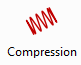
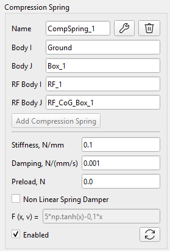
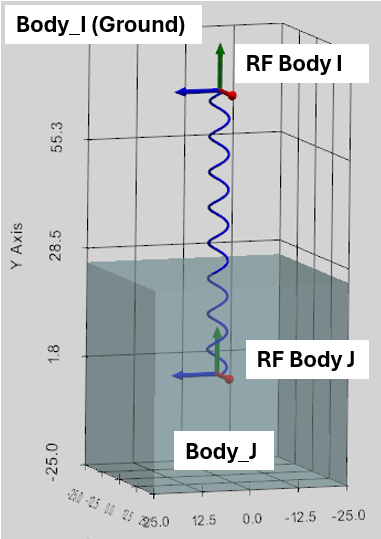

Розділ «Пружини» включає такі компоненти:

-   Компресійна пружина (Compression Spring), яка діє як поступальний пружинний амортизатор,
-   Торсіонна пружина (Torsion Spring), яка діє як обертальний пружинний амортизатор,
-   Втулка (Bushing), що діє як гнучкий сполучний елемент поступального та обертального руху.

## Компресійна пружина (Compression Spring)

Пружину стиснення можна встановити між будь-якими двома жорсткими тілами та землею в конкретних точках простору, визначених вибором систем відліку.

Пружина одночасно діє на обидва тіла (Body_I, Body_J).

### Визначення пружини стиснення

Пружина стиснення визначається такими параметрами в інтерфейсі користувача:

-   Body_I: перше Тіло або земля,
-   Body_J: друге Тіло або земля,
-   RF Body I: Система відліку як точка дії на Body_I,
-   RF Body J: Система відліку як точка дії на Body_J,
-   Stiffness (N/mm) - Жорсткість пружини (k),
-   Damping (Ns/mm): коефіцієнт затухання (C),
-   Preload (N): попереднє натягнення або стиснення пружини: штовхає за позитивного значення і стискає за негативного.

 

Після того як пружину задано, параметри жорсткості, затухання та попереднього натягу можна згодом змінити, проте пов'язані з нею незалежні системи координат стають недоступними для редагування. Водночас, за необхідності, тіла Body_I або Body_J, пов'язані пружиною, можна переміщати разом із пружиною.

Між тими самими тілами можна визначити відразу кілька пружин.

### Розрахунок сили пружини стиснення

Величина сили пружини стиснення розраховується таким чином:

$$
F_{s p r i n g} = F_{p r e l o a d} - k \mathrm{\Delta} L - C \dot{L}
$$

$$
\mathrm{\Delta} L = L - L_{i n i t i a l}
$$

де:

$$L_{i n i t i a l}$$ — початкова відстань між RF_Body_I та RF_Body_J у момент часу t=0,

$$L$$ — фактична відстань як величина вектора між RF_Body_I та RF_Body_J, динамічно обчислюваного розв'язувачем,

$$\mathrm{\Delta} L$$ — це деформація пружини,

$$\dot{L}$$ — відносна швидкість точок приєднання пружини RF_Body_I та RF_Body_J,

Розрахована сила пружини ($$F_{s p r i n g}$$) прикладається до тіл Body_I та Body_J за принципом «дія — протидія». Також прикладаються локальні моменти, що визначаються як векторний добуток важелів, проведених від центрів мас тіл до точок прикладання сили пружини («RF Body I» та «RF Body J»).

### Спеціально задана нелінійна пружина стиснення

Користувач може встановити нелінійну силу пружини F(x, v) у вигляді будь-якої функції.

Використовується наступний формат для визначення сили пружини:

$$
F_{spring}=F_{preload}-F\left(x,v\right)
$$

де:

x = ΔL = L - L_initial (в мм; позитивне значення відповідає розтягуванню пружини).

v = d(ΔL)/dt (швидкість деформації мм/с).

Функція F(x, v) повинна повертати значення в Ньютонах (Н).

Приклад: для моделювання лінійної жорсткості K та демпфування C слід ввести: 

-K\*x - C\*v

Допускається використання префіксу "np." для виклику будь-яких стандартних математичних функцій бібліотеки NumPy, наприклад:

np.cosh(x), np.sign(v) тощо.

У програмі також підтримуються такі функції користувача:

Функція STEP забезпечує плавний перехід між двома заданими значеннями.

Синтаксис: step(x; x0; F0; x1; F1)

Функція IF:

Синтаксис: if(\<умова\>; \<значення, якщо менше або дорівнює 0\>; \<значення, якщо більше 0\>).

## Торсіонна пружина (Torsion Spring)

Торсіонна пружина може бути задана між будь-якими двома жорсткими тілами (або землею) у конкретній точці вздовж певного напрямку.

Торсіонна пружина одночасно додає пару крутних моментів «дія-реакція» до двох тіл (Body_I, Body_J).

### Визначення торсіонної пружини

Торсіонна пружина визначається такими параметрами в інтерфейсі користувача:

-   Body_I: перше Тіло або Земля,
-   Body_J: друге Тіло або Земля,
-   Anchor: система координат пружини,
-   XYZ-спадне меню: вісь системи координат Anchor RF. Вона визначає вісь крутного моменту пружини та враховується, лише якщо систему координат Target не визначено.
-   Target: ця система відліку визначає напрямок крутного моменту пружини як вісь між системами відліку Anchor і Target. Спадне меню XYZ ігнорується, якщо задана система координат Target.
-   Stiffness (Nmm/rad): Жорсткість пружини (k),
-   Damping (Nmms/ rad): коефіцієнт затухання (C),
-   Preload (Nmm): Початкове натягнення пружини.

Як видно з визначення, після визначення системи координат пружини Anchor існує два способи задання осі крутного моменту пружини:

1.  Якщо вісь крутного моменту — одна з осей Anchor RF, то цю вісь можна вибрати за допомогою випадного меню XYZ;
2.  Якщо задана система координат Target RF, то вісь крутного моменту з'єднає системи відліку Anchor і Target. У цьому випадку розкривний список XYZ не розглядається.

 

Після того як пружину задано, параметри жорсткості, затухання та попереднього натягу можна згодом змінити, однак пов'язані з нею незалежні системи координат стають недоступними для редагування. Водночас, за необхідності, пов'язані пружиною тіла Body_I або Body_J можна переміщати разом із пружиною.

Можна визначити кілька торсіонних пружин між тими самими тілами.

### Розрахунок крутного моменту для торсіонної пружини

Дія торсіонної пружини обмежена обертанням навколо головної осі, що визначається системами відліку «Опора» (Anchor) та (опціонально) «Ціль» (Target). Величина крутного моменту торсіонної пружини розраховується таким чином:

$$
T_{s p r i n g} = T_{p r e l o a d} - k \mathrm{\Delta} \theta - C \dot{\theta}
$$

де:

$$\mathrm{\Delta} \theta$$ — деформація пружини, розрахована як відносне обертання Body_I та Body_J вздовж осі крутного моменту,

$$\dot{\theta}$$ — відносна кутова швидкість Body_I та Body_J уздовж осі крутного моменту.

Розрахована величина крутного моменту пружини ($$T_{s p r i n g}$$) застосовується як момент дії та реакції до Body_I та Body_J.

### Спеціально задана нелінійна торсіонна пружина

Користувач може задати нелінійний крутний момент пружини T(theta, omega) у вигляді будь-якої функції.

Використовується наступний формат для визначення сили пружини:

$$
T_{spring}=T_{preload}-T\left(\theta,\omega\right),
$$

де:

theta - кут закручування щодо початкового кута (у радіанах);

omega = d(theta)/dt — кутова швидкість деформації (рад/с).

Значення T(theta, omega) має бути виражене Нмм.

Приклад: для моделювання лінійної жорсткості K та демпфування C слід ввести вираз:

 -K\*theta - C\*omega

Допускається використання префіксу "np." для виклику будь-яких стандартних математичних функцій бібліотеки NumPy, наприклад:

np.cosh(x), np.sign(v) тощо.

У програмі також підтримуються такі функції користувача:

Функція STEP забезпечує плавний перехід між двома заданими значеннями.

Синтаксис: step(x; x0; F0; x1; F1)

Функція IF:

Синтаксис: if(\<умова\>; \<значення, якщо менше або дорівнює 0\>; \<значення, якщо більше 0\>).

## Втулка (Bushing)

Втулка (Bushing) — це узагальнений піддатливий елемент, який створює поступальні та обертальні сили пружності й демпфування за всіма 6 ступенями свободи.

Математично вона працює виключно в локальній системі координат своєї опорної системи відліку (RF Body_I). Елемент Bushing діє як три пружини стиснення і три торсіонні пружини, прикладені до однієї точки.

### Визначення втулки

Втулка — це піддатливе з'єднання з 6 ступенями свободи (пружина-демпфер) між двома Тілами (Bodies). В інтерфейсі користувача вона визначається такими параметрами:

* **Body_I**: перше взаємодіюче Тіло (Body) або Земля (Ground). Body_I несе на собі систему координат втулки (RF Body I).
* **Body_J**: друге взаємодіюче Тіло або Земля. Сила та крутний момент втулки діють на Body_J; реакція діє на Body_I.
* **RF Body I (обов'язково)**: глобальна система відліку (Reference Frame), що визначає положення втулки на Body_I (точка прив'язки/анкерна точка) та орієнтацію осей втулки X, Y, Z. Жорсткість, демпфування та попередній натяг діють уздовж цих осей. Осі жорстко прив'язані до Body_I: вони переміщуються та обертаються разом із Body_I. Можна використовувати будь-яку систему відліку (наприклад, глобальну (Global RF) або систему відліку центру мас (CoG RF)).
* **RF Body J (необов'язково)**: глобальна система відліку, що визначає точку прив'язки на Body_J. Якщо поле порожнє, точка прив'язки на Body_J розміщується точно в положенні та орієнтації RF Body I.
* **Stiffness Kx, Ky, Kz (Н/мм)**: поступальна жорсткість уздовж осей RF Body I.
* **Stiffness KRx, KRy, KRz (Н·мм/рад)**: обертальна жорсткість навколо осей RF Body I.
* **Damping Cx, Cy, Cz (Н/(мм/с))**: поступальне демпфування.
* **Damping CRx, CRy, CRz (Н·мм/(рад/с))**: обертальне демпфування.
* **Preload Fx, Fy, Fz (Н)**: постійна початкова сила уздовж осей RF Body I, що діє на Body_J також при нульовій деформації.
* **Preload Tx, Ty, Tz (Н·мм)**: постійний початковий крутний момент навколо осей RF Body I.

**Еталонна (ненавантажена) конфігурація** 

Деформація вимірюється від початкової конфігурації моделі, тобто від положення тіл на початку симуляції (t = 0). У цей момент деформації дорівнюють нулю і діє лише попередній натяг. Тому RF Body I та RF Body J не обов'язково повинні збігатися: початкове зміщення між точками прив'язки або різна орієнтація двох систем відліку не є деформацією і не створює сили. RF Body J визначає лише положення точки прив'язки на Body_J, до якої прикладається сила; її орієнтація не впливає на результати.

### Розрахунок сил реакції та крутних моментів втулки

Втулка (також відома як пружина-демпфер з 6 ступенями свободи) по суті є 3 незалежними пружинами стиснення та 3 незалежними торсіонними пружинами, об'єднаними в один елемент. Вони діють уздовж і навколо осей X, Y і Z системи RF Body I. Оскільки RF Body I прив'язана до Body_I, ці осі слідують за Body_I, а не за Body_J. Якщо Body_I — Земля (Ground), вони фіксуються в глобальній системі відліку (Global RF).

**Позначення** (k = I, J; нижній індекс 0 = значення при t = 0):

| Символ | Значення |
| --- | --- |
| $\mathbf r_k$, $\mathbf v_k$ | положення та швидкість центру мас Тіла (в Global RF)
| $\mathbf A_k$ | матрица обертання Тіла (головні осі в Global RF)|
| $\boldsymbol\omega_k$, $\boldsymbol\omega_k^{glob}=\mathbf A_k\boldsymbol\omega_k$ | кутова швидкість у локальній системі координат Тіла та в глобальній системі координат|
| $\mathbf s_k=\mathbf A_k\bar{\mathbf s}_k$ | вектор від центру мас до точки прив'язки ($\bar{\mathbf s}_k$ є постійною в локальній системі координат Тіла)|
| $\mathbf p_k=\mathbf r_k+\mathbf s_k$ | положення точки прив'язки|
| $\mathbf E_k=\mathbf A_k\bar{\mathbf E}_k$ | матриця обертання системи RF Body k у глобальній системі відліку ($\bar{\mathbf E}_k$ є постійною; для k = J це RF Body I, якщо RF Body J не задана)|
| $\mathbf d=\mathbf p_J-\mathbf p_I$ | вектор між точками прив'язки|
| $\Delta\mathbf x$, $\Delta\boldsymbol\theta$ | Відносне положення та орієнтація Body_J щодо Body_I |
| $\mathbf v_{rel}$, $\boldsymbol\omega_{rel}$ | Відносні поступальні та обертальні швидкості тіла Body_J відносно тіла Body_I |
| $R_Δ$ | матриця обертання 3×3, що містить обертання Body_J відносно RF Body I з моменту t = 0, виражена в осях RF Body I. Є одиничною матрицею за відсутності відносного обертання.|
| $tr(R_Δ)$ | слід R_Δ, тобто сума її діагональних елементів (R₁₁ + R₂₂ + R₃₃). Для обертання на кут α, tr(R_Δ) = 1 + 2 cos α. Це співвідношення використовується для відновлення кута.|
| $α$ | кут обертання R_Δ у радіанах, від 0 до π, що знаходиться з α = arccos((tr(R_Δ) − 1)/2). Він дорівнює довжині вектора обертання, |Δθ| = α. Вісь обертання отримується з різниць позадіагональних елементів (R₃₂ − R₂₃, …), які дорівнюють 2 sin α, помноженому на одиничний вектор осі. Отже, Δθ = α × одиничний вектор осі.|

**Деформації** 

Відносне положення та орієнтація точки прив'язки Body_J вимірюються в рухомих осях RF Body I і відраховуються від t = 0:

$$\Delta\mathbf x=\mathbf E_I^{\top}\mathbf d-\mathbf E_{I,0}^{\top}\mathbf d_0$$

$$\mathbf R_\Delta=\left(\mathbf E_I^{\top}\mathbf E_J\right)\left(\mathbf E_{I,0}^{\top}\mathbf E_{J,0}\right)^{\top},\qquad \alpha=\arccos\frac{\operatorname{tr}(\mathbf R_\Delta)-1}{2}$$

$$\Delta\boldsymbol\theta=\frac{\alpha}{2\sin\alpha}\begin{bmatrix}R_{\Delta,32}-R_{\Delta,23}\\ R_{\Delta,13}-R_{\Delta,31}\\ R_{\Delta,21}-R_{\Delta,12}\end{bmatrix}$$

$\Delta\boldsymbol\theta$ — вектор обертання (вісь × кут) матриці $\mathbf R_\Delta$, дійсний для $\vert{}\Delta\boldsymbol\theta\vert{}<180^\circ$. Для малих кутів він приблизно дорівнює половині вектора в квадратних дужках.

**Швидкості** 

RF Body I обертається разом із Body_I, тому її обертання віднімається від швидкості точки прив'язки:

$$\mathbf v_{P,k}=\mathbf v_k+\boldsymbol\omega_k^{glob}\times\mathbf s_k,$$

$$\qquad \mathbf v_{rel}=\mathbf E_I^{\top}\left(\mathbf v_{P,J}-\mathbf v_{P,I}-\boldsymbol\omega_I^{glob}\times\mathbf d\right),$$

$$\qquad \boldsymbol\omega_{rel}=\mathbf E_I^{\top}\left(\boldsymbol\omega_J^{glob}-\boldsymbol\omega_I^{glob}\right)$$

$\mathbf v_{rel}$ — похідна за часом від $\Delta\mathbf x$. Якщо обидва Тіла рухаються як єдине тверде тіло, всі чотири величини $\Delta\mathbf x$, $\Delta\boldsymbol\theta$, $\mathbf v_{rel}$, $\boldsymbol\omega_{rel}$ дорівнюють нулю, і втулка не створює сили (включаючи демпфування).

**Сили та крутні моменти** 

Стандартні рівняння пружини-демпфера, компоненти вздовж осей RF Body I:

$$\mathbf F_{loc}=-\mathbf K_{trans}\Delta\mathbf x-\mathbf C_{trans}\mathbf v_{rel}+\mathbf F_{preload}$$

$$\mathbf T_{loc}=-\mathbf K_{rot}\Delta\boldsymbol\theta-\mathbf C_{rot}\boldsymbol\omega_{rel}+\mathbf T_{preload}$$

де $\mathbf K_{trans}=\mathrm{diag}(K_x,K_y,K_z)$, $\mathbf K_{rot}=\mathrm{diag}(K_{Rx},K_{Ry},K_{Rz})$ і аналогічно для $\mathbf C$. $\mathbf F_{loc}$ та $\mathbf T_{loc}$ діють на Body_J, причому сила прикладена в його точці прив'язки. У глобальній системі відліку:

$$\mathbf F_{glob}=\mathbf E_I\mathbf F_{loc},$$

$$\qquad \mathbf T_{glob}=\mathbf E_I\mathbf T_{loc}$$

**Навантаження, що прикладаються до Тіл** 

Body_J отримує $\mathbf F_{glob}$ та $\mathbf T_{glob}$. Body_I отримує реакцію:

$$\mathbf F_{glob,J}=\mathbf F_{glob},$$

$$\quad \mathbf T_{glob,J}=\mathbf T_{glob},$$

$$\qquad \mathbf F_{glob,I}=-\mathbf F_{glob},$$

$$\quad \mathbf T_{glob,I}=-\mathbf T_{glob}-\mathbf d\times\mathbf F_{glob}$$

Доданок $\mathbf d\times\mathbf F_{glob}$ переносить момент сили між двома точками прив'язки. Кожна сила діє у своїй власній точці прив'язки на відстані $\mathbf s_k$ від центру мас Тіла (CoG), тому вона створює додатковий крутний момент на кожному Тілі. Сумарний крутний момент відносно центру мас дорівнює:

$$\mathbf T_{total,I}=\mathbf T_{glob,I}+\mathbf s_I\times\mathbf F_{glob,I},$$

$$\qquad \mathbf T_{total,J}=\mathbf T_{glob,J}+\mathbf s_J\times\mathbf F_{glob,J}$$

**Властивості**

- Навантаження на Body_I та Body_J є рівними і протилежними, а їхній сумарний момент відносно будь-якої точки дорівнює нулю: втулка зберігає лінійний та кутовий імпульси.
- Накопичена пружна енергія та розсіяна потужність дорівнюють:

$$U_{el}=\tfrac12\Delta\mathbf x^{\top}\mathbf K_{trans}\Delta\mathbf x+\tfrac12\Delta\boldsymbol\theta^{\top}\mathbf K_{rot}\Delta\boldsymbol\theta,$$

$$\qquad P_d=\mathbf v_{rel}^{\top}\mathbf C_{trans}\mathbf v_{rel}+\boldsymbol\omega_{rel}^{\top}\mathbf C_{rot}\boldsymbol\omega_{rel}\ \ge 0$$

Вираз для $U_{el}$ є точним для ізотропної обертальної жорсткості (KRx = KRy = KRz). Для різних значень він є наближеним, і похибка зростає зі збільшенням кута повороту, як і в інших моделях втулок з 6 ступенями свободи.

**Результати** 

Дані телеметрії та CSV видаються в одиницях СІ (м, рад, Н, Н·м) і вздовж осей RF Body I:

* Відхилення (Deflection) X, Y, Z = $\Delta\mathbf x$

* Обертання (Rotation) X, Y, Z = $\Delta\boldsymbol\theta$

* Сила (Force) X, Y, Z = $\mathbf F_{loc}$

* Крутний момент (Torque) X, Y, Z = $\mathbf T_{loc}$

Це навантаження, що діють на Body_J; реакція на Body_I випливає з наведених вище рівнянь.

**Примітки**

* Порядок Тіл має значення: осі належать Body_I. Якщо поміняти місцями Body_I та Body_J, осі перемістяться на інше Тіло.

* Якщо Земля (Ground) обрана як Body_J, точка прив'язки на Землі фіксується в просторі, а навантаження на Землю ігнорується; осі, як і раніше, слідують за Body_I.

* Жорстка втулка на малій масі або моменті інерції вимагає малого кроку за часом. При використанні методу Рунге-Кутти (RK4) підтримуйте $\omega_{max}\Delta t\lesssim 0.2$, де $\omega_{max}=\sqrt{K/m}$ для поступального руху і $\sqrt{(K_R+K s^2)/J}$ для обертального (член $K s^2$ з'являється, коли точка прив'язки зміщена від центру мас).

